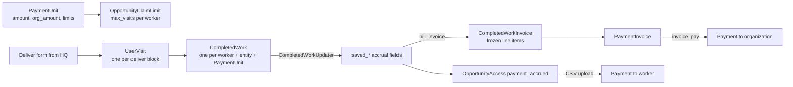
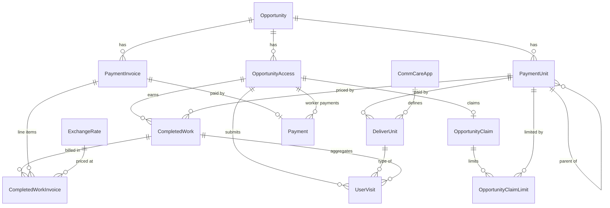
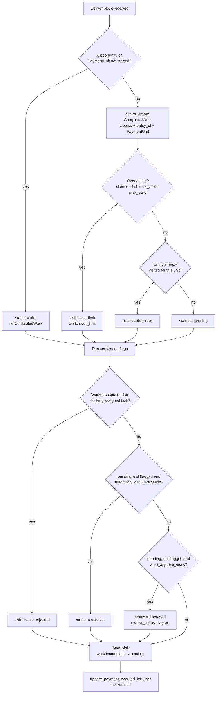
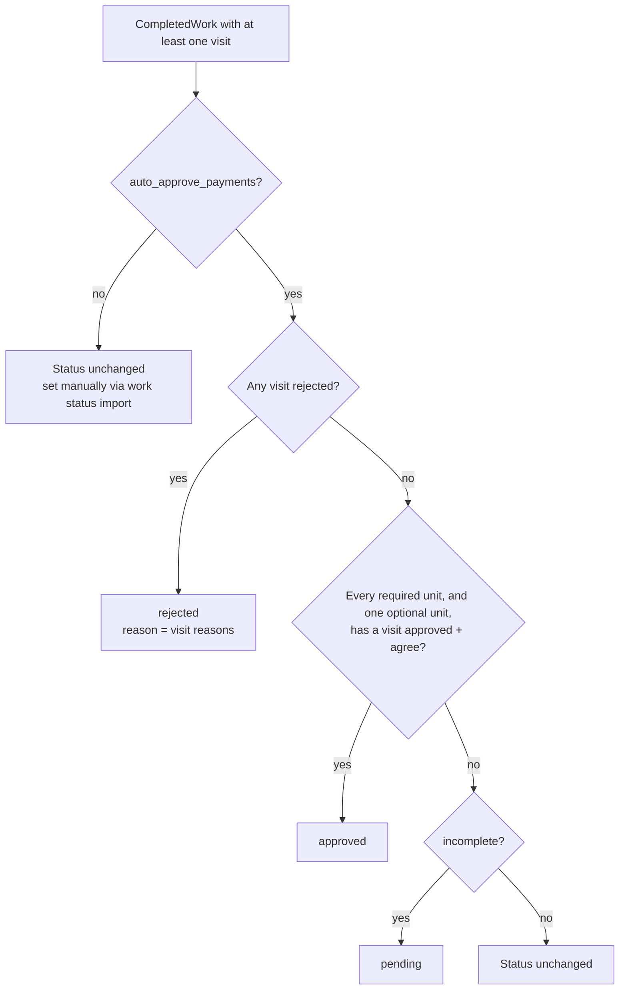
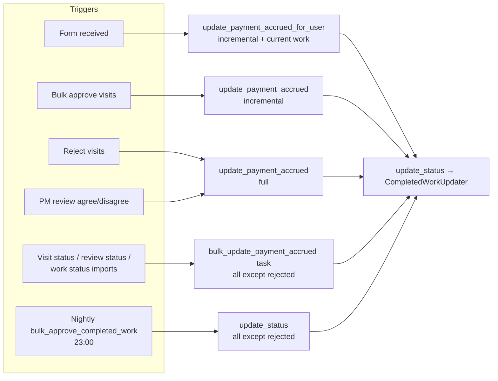
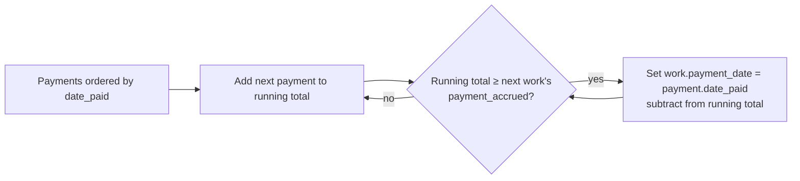
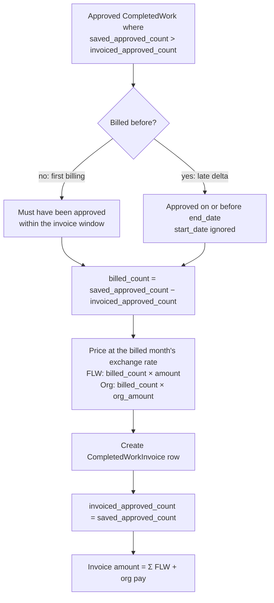
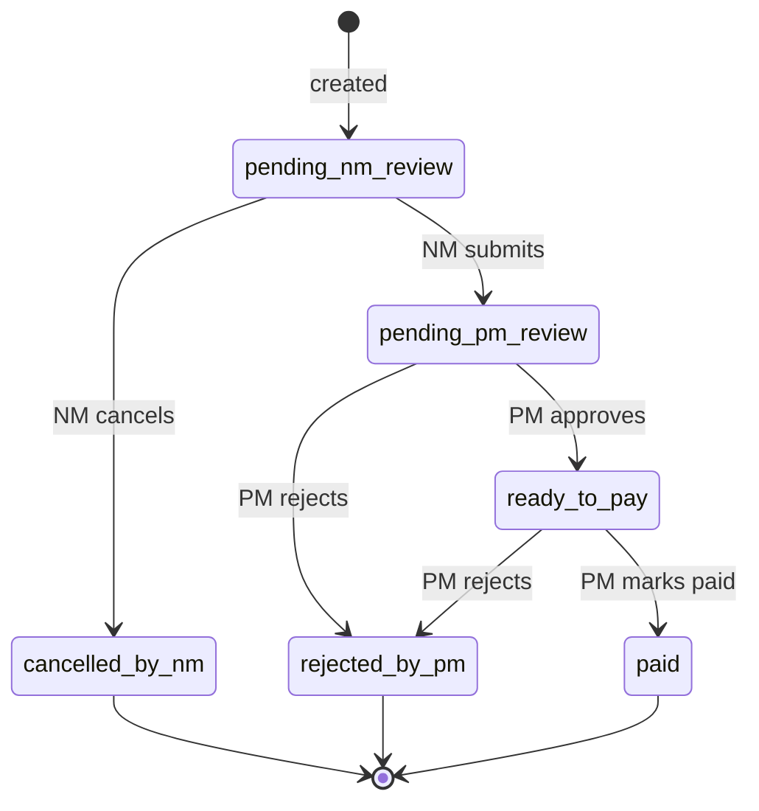

# Payments and Accrual

How a worker's form submission becomes money: the models involved, how accrual is calculated, when it is recalculated, where the results are stored, and how accrued work is invoiced and paid.

See [README.md](README.md) for the wider opportunity app.

## Overview



There are two payees:

- **The worker (FLW)** earns `PaymentUnit.amount` per approved unit. They are paid by uploading a payment CSV, which creates `Payment` rows linked to an `OpportunityAccess`.
- **The organization** earns `PaymentUnit.org_amount` per approved unit, billed together with the FLW pay on a `PaymentInvoice`. It is paid when a PM marks the invoice paid, which creates a `Payment` row linked to an `Organization` and the invoice.

## Model Relationships



## 1. Payment Units and Deliver Units

### PaymentUnit

> What a worker is paid for, and how much. Belongs to one `Opportunity`.

| Field                     | Meaning                                                                                  |
| ------------------------- | ---------------------------------------------------------------------------------------- |
| `amount`                  | Worker pay per completed unit, in the opportunity's currency (integer)                   |
| `org_amount`              | Organization pay per completed unit (default 0). Applies to every opportunity            |
| `max_total`               | Maximum units per worker. Required for setup to be complete                              |
| `max_daily`               | Maximum visits per worker per day. Required for setup to be complete                     |
| `parent_payment_unit`     | Optional parent. A parent unit can only complete as many times as its children completed |
| `start_date` / `end_date` | Optional window. Visits before`start_date` are `trial`; `end_date` caps the claim limit  |

### DeliverUnit

A deliver block in the deliver app's forms (identified by `slug`). It belongs to a `CommCareApp`, not an opportunity, and points at the `PaymentUnit` it pays toward. A `PaymentUnit` can have several deliver units:

- **Required** (`optional=False`): every required unit must be submitted for the payment unit to count as completed.
- **Optional** (`optional=True`): at least one optional unit must also be submitted, if any exist.

### Claim limits and budget

When a worker claims an opportunity, `OpportunityClaimLimit.create_claim_limits()` gives them one `OpportunityClaimLimit` per payment unit:

- `max_visits = min(max_total, remaining_budget // (amount + org_amount))`
- Units are funded in `pk` order, drawing down the remaining budget, so the newest units go short first.
- A unit the budget cannot fund gets **no** claim limit row, and deliver forms for it are rejected with a 400.

The opportunity budget counts both worker and organization pay: `claimed_budget = Σ max_visits × (amount + org_amount)`.

## 2. UserVisits and CompletedWork

### UserVisit

One row per deliver block in a form submission. A form with several deliver blocks creates several visits that share an `xform_id`.

Two independent statuses decide whether a visit counts toward payment:

| Field           | Values                                                                | Set by                                          |
| --------------- | --------------------------------------------------------------------- | ----------------------------------------------- |
| `status`        | `pending`, `approved`, `rejected`, `over_limit`, `duplicate`, `trial` | Form processing, staff visit approval/rejection |
| `review_status` | `pending`, `agree`, `disagree`                                        | Auto-approval, PM review                        |

**A visit counts toward payment only when `status=approved` and `review_status=agree`.**

### Visit processing

`process_deliver_unit()` in `form_receiver/processor.py` runs for every deliver block:



The claim limit row is locked with `select_for_update()` while this runs, so concurrent submissions for the same worker and payment unit cannot both pass the limit checks.

Limits are counted **per deliver unit** and exclude `over_limit` and `trial` visits. Only auto-approved visits get `review_status=agree` here. Every other visit needs a PM to agree before it can be paid.

### CompletedWork

One row per `(opportunity_access, entity_id, payment_unit)`: everything a worker delivered for one beneficiary under one payment unit. It is the unit that gets approved, accrues payment, and is invoiced.

| Status       | Meaning                                                                        |
| ------------ | ------------------------------------------------------------------------------ |
| `incomplete` | Default on creation. Moved to`pending` once a visit is saved                   |
| `pending`    | Has visits, not yet approved                                                   |
| `approved`   | Accrues payment                                                                |
| `rejected`   | A visit was rejected, or the worker was suspended or blocked by a pending task |
| `over_limit` | A visit hit a claim limit                                                      |

`status_modified_date` is set automatically whenever `status` changes. It is the **approval date** used for USD conversion and invoice windows, and it does **not** move when more visits arrive for an already-approved work.

### Counting completions

A payment unit is completed once for each full set of its deliver units. For a single `CompletedWork`:

```text
completed = min(count of each required deliver unit)
          → capped by sum(count of all optional deliver units)   if any optional units
          → capped by sum(completed of child CompletedWorks)     if any child payment units
```

`approved` uses the same rule, counting only visits with `status=approved` and `review_status=agree`.

Example: a payment unit with required units A and B and optional unit C. Visits A, A, B, C give `completed = min(2, 1) = 1`, capped by `C = 1`, so 1. A second visit to the same entity (a duplicate) that completes the set again raises the count to 2 and doubles the accrual.

### Approving CompletedWork

Status changes are made in `CompletedWorkUpdater._update_status()` (`utils/completed_work.py`), and **only when `opportunity.auto_approve_payments` is on**:



With `auto_approve_payments` off, `CompletedWork` status is only changed by the completed-work status import (`visit_import.bulk_update_completed_work_status`).

### Accrual calculation

`CompletedWorkUpdater._update_payment()` writes the cached accrual fields on every work that has at least one completion:

```text
if status == approved and approved_count > 0:
    saved_payment_accrued         = approved_count × payment_unit.amount
    saved_org_payment_accrued     = approved_count × payment_unit.org_amount
    saved_payment_accrued_usd     = saved_payment_accrued     / rate(status_modified_date)
    saved_org_payment_accrued_usd = saved_org_payment_accrued / rate(status_modified_date)
else:
    all four = 0

saved_completed_count = completed
saved_approved_count  = approved
```

The rate comes from `ExchangeRate.latest_exchange_rate()`: the newest stored rate on or before the approval date. If none is stored, it fetches one from OpenExchangeRates synchronously. USD opportunities use a rate of 1. Because the rate is tied to the approval date, later rate changes do not alter accrued USD.

`update_status()` then totals the **worker** accrual onto the access:

```text
OpportunityAccess.payment_accrued = Σ CompletedWork.saved_payment_accrued   (all of the access's works)
```

Organization accrual has no per-access total. Reports sum `saved_org_payment_accrued` directly.

### When accrual is recalculated

Accrual is cached, not calculated on read, so every action that can change a visit or work status must trigger a recalculation. Each trigger recalculates a different set of works:



| Trigger                              | Entry point                                                                  | Works recalculated                                                              |
| ------------------------------------ | ---------------------------------------------------------------------------- | ------------------------------------------------------------------------------- |
| Form received                        | `process_deliver_unit` → `update_payment_accrued_for_user(incremental=True)` | Works not yet approved with`saved_approved_count=0`, plus the work just touched |
| Bulk approve visits                  | `views.approve_visits` → `update_payment_accrued(incremental=True)`          | Works not yet approved with`saved_approved_count=0`                             |
| Reject visits                        | `views.reject_visits` → `update_payment_accrued()`                           | All of the worker's works                                                       |
| PM review                            | `views.user_visit_review` → `update_payment_accrued()`                       | All of the worker's works                                                       |
| Visit, review or work status imports | `visit_import.*` → `tasks.bulk_update_payment_accrued` (Celery)              | All works except`rejected`                                                      |
| Nightly,`auto_approve_payments` only | `tasks.bulk_approve_completed_work` (active, not-ended opportunities)        | All works except`rejected`                                                      |

All paths except the nightly task run under a Redis lock `update_payment_accrued_lock_<access_id>`. `update_payment_accrued` and `bulk_update_payment_accrued` skip suspended workers.

### Cached vs live values

`CompletedWork` has both cached fields and live properties for the same numbers:

| Cached (stored)         | Live (queried on access) | Used by                                                                                       |
| ----------------------- | ------------------------ | --------------------------------------------------------------------------------------------- |
| `saved_completed_count` | `completed_count`        | Cached: reports,`OpportunityAccess.visit_count`                                               |
| `saved_approved_count`  | `approved_count`         | Cached: invoicing (`invoiced_approved_count` watermark), reports                              |
| `saved_payment_accrued` | `payment_accrued`        | Cached:`OpportunityAccess.payment_accrued`, payment reports. Live: `update_work_payment_date` |

The live properties run several queries per work. Prefer the cached fields in anything that loops over many works.

## 3. Payments and Invoices

### Where the money values are stored

| Value                      | Location                                                | Currency    |
| -------------------------- | ------------------------------------------------------- | ----------- |
| Worker accrual per work    | `CompletedWork.saved_payment_accrued` / `_usd`          | Local / USD |
| Org accrual per work       | `CompletedWork.saved_org_payment_accrued` / `_usd`      | Local / USD |
| Worker accrual per worker  | `OpportunityAccess.payment_accrued`                     | Local       |
| Units already billed       | `CompletedWork.invoiced_approved_count`                 | —           |
| Billed line item           | `CompletedWorkInvoice` (`flw_amount_*`, `org_amount_*`) | Local + USD |
| Invoice total              | `PaymentInvoice.amount` / `amount_usd`                  | Local / USD |
| Worker payment             | `Payment` with `opportunity_access`                     | Local + USD |
| Organization payment       | `Payment` with `organization` and `invoice`             | Local + USD |
| Date a work was fully paid | `CompletedWork.payment_date`                            | —           |

### Worker payments

Worker payments are recorded by uploading a CSV (`visit_import.bulk_update_payments`, via `tasks.bulk_update_payments_task`):

- The whole file is validated first. Nothing is written unless every row is payable.
- Each row creates a `Payment` with `opportunity_access` set. `amount_usd` uses the rate on the row's payment date, or today's rate if no date is given.
- Afterwards, `update_work_payment_date()` matches the worker's payments to their works, oldest first:



Works are ordered by `status_modified_date`. A partial payment leaves `payment_date` empty on that work and on every later one.

The amount still owed to a worker is `payment_accrued − Σ Payment.amount`. `Payment.payment_unit` exists on the model but neither payment path sets it.

### Service delivery invoices

Service delivery invoices bill approved work, both worker and organization pay, to the program. They are created:

- **Automatically**, by `tasks.generate_automated_service_delivery_invoice` on the 2nd of each month at 01:00 UTC, for active, non-test opportunities starting on or after `OPPORTUNITY_AUTO_INVOICE_START_DATE`. It covers the period up to the end of the previous month.
- **Manually**, through `AutomatedPaymentInvoiceForm` from `InvoiceCreateView`.

Both call `bill_invoice()` (`utils/invoice_line_items.py`). Billing uses a per-work watermark instead of a link to a single invoice, so work that gains more approved units after it was billed can be billed again for the difference:



- **Billed month**: a first billing uses the work's approval month. A late delta uses the month of the invoice `end_date`, because `status_modified_date` is fixed at the original approval.
- **Exchange rate**: invoices use the billed month's rate, but accrual uses the approval-date rate. Invoiced USD can therefore differ from accrued USD for the same work.
- **Window start**: `get_start_date_for_invoice()` uses the earliest approval awaiting first billing. If only late deltas remain, it uses the previous month.
- Works are locked with `select_for_update()` while billing, so two invoices cannot bill the same units.
- `CompletedWorkInvoice` rows are frozen at creation. Invoice views read them instead of recalculating from `CompletedWork`.

**Custom invoices** (`service_delivery=False`) are free-form expenses with no line items. They do not touch the watermark.

### Invoice lifecycle



- Transitions and the roles allowed to make them are defined in `InvoiceWorkflow` (`utils/invoice.py`).
- **Cancel or reject** (service delivery only): `rollback_invoice_line_items()` lowers each work's `invoiced_approved_count` by its `billed_count` and deletes the invoice's `CompletedWorkInvoice` rows, so the units are billable again.
- **Mark paid** (`views.invoice_pay`): only from `ready_to_pay`. Creates one `Payment` per invoice with `organization` and `invoice` set, copying the invoice's `amount` and `amount_usd`.
- NM and PM certification (who moved the invoice and when) is read from the `pghistory` status events on `PaymentInvoice`.
