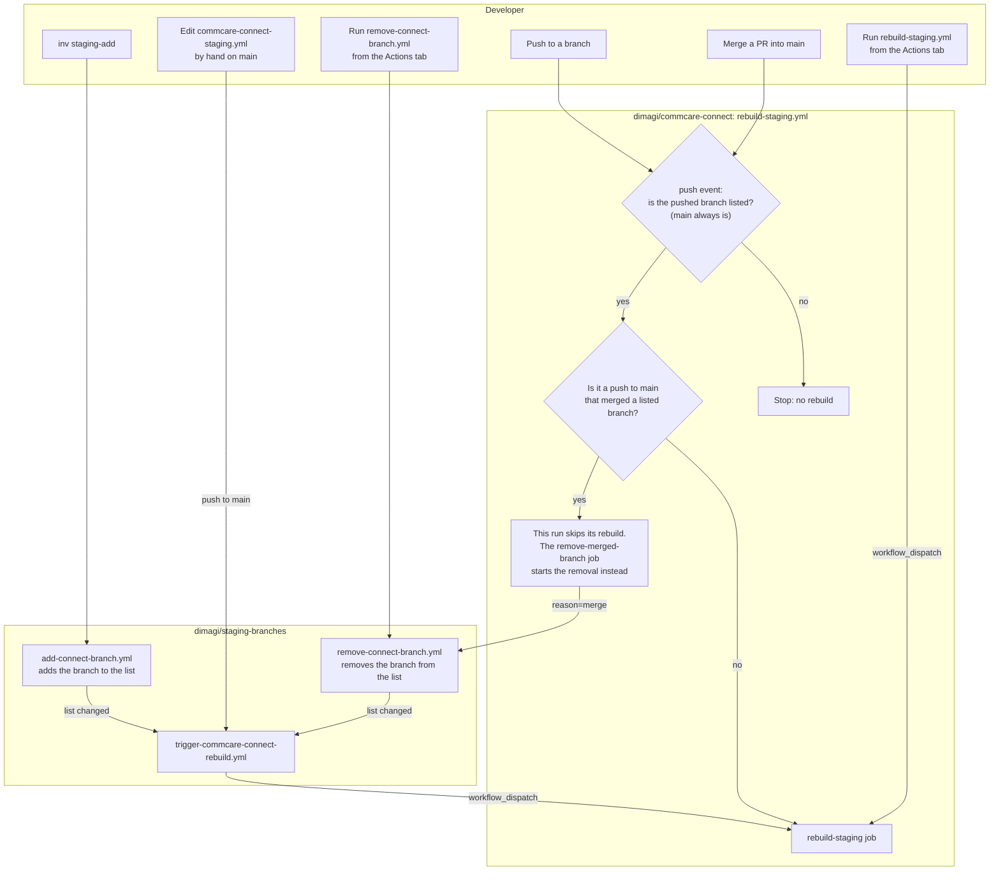
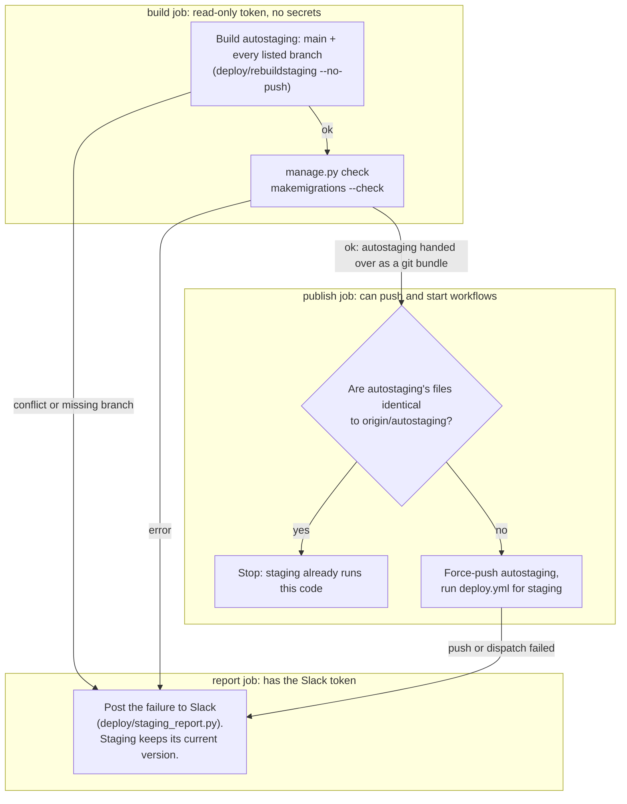
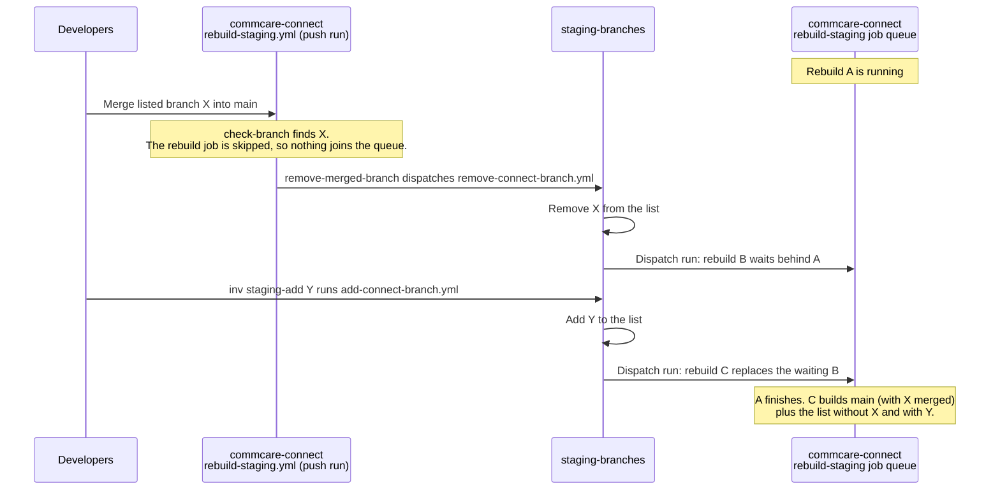

# CommCare Connect Deployment

This folder contains the configuration and scripts for deploying CommCare Connect.

## Overview

CommCare Connect is deployed to AWS using Docker containers. The deployment is managed using [Kamal](https://kamal-deploy.org/), a Ruby-based deployment tool.
See https://semaphoreci.com/blog/mrsk.

Deploying commcare-connect uses the following tools:

- [Ansible](https://www.ansible.com/)

  - Setup of EC2 instances
  - Management of Docker container ENV files

- [Kamal](https://kamal-deploy.org/)

  - Deployment of Docker containers

- [1Password CLI](https://developer.1password.com/docs/cli/get-started/)

  - Some secrets are stored in 1Password and retrieved using the CLI

- [AWS CLI](https://aws.amazon.com/cli/)
  - Used to manage AWS resources

## Setup

### Kamal

(requires Ruby)

```bash
gem install kamal -v '~> 1.9.2'
```

### Ansible

This is only required if you need to update Django settings.

```bash
python3 -m pip install --user pipx
pipx install ansible
```

### 1Password CLI

See https://developer.1password.com/docs/cli/get-started/

Note: Do not use Flatpack or snap to install 1password CLI as these do not work with the SSH agent.

You will also need to update the 1Password configuration to allow it to access the SSH key:

_~/.config/1Password/ssh/agent.toml_

```toml
[[ssh-keys]]
vault = "Connect Tech"
```

See https://developer.1password.com/docs/ssh/agent for more details.

#### AWS CLI

```bash
aws configure sso --profile commcare-connect
aws sso login --profile commcare-connect
```

Note: If you used a different profile name you will need to set the `AWS_PROFILE` environment variable to the profile name.

The servers are reached over SSH through AWS Systems Manager, using their EC2 instance IDs (see the inventory
files), so you also need the
[Session Manager plugin](https://docs.aws.amazon.com/systems-manager/latest/userguide/session-manager-working-with-install-plugin.html)
for the AWS CLI. Kamal and Ansible both set up the proxy themselves.

To test that SSH, 1Password and AWS are all working you can run (instance ID from `staging.inventory.yml`):

```bash
ssh -o ProxyCommand="aws ssm start-session --target %h --document-name AWS-StartSSHSession --parameters portNumber=%p" connect@i-08bbcc89fcb90b8c7
```

## Updating Django Settings

The Django settings are configured using the `deploy/roles/connect/templates/connect.docker.env.j2` file. The plain text
settings values are in `deploy/roles/connect/defaults/main.yml`, overridden per environment in the inventory files.
Secrets are stored in 1Password under the `Ansible Secrets - Staging` and `Ansible Secrets - Production` entries.

`HEALTH_CHECK_TOKENS` is set from the `health_check_tokens` secret, a list of tokens joined with commas; leaving the
secret out renders an empty value, which leaves the `/status/` health check pages open. See
`commcare_connect/health/README.md`.

To update the Django settings:

```bash
inv django-settings
```

## Deploy

Ideally deploy should be done via GitHub actions however it can be run locally as follows:

```bash
inv deploy
```

A deploy restarts the app containers only. Changes to Traefik's own arguments (`traefik.args` in
`config/deploy.yml`, such as the forwarded-header range it trusts) need the proxy restarted as well:

```bash
kamal traefik reboot -d <destination>
```

### Scheduled deploys

The `Scheduled production deploy` workflow (`.github/workflows/scheduled-deploy.yml`) deploys `main` to production
every Monday, Wednesday and Friday at 12:00 UTC. GitHub sometimes starts scheduled runs a few minutes late. It takes
the same concurrency group as manual production deploys, so it waits for any deploy already running and none can start
until it finishes. A group holds one waiting run at most: if a manual production deploy is waiting at 12:00, the
scheduled run replaces it and the manual one is cancelled, and a manual deploy started while the scheduled run waits
cancels the scheduled one. Once it has the group, it checks `main` against the latest release and CI:

- **Nothing new since the latest release:** the run skips and posts an info message to the production deploy
  channel.
- **The latest release isn't in `main`'s history** (it has commits `main` doesn't, for example after `main` was reset):
  the run skips and posts a warning, so someone can decide whether to deploy by hand.
- **CI on `main` is still running:** the run waits up to 20 minutes for it to finish, then carries on as below. While
  it waits it holds the production deploy group, so a manual production deploy queues behind it.
- **CI on `main` failed, was still running after the wait, or hasn't run:** the run skips the deploy and posts a
  warning to the production deploy channel. It doesn't retry, and the next slot tries again.
- **The check itself fails** (for example a GitHub API error): the run skips and posts a warning.

The deploy is pinned to the commit that was checked, so anything merged while it runs waits for the next slot. To
retry a failed scheduled deploy, start a manual deploy or use **Re-run all jobs**. **Re-run failed jobs** reuses the
old commit without checking it again, so the deploy refuses to run when production already has something newer.

Every scheduled run posts to the production deploy channel. The deploy's own Slack messages show `(automatic)` for
these runs, and `(scheduled)` or `(adhoc)` for manual deploys. A slot with no message means the run never started (the
workflow is disabled, or GitHub dropped the schedule), it was cancelled while waiting for another deploy, or it
couldn't reach Slack.

To stop scheduled deploys, go to **Actions → Scheduled production deploy**, open the **⋯** menu and choose
**Disable workflow**. Choose **Enable workflow** in the same place to resume them. Nothing reminds you to turn it back
on. Manual deploys through the `Deploy` workflow keep working while the schedule is disabled.

## Accessing logs

The logs from the Docker containers are shipped to CloudWatch. To access them you will need to use the AWS console.

You can also view them using Kamal:

```bash
kamal app logs
```

See `kamal app logs --help` for more details.

## Staging

Staging runs the `autostaging` branch: `main` with every branch listed in
[`commcare-connect-staging.yml`](https://github.com/dimagi/staging-branches/blob/main/commcare-connect-staging.yml)
merged in. The `rebuild-staging` workflow rebuilds and deploys it when a listed branch gets a push or the list changes,
and removes branches from the list once they are merged to `main`. A git conflict, an error from `manage.py check`, or a
migration problem found by `makemigrations --check` (such as two branches adding a migration to the same app) stops the
rebuild before `autostaging` is pushed; staging keeps its current version until the list builds again.

The failure is posted to the staging deploy Slack channel by `deploy/staging_report.py`, which names the branches that
likely caused it. For each one it mentions whoever started the branch (the author of its first commit not on `main`),
found in Slack by commit email (the bot token needs the `users:read.email` scope), or else shows the name from the
comment on the branch's line in the list.

To add your current branch (needs `gh` logged in with permission to run workflows in `dimagi/staging-branches`):

```bash
inv staging-add
```

It checks the branch is pushed, runs a trial build to catch conflicts, and puts a compatibility branch (one that merges
two listed branches) above the branches it contains. Options: `--branch <name>`, `--yes`, `--skip-trial`.

`deploy/rebuildstaging --no-push` runs the same build locally without pushing.

### What starts a rebuild

Two repos take part. `dimagi/staging-branches` holds the branch list and the workflows that edit it.
`dimagi/commcare-connect` holds `rebuild-staging.yml`, which builds `autostaging`, and `deploy.yml`, which deploys it.



The rebuild job itself, whichever way it started (see [When changes overlap](#when-changes-overlap) for how runs
queue). It calls `rebuild-staging-jobs.yml`, which splits the work into three jobs:



Only the `build` job runs the listed branches' code: `uv sync`, `manage.py check` and `makemigrations` all import it.
So that job gets a read-only token, keeps no credentials in `.git/config` and doesn't save the uv cache. The `publish`
and `report` jobs start on fresh runners and run only `main`'s code, so a listed branch can't reach the push token or
the Slack token.

| Case                                        | `staging-branches`                                                                        | `commcare-connect`                                                                                                  | Deploys?                           |
| ------------------------------------------- | ----------------------------------------------------------------------------------------- | ------------------------------------------------------------------------------------------------------------------- | ---------------------------------- |
| `inv staging-add`                           | `add-connect-branch.yml` edits the list, then `trigger-commcare-connect-rebuild.yml` runs | `rebuild-staging.yml` (dispatch) rebuilds                                                                           | If the files changed               |
| Hand edit of the list on `main`             | `trigger-commcare-connect-rebuild.yml` runs on the push                                   | `rebuild-staging.yml` (dispatch) rebuilds                                                                           | If the files changed               |
| Run `remove-connect-branch.yml` by hand     | Edits the list, then `trigger-commcare-connect-rebuild.yml` runs                          | `rebuild-staging.yml` (dispatch) rebuilds                                                                           | If the files changed               |
| Push to a listed branch                     | Nothing                                                                                   | `rebuild-staging.yml` (push) rebuilds                                                                               | If the files changed               |
| Push to an unlisted branch                  | Nothing                                                                                   | `rebuild-staging.yml` (push) stops at `check-branch`                                                                | No                                 |
| Push to `main` that merges no listed branch | Nothing                                                                                   | `rebuild-staging.yml` (push) rebuilds, since `main` is always listed                                                | If the files changed               |
| Merge a listed branch into `main`           | `remove-connect-branch.yml` removes it, then `trigger-commcare-connect-rebuild.yml` runs  | Two runs of `rebuild-staging.yml`: the push run skips its rebuild and starts the removal; the dispatch run rebuilds | Once at most, if the files changed |
| Run `rebuild-staging.yml` by hand           | Nothing                                                                                   | `rebuild-staging.yml` (dispatch) rebuilds                                                                           | If the files changed               |

"If the files changed" compares the file tree of the new `autostaging` with `origin/autostaging`, not the commits,
because every build makes new merge commits. A rebuild that produces the code staging already runs does not deploy.
When a merged branch is removed, staging usually stays the same, since its code now comes in through `main`. It
deploys if `main` gained other commits since the last build, or if the merge resolved conflicts differently.

The workflows in `staging-branches` push with `GITHUB_TOKEN`, and a push made with that token starts no workflows. So
they start the next workflow with `workflow_dispatch` instead. For the same reason `rebuild-staging.yml` runs
`deploy.yml` itself after pushing `autostaging`.

### When changes overlap

Only the `rebuild-staging` job of `rebuild-staging.yml` has a concurrency group (`rebuild-staging`,
`cancel-in-progress: false`). It covers the `build`, `publish` and `report` jobs it calls as one unit. The `check-branch` and `remove-merged-branch` jobs have none, so they run straight away
even while a rebuild is in progress.

- One rebuild runs at a time, and a running rebuild is never cancelled.
- At most one rebuild waits. When another arrives, GitHub cancels the waiting one and queues the newest.
- Dropping a waiting rebuild loses nothing. A rebuild reads the list and checks out the branches when it starts, not
  when it was triggered, so the one that runs next builds everything that has landed by then.
- List edits are never dropped. `add-connect-branch.yml` and `remove-connect-branch.yml` in `staging-branches` don't
  queue, so every edit runs. If two edits run at the same time, both push to `main` and the second push is rejected.
  That workflow then fetches the new `main`, makes its edit again and pushes, up to 5 times.
- `deploy.yml` has its own group (`deploy-staging`, `cancel-in-progress: false`) that works the same way.

Example: a rebuild is running, someone merges a listed branch into `main`, and then someone adds another branch.



There are two runs of `rebuild-staging.yml` here. The push run from the merge starts the removal and never queues a
rebuild. Rebuild B belongs to a later dispatch run, started after the removal has landed. So when C replaces B, the
removal has already happened and C includes it. If a list edit lands after C has started, its own rebuild queues
behind C and runs next.
