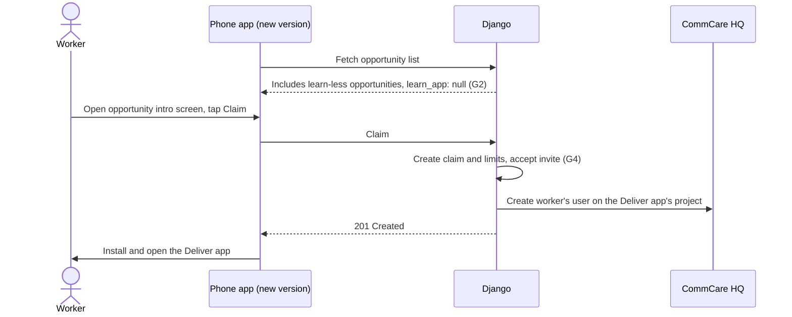
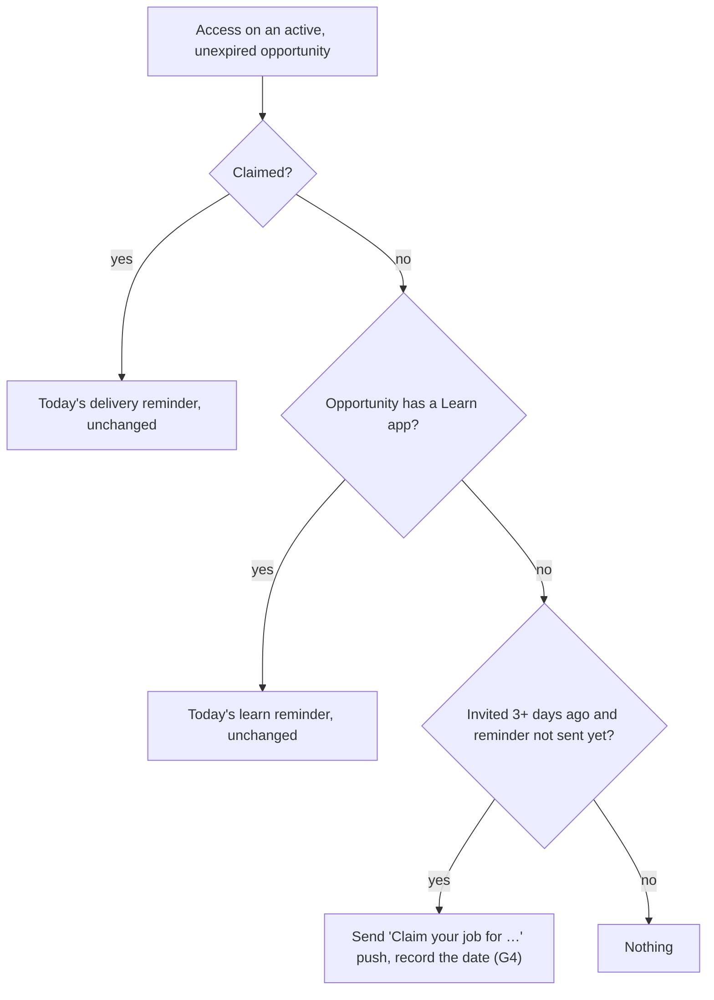

# Optional Learn apps

**Ticket:** CCCT-2963 · **Mockup:** [Optional Learn App Mockups](https://claude.ai/artifact/DR5nWCB1Xy8oLd5NpVzTw1) · **Scope:** Connect server and web UI. The phone app's screens are covered by a separate mobile spec. This spec defines the contract that spec builds on.

## Overview

**Problem.** Every opportunity has to have a Learn app, the CommCare app that trains Connect Workers and tests them before they can claim the job. Some opportunities don't need training, for example when the workers are already trained. The delivery team has asked for a way to run these opportunities without a Learn app. The only workaround today is an empty Learn app, which still makes workers install and open an app with nothing in it, and shows the job as "learning" before they've started.

**Current flow.**

- A Program Manager creates an opportunity and has to choose a Learn app, a description and a passing score.
- An invited worker sees the job in the phone app. The job opens on the opportunity intro screen (badged "New Opportunity"), where the only action is **Start learning**. Tapping it accepts the invite, creates the worker's CommCare HQ user and installs the Learn app.
- Learn forms come back to Connect through CommCare HQ and record completed modules and assessment scores.
- Once the worker has finished every module and passed the assessment, the phone shows a **Go To App** button. Tapping it claims the job, which creates the worker's limits and HQ user for delivery, and opens the delivery dashboard. From there the worker taps **Start** to install and launch the Deliver app.
- The invite SMS links to the job: the phone app opens it if installed, otherwise the link goes to the Play Store. Opening the link doesn't accept the invite. There is no accept button in the phone app, so in practice "Start learning" is the only thing that accepts an invite. (An older browser confirmation page that accepts invites still exists, but nothing links to it any more.)

**Goals.**

- **G1.** A Program Manager can create an opportunity without a Learn app, on the web or through the program automation API.
- **G2.** A worker on a phone app version that supports it can claim a learn-less opportunity straight from the opportunity intro screen.
- **G3.** Phone app versions that don't support it keep working: they skip learn-less opportunities and still show the worker's other jobs.
- **G4.** Invite acceptance, reporting and reminders still work without a learning step.
- **G5.** The web UI only shows learning information where an opportunity has a Learn app. Opportunities that have one don't change.
- **G6.** The feature can be piloted with chosen organizations and programs before it's available to everyone.

**Solution in brief.** The create form gets a "This opportunity uses a Learn app" toggle, on by default. Turning it off leaves the opportunity's Learn app empty, which the database already allows. The phone API sends learn-less opportunities to every app version, with the learn sections of the opportunity empty. Old app versions discard such a job and show a sync error, while still showing the worker's other jobs. On a learn-less opportunity, claiming the job also accepts the invite, taking over what "Start learning" does today. Workers who haven't claimed get a single reminder. The web pages leave out learning information that doesn't apply, and a feature flag limits who can create learn-less opportunities.

## At a glance

| Area | Change |
|---|---|
| Django apps | None |
| Data models | Opportunities can have no Learn app; the database column already allows this. Each worker's access record gains a date for the "Claim your job" reminder. See [Data model changes](#data-model-changes). |
| URLs and endpoints | The phone's opportunity list returns learn-less opportunities. Claiming accepts the invite on learn-less opportunities. "Start learning" refuses them. The program automation API's Learn app input becomes optional. See [URLs and endpoints](#urls-and-endpoints). |
| Background work | The daily inactivity notification task sends a one-off "Claim your job" push for learn-less opportunities. See [Background work and external services](#background-work-and-external-services). |
| External services | None. CommCare HQ doesn't tell Learn and Deliver apps apart, so it needs no changes. |
| Dependencies | None |
| Templates and frontend | A Learn app toggle on the create form, and changes to the credentials card, dashboard, resources modal and Connect Workers page. See [Templates and frontend](#templates-and-frontend). |

## Data model changes

### `opportunity.Opportunity`

The model already allows nullable learn apps, so no field changes are needed. This feature will now simply make use of this nullable fact.

| Field | Change | Notes |
|---|---|---|
| `learn_app` | None. It's already a nullable foreign key to the app record. | Can only change from set to empty, or empty to set, before any worker has joined (G1). The create and edit forms will enforce this, the same way they lock the app fields today. |

### `opportunity.OpportunityAccess` (changed)

**Purpose:** `OpportunityAccess` is the record that links one worker to one opportunity. It needs to record that the "Claim your job" reminder was sent, so it's sent only once (G4).

| Field | Change | Notes |
|---|---|---|
| `claim_reminder_sent_date` | Added, `DateTimeField(null=True, blank=True)` | Set when the reminder is queued. Only used for learn-less opportunities. |

### Migrations

One migration adds `claim_reminder_sent_date`. There's no backfill: existing workers on existing opportunities all have a Learn app, so the reminder never applies to them.

## Architecture changes

### URLs and endpoints

| Route | View | Purpose | Goals |
|---|---|---|---|
| `GET /api/opportunity/` | `OpportunityViewSet` (existing; the phone's opportunity list) | Returns learn-less opportunities, with `learn_app: null` and `learn_progress: null`. Opportunities with a Learn app are unchanged. | G2, G3 |
| `POST /api/opportunity/<id>/claim` | `ClaimOpportunityView` (existing) | On a learn-less opportunity, also accepts the invite: marks the access accepted and sets the invite's status to accepted - today this happens during the `start_learn_app` routine. Opportunities with a Learn app are unchanged. | G2, G4 |
| `POST /users/start_learn_app/` | `start_learn_app` (existing; called by "Start learning") | Returns `400` with a new error code, `NO_LEARN_APP`, for learn-less opportunities, instead of failing on the missing app. | G3 |
| Program automation API: create managed opportunity | `ManagedOpportunityCreateSerializer` (existing; validates and saves the request) | `learn_app` becomes optional. Leaving it out, or sending null, creates a learn-less opportunity, and is refused unless the feature flag is on for the program. The opportunity's HQ API key and HQ server then come from the Deliver app input instead of the Learn app input. The response returns `learn_app: null`. Existing callers keep working, so there's no version bump. | G1, G6 |
| Data export: opportunity | `OpportunitySerializer` in `data_export/serializer.py` (existing) | Returns `learn_app: null` for learn-less opportunities. | G5 |

**Why no new phone API version.** We considered adding API version `3.0` and sending learn-less opportunities only to apps that ask for it, so older apps would never see them. We dropped it for these reasons:

- The mobile team confirmed that current app versions already cope: they discard a job with no Learn app, keep showing the worker's other jobs, and show a sync error.
- That sync error is useful. Support can tell a worker who needs to update apart from one who wasn't invited by asking whether they see the opportunity. If the job were hidden, the two cases would look the same.
- No error code the server sends makes older apps tell the worker to update, so a version check couldn't give them a better message either.

### Behaviour

#### Creating an opportunity without a Learn app (G1, G6)

**Entry:** a Program Manager fills in the Apps card of the create form, or a program calls the automation API.

- When the feature flag is on, the Apps card shows a "This opportunity uses a Learn app" toggle, on by default. With it off, the Learn app domain, app, description and passing score fields are hidden and not required, and saving creates no Learn app record. When the flag is off, the toggle isn't shown and the form behaves as it does today.
- After a worker has joined, the toggle is disabled along with the app fields, and its tooltip says why. Adding a Learn app later would leave workers who already claimed without any learning progress. Removing one would leave workers stuck partway through learning.
- When the opportunity credentials switch is on, creating an opportunity normally adds a "Learning passed" credential. Learn-less opportunities skip it, and on the edit page the Learn Level field is disabled and set to None.
- Syncing app structure (`sync_learn_modules_and_deliver_units`), which downloads the apps from HQ and creates the Learn modules and deliver units, skips the Learn app when there isn't one and still syncs the deliver units.

#### Worker claims a learn-less opportunity (G2, G3, G4)

**Entry:** a worker opens a learn-less job in a phone app version that supports learn-less opportunities.

- Claiming a learn-less opportunity does everything claiming does today: it checks the budget and end date, creates the claim, its limits and the HQ user for delivery. It also accepts the invite (only for learn-less opportunities), in the same transaction as the claim. Accepting is already happening automatically today as part of the "Start learning" process, but since the user on learn-less opportunities won't have this option we should push this action to the claim process.
- The date learning started stays empty. On the Connect Workers page, "Days to start delivery" for a learn-less opportunity is counted from the claim date as opposed to the date learning started.
- Older app versions get these learn-less opportunities too, with the same empty learn sections. The mobile team confirmed how current app versions handle them:
  - The app treats the job as corrupt and discards it, while still saving and showing the worker's other jobs.
  - The opportunity list shows a message saying the sync failed.
  - If the worker taps the invite link or push notification, the phone says the opportunity wasn't found, because the job was never saved.
  - No error code the server could send would make these apps tell the worker to update, so sending the job as it is gives the most useful result.

  The sync error is what tells this case apart from a worker who wasn't invited. Support can ask "Do you see a sync error on the opportunity list?".
- "Start learning" is only called from the opportunity intro screen, which current apps never show for a learn-less job, and new apps won't call it for one. As a safeguard, the view returns `400 NO_LEARN_APP` for a learn-less opportunity before it does anything else, so it creates no HQ user and doesn't accept the invite. Today it would fail with a 500 on the missing app.

#### Reminding workers who haven't claimed (G4)

**Entry:** the daily inactivity notification task (`send_notification_inactive_users`).

- The reminder goes to every invited worker who hasn't claimed. It counts from the date the worker was invited, which is the access record's `invited_date`, set when the record is created.
- It's sent once (chosen to not spam the user). The task records `claim_reminder_sent_date` when it queues the message, and skips accesses that already have it.
- The title and body reuse the existing "Claim your job for …" wording, minus the sentence about having completed learning.
- The push uses the existing `ccc_generic_opportunity` action, which Connect already sends for other opportunity notifications.

### Background work and external services

- **Daily inactivity notifications** (existing periodic task): gains the claim-reminder branch above. The push goes out through the existing ConnectID messaging client. If that client fails, the task behaves as it does today. The reminder date is only recorded for messages that were queued, so a failed run is retried the next day.
- **Syncing app structure** (`sync_learn_modules_and_deliver_units`, existing task): with no Learn app it only fetches the Deliver app from HQ. Its existing retry behaviour is unchanged.
- **CommCare HQ:** no changes. The learn form path in the form receiver only matches opportunities whose Learn app matches the form, so a learn-less opportunity never matches it.

### Templates and frontend

The [mockup](https://claude.ai/artifact/DR5nWCB1Xy8oLd5NpVzTw1) shows each screen, with reviewer notes. All changes apply only to learn-less opportunities, except where noted.

- **Create and edit form, Apps card:** the Learn app toggle described above. It uses the form's existing toggle row, with the explanation in an info-icon tooltip, matching the Deliver app toggle in the external schedule mockups.
- **Edit form, credentials card:** Learn Level is disabled and set to None, with help text saying the opportunity has no Learn app.
- **Dashboard:**
  - There's no Learn App resource chip, and the resources modal opens on the Deliver App tab.
  - The Worker Progress Funnel leaves out Started Learning, Completed Learning and Completed Assessment, and shows only Invited, Accepted, Claimed Job and Started Delivery.
  - The tooltip on "Inactive last 3 days" mentions Deliver forms only.
  - For every opportunity, the "Started Delivery" tooltip is corrected from "submitted at least 1 Learn form" to "Deliver form".
- **Connect Workers page:**
  - The Learn tab is hidden.
  - The Connect Workers tab drops the Started Learn, Completed Learn and Days to complete Learn columns, and gains a Claimed date column.
  - "Days to start delivery" counts from the claim.
  - Column tooltips stop mentioning Learn forms.

  As with the funnel, learning information that doesn't apply is left out rather than shown empty.
- **Code that assumes a Learn app exists:** a few helpers read the Learn app without checking for one, and they get a check. These are the Connect Workers query (`get_annotated_opportunity_access`), the Learn table data, and HQ's app picker, which lists apps already used by active opportunities (`commcarehq/views.py`). The Learn table's percentage calculation also divides by the module count, so it gets a zero guard. With no modules it would divide by zero, which may already be a bug today.

## Risks

- **An invited worker on an old app version never sees the job.** They see a sync error on the opportunity list, and "opportunity not found" if they tap the invite, but nothing tells them to update. Delivery teams should tell workers to update before inviting them, and support can ask workers who don't see the job whether they see the sync error.
- **The sync error shows on every refresh.** An old app keeps reporting a failed sync for as long as the worker has access to a learn-less opportunity, even though their other jobs work. This is accepted, because it's the signal that the app needs updating.
- **Some workers on old app versions see no jobs at all (confirmed by the mobile team).** From the phone app code (2.64 onwards): the opportunity list only shows the jobs saved on the phone if the list has synced successfully at least once on that install, and a list that includes a learn-less job never syncs successfully. So a worker with no earlier successful sync, such as a new Connect worker, someone who reinstalled the app, cleared its data or moved to a new phone, or someone upgrading from a version before 2.64, would see only "Sync Failed" and none of their jobs, including jobs with a Learn app. Logging out doesn't reset this. This is accepted, because delivery teams will be asking workers to update anyway. The alternative, hiding learn-less opportunities from old app versions, would need a way for the phone to say it supports them.
- **The flag is turned on before a phone app that supports learn-less opportunities has shipped.** Every worker would get a sync error on the opportunity list, and no one could see learn-less opportunities created then. The flag's description and the release notes say it must only be turned on after that release.
- **Consumers of the data export break on `learn_app: null`.** The change goes in the release notes, and known consumers are told before the flag goes on for any organization.

## Open questions

For the mobile spec to answer:

- **The first phone app version that supports learn-less opportunities.**
  - The server can't tell versions apart, so this version number is the only thing that tells the delivery team when the feature is safe to use.
  - The feature flag stays off until that version has shipped, and delivery teams tell invited workers to update to at least that version.
  - Workers on older versions get the behaviour described under [Risks](#risks).
- **How a learn-less job's status is worked out.**
  - The phone sets a job's status when it parses the opportunity list. A job starts as "available", becomes "learning" once learning progress is above 0, and only becomes "delivering" if it's claimed *and* learning progress is above 0.
  - Learning progress counts the assessment as one module. A job with no modules and no passed assessment is therefore at 0%, so a claimed learn-less job would stay "available".
  - The status decides which section of the opportunity list the job appears in and which screen opens when the worker taps it, so a wrong status would send a worker who has claimed back to the opportunity intro screen.
  - Expected outcome: an unclaimed learn-less job shows as available, and a claimed one shows as delivering.
- **Where the generic opportunity push leads.**
  - The "Claim your job" reminder uses the existing `ccc_generic_opportunity` push action. When the worker taps it, the phone picks the screen from the job's status.
  - Today that's payments or the job page for delivering jobs, the job page for available or learning jobs, and no redirect for any other status.
  - The reminder only goes to workers who haven't claimed, so an "available" job leads to the opportunity intro screen, which is what we want. If the mobile spec adds a new status for learn-less jobs, this mapping has to handle it, or the reminder stops leading anywhere.
