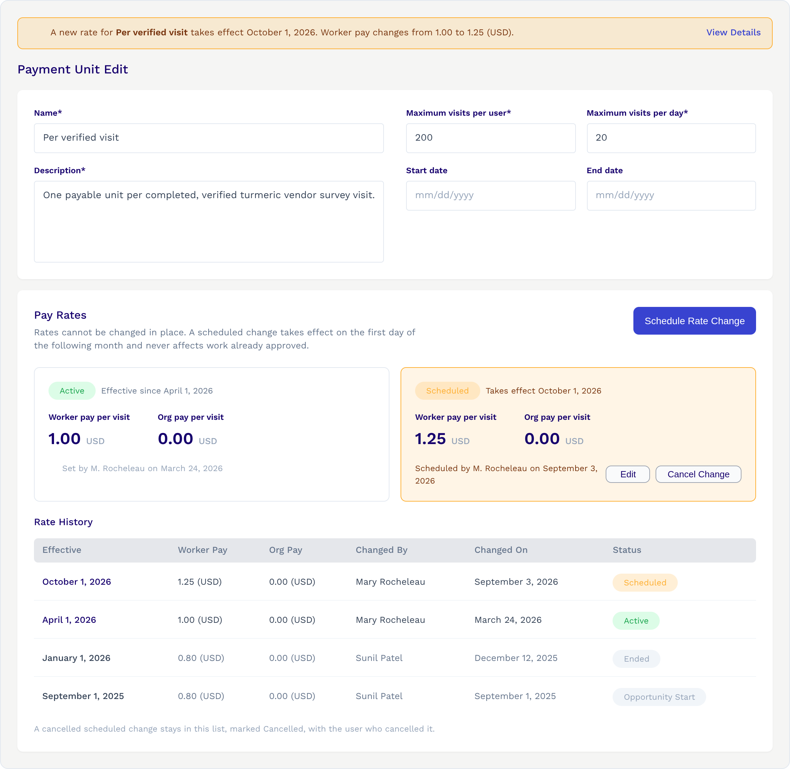
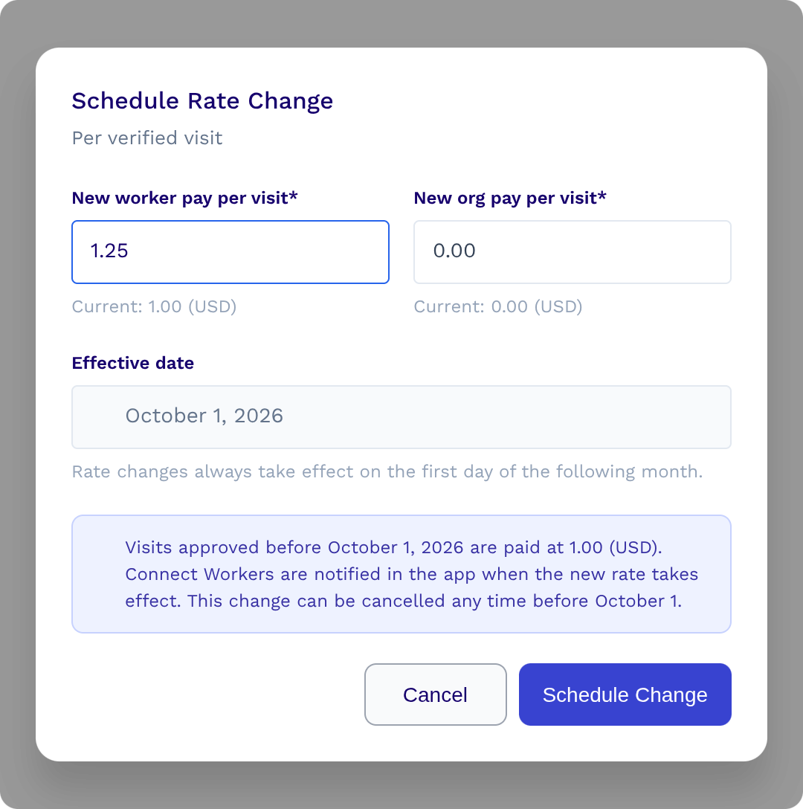
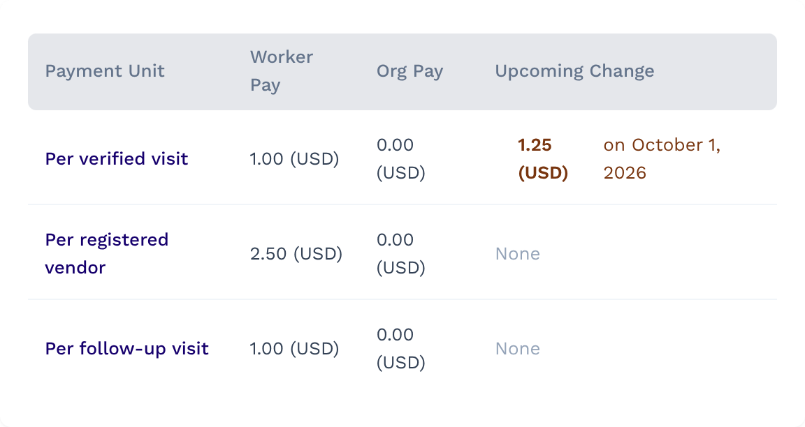

# Tech Spec: Scheduled Pay Rate Changes

- **Jira:** [CCCT-2884](http://dimagi.atlassian.net/browse/CCCT-2884) (epic [CCCT-2883](https://dimagi.atlassian.net/browse/CCCT-2883))
- **PRD:** "[PRD: Scheduled Pay Rate Changes](https://docs.google.com/document/d/16RgaTroDZc36ZnoAnqMhkt7uL41aj-VUq_pz50GVxeU/edit?tab=t.0#heading=h.edm5cm24b01s)"
- **Design:** [Claude design "Scheduled Pay Rate Changes](https://claude.ai/design/p/af178df3-1314-4e21-90b3-e1436099b7df?file=Scheduled+Pay+Rate+Changes.dc.html&via=share)"
- **Status:** Draft

## 1. Summary

Program Managers (PMs) can change a payment unit's pay rate (worker pay and/or org pay). This works for all active
opportunities, including ones already running. A change is **scheduled** and takes effect on the **1st of the next
month**. Until then it can be edited or cancelled. For a payment unit with no visits yet, the change takes effect
immediately.

A pay rate change only affects work **approved on or after** the date it takes effect. Work approved before that keeps
its old pay rate.

**Terms**

- **Visit:** one submitted form.
- **Delivery:** one completed set of a payment unit's required forms (deliver units). Pay and visit limits count
  deliveries. For a payment unit with one form, 1 delivery = 1 visit. This matches the UI ("Total Deliveries",
  "Worker pay per delivery").
- **Cost per delivery:** worker pay + org pay.

Worker-facing text and the "visit limit" name keep saying visits, since that is what the product calls them.

## 2. Goals

- PMs can schedule, edit and cancel a pay rate change on any payment unit.
- PMs can see the active pay rate, any upcoming change, and the full history (what changed, when, by whom).
- Workers are notified when their pay changes, and Network Managers (NMs) see a banner from 2 days before any change
  (section [10.1](#101-notifications)).
- Each invoice line shows a pay rate that really applied.
- A pay rate change never changes pay for work that is already approved.
- A pay rate increase never takes the opportunity over its budget.

## 3. Out of scope

- Fixing past invoices that went out at a wrong pay rate.
- Changing the opportunity's total budget automatically.
- Custom effective dates: the PM doesn't choose the date.
- Different pay rates for different workers in the same period.

## 4. The problem today

Today a PM can change the pay rate on the payment unit edit page, but the change can be **retroactive**: approved
work, including work done before the change, is repriced at the new pay rate.

Pay is not calculated once and kept. Each completed-work record stores its earned amount, but that amount is
**recalculated from scratch** as:

```
approved deliveries × current pay rate
```

So a change becomes retroactive in these situations:

- when a PM agrees or disagrees visits (all of that worker's records are recalculated, not just the agreed one)
- after visit and review imports
- every night, for every worker in every active auto-approve opportunity
- when an approved record receives another visit
- when an invoice is created: it reads the current pay rate. The automatic invoice runs on the **2nd** of each month
  and bills the previous month.

A worker whose records aren't recalculated keeps the old amount until they are, so workers in the same opportunity can
show earned pay at different pay rates for a while.

We want a new pay rate to apply only to deliveries approved from the 1st of the next month. Pay already earned, and
invoices for past months, should keep the pay rate that applied at the time.

## 5. Solution overview

### 5.1 Structure

- **Part 1: Foundation** (sections 6–8): reliable pay rate history, earned pay that never reprices past work, and
  invoices that bill it.
- **Part 2: Scheduling and applying pay rate changes** (sections 9–12): builds on Part 1 so PMs can schedule changes,
  with budgets, visit limits and notifications kept in step.

### 5.2 Key changes

1. **Pay rate history is the single source of truth.** A new table keeps one row per pay rate, with the date it
   takes effect. The pay rate on any day is the latest applied row that started on or before that day.
2. **Add to earned pay, don't recalculate it.** Each worker's earned (accrued) pay is only increased for deliveries
   approved since the last update, at the pay rate active that day. Earned pay already recorded is never changed.
   Each addition is kept as its own record.
3. **Invoices bill those records**, so they always match earned pay and show the pay rate each delivery earned.
4. **Visit limits follow the budget.** When the cost per delivery goes up, each worker's remaining visits are scaled
   down so the money left for them stays the same.
5. **Remove `amount` and `org_amount` from `PaymentUnit`** once everything reads from the pay rate history.

### 5.3 Product decisions

- **Visit limits on a pay rate increase.** Reduce visit limits for both existing and new workers, with a
  warning before the PM confirms (section [11](#11-budget-and-visit-limits)).
- **Brand-new payment units.** If a payment unit has no visits, a pay rate change takes effect immediately
  (section [9.1](#91-payment-units-with-no-visits)).
- **Existing opportunities.** The feature applies to all active opportunities, including ones already running.
- **Pay rate decreases.** Visit limits stay as they are; the PM sees a message saying so (section [11.3](#113-message-before-confirming)).
- **Changes that can't be funded.** Cover the extra from the remaining budget; if it isn't enough, block the
  change when scheduling or cancel it on the 1st, and email all opportunity admins (section [11.4](#114-no-overspend-funding-check)).

## Part 1: Foundation

Pay rate history, add-only earned pay and invoices (tickets 1–4, releases 1 and 2). Until a pay rate changes, pay and
invoices give the same results as today.

## 6. Data model

Model and lookup (6.1–6.2), the first pay rate (6.3–6.5), and retiring the old fields (6.6–6.7).

### 6.1 New model: `PaymentUnitRate`

```python
class PaymentUnitRate(BaseModel):
    payment_unit = models.ForeignKey(PaymentUnit, on_delete=models.PROTECT, related_name="pay_rates")
    flw_amount = models.PositiveIntegerField()  # worker pay
    org_amount = models.PositiveIntegerField(default=0)  # org pay
    effective_from = models.DateField()  # the 1st of a month; first pay rate: section 6.3
    cancelled_by = models.CharField(max_length=255, blank=True)  # user's email, or "system"
    cancelled_on = models.DateTimeField(null=True, blank=True)
    cancellation_reason = models.TextField(blank=True)  # filled in when the system cancels a change
    applied_on = models.DateTimeField(null=True, blank=True)  # when the change was applied (limits scaled)

    class Meta:
        constraints = [
            # At most one live (not cancelled) pay rate per payment unit per date
            models.UniqueConstraint(
                fields=["payment_unit", "effective_from"],
                condition=Q(cancelled_on__isnull=True),
                name="unique_live_pay_rate_per_date",
            ),
        ]
```

- **Who and when:** `BaseModel` gives `created_by` (who scheduled it), `modified_by` (who edited it last),
  `date_created` and `date_modified`.
- **System cancellations** (section [11.4](#114-no-overspend-funding-check)): `cancelled_by` is `"system"` and `cancellation_reason` says why.
- **`applied_on`** is when a change was applied (limits scaled). `effective_from` is only the day it
  is due. It is set by:
  - the job on the 1st (section [10](#10-applying-a-scheduled-change))
  - an Initial Rate, when it is created (section [6.3](#63-first-pay-rate-of-a-payment-unit))
  - in-place changes, which keep it (sections [9.1](#91-payment-units-with-no-visits) and [9.2](#92-payment-units-that-havent-started-yet))

A pay rate's **status** is worked out, not stored:

| Status    | Rule                                                                         |
| --------- | ---------------------------------------------------------------------------- |
| Scheduled | not cancelled, and `effective_from` is in the future or it isn't applied yet |
| Active    | the latest non-cancelled, applied pay rate with `effective_from` ≤ today     |
| Ended     | an older non-cancelled, applied pay rate when a newer active pay rate exists |
| Cancelled | `cancelled_on` is set                                                        |

**Active Pay Rate:** the pay rate workers are paid at today (the Active status above; section
[6.2](#62-looking-up-a-pay-rate)).

**Initial Rate:** a payment unit's first pay rate (its earliest non-cancelled row).

### 6.2 Looking up a pay rate

```python
class PaymentUnit(models.Model):
    def pay_rate_on(self, day):
        return (
            self.pay_rates.filter(cancelled_on__isnull=True, applied_on__isnull=False, effective_from__lte=day)
            .order_by("-effective_from")
            .first()
        )

    @property
    def current_pay_rate(self):
        return self.pay_rate_on(date.today())

    @property
    def budget_pay_rate(self):
        # Before the unit starts there is no active pay rate yet, so budgets use the Initial Rate
        return self.current_pay_rate or self.pay_rates.filter(cancelled_on__isnull=True).earliest("effective_from")
```

**A pay rate counts only once it is applied** (`applied_on` set), not when its date comes.

- If the daily job runs late, approvals, budget checks and new workers keep the old pay rate until the change is
  applied, so earned pay and visit limits always match.
- If the job cancels the change instead (section [11.4](#114-no-overspend-funding-check)), nobody ever earned the new
  pay rate.

**Budgets before the unit starts.** Until a payment unit (or its opportunity) starts, `current_pay_rate` finds nothing,
but workers can already join and get limits. So budget totals, visit limits and the join check use `budget_pay_rate`.
Earned pay uses `current_pay_rate`, since nothing can be approved before the unit starts.

### 6.3 First pay rate of a payment unit

Every payment unit needs an Initial Rate row, with `effective_from` on or before the first approval it covers. New
payment units get it when created. `effective_from` is:

- the unit's `start_date`, if set and in the future
- otherwise, the opportunity's start date, if in the future
- otherwise, today

`applied_on` is set straight away, since limits already match this pay rate; otherwise the job on the 1st would treat
it as a change.

### 6.4 Data migration for existing payment units

The **pay rate backfill** creates one row for **every** existing payment unit, in all opportunities (active, ended and not started yet), from
its current `amount` and `org_amount`. `applied_on` is set, for the same reason as section [6.3](#63-first-pay-rate-of-a-payment-unit). `effective_from` is:

- the payment unit's `start_date`, if set. Visits submitted before it are marked "trial" and never paid, so no
  approval comes before it. If `start_date` is in the future but the unit already has visits (its start was moved
  after it started, which section [6.5](#65-changing-a-payment-units-start-date) now prevents), the day the backfill
  runs instead, so the unit has an active pay rate for new approvals.
- otherwise, the opportunity's start date. All work happens after the opportunity starts.

### 6.5 Changing a payment unit's start date

The Initial Rate starts on its `effective_from` (section [6.3](#63-first-pay-rate-of-a-payment-unit)), and every
approval must fall on or after it. Today a PM can edit `start_date` at any time, which could break this.

**Rule.** A PM can change `start_date` only if:

- the payment unit **hasn't started yet**: its current `start_date` is in the future, or it has no visits at all, and
- the new date is **after today**, or **today** if the unit has no visits at all, and
- the new date is **before any pay rate change** that isn't cancelled. Otherwise the Initial Rate would move after
  that change, and the old pay rate would come back from the new start date.

When the date changes, the Initial Rate's `effective_from` moves with it in the same save.

Otherwise the form shows an error: the unit has already started, or (if only the last rule fails) the PM must cancel
the pay rate change first.

**Opportunity start date.** When the opportunity's start date changes, each unit's Initial Rate `effective_from` is
worked out again with the rule in section [6.3](#63-first-pay-rate-of-a-payment-unit), in the same save. The
opportunity form already only allows this before the opportunity starts, so no unit has approved work yet. It also allows it on the start day itself, which is now locked too: moving the
start date then would leave that day's approvals with no active pay rate.

**Why these rules**

- **Before the unit starts:** its visits are only trial visits, which are never paid. There is no approved work for
  the Initial Rate to cover, so it can move freely.
- **Today, only with no visits:** visits processed earlier today are already marked trial. Moving the start date to
  today would put them inside the active period while they stay trial, which is misleading.
- **Never a past date:** the unit didn't really start then, so the history would show a wrong start date for the
  Initial Rate.

**Example.** Today is November 5. The unit starts on November 10.

| Change                                             | Allowed?          | Why                                                                     |
| -------------------------------------------------- | ----------------- | ----------------------------------------------------------------------- |
| Move to November 20                                | Yes               | Not started yet. The Initial Rate moves to November 20.                 |
| Move to November 6                                 | Yes               | Not started yet, and the new date is after today.                       |
| Move to November 5 (today)                         | Only if no visits | Visits processed earlier today would be trial inside the active period. |
| Move to November 3                                 | No                | The new date is in the past.                                            |
| On November 12, with visits, move to November 20   | No                | Already started. Visits approved November 10–12 would have no pay rate. |
| On November 12, no visits yet, move to November 20 | Yes               | No visits, so nothing to cover. The Initial Rate moves to November 20.  |

### 6.6 Removing `amount` and `org_amount` from `PaymentUnit`

1. **This feature:** every reader of `amount` / `org_amount` (pay, invoices, budgets and claim limits, payment unit
   form and table, add-budget forms, mobile API, exports) reads the pay rate history instead. The old fields are still
   written for a while:
   - **Until PMs can schedule changes:** editing pay on the form updates the active pay rate row and the old fields,
     so the Foundation release (section [14.1](#141-releases)) can be rolled back.
   - **After that:** they are only filled when a payment unit is created, because they are required columns.
2. **Follow-up:** drop the two fields with a migration.

### 6.7 Protecting pay rate history

Earned pay and invoices depend on pay rate rows, so they are never deleted in normal use: no delete in the app, and
`on_delete=PROTECT` on `payment_unit`.

**Exception:** `delete_opportunity` (stale and test opportunities) and the dev-only `generate_sample_data` delete
`PaymentUnitRate` rows just before `PaymentUnit`.

## 7. Updating earned pay (the key change)

Today, every recalculation does:

```python
saved_payment_accrued = approved_count * payment_unit.amount
```

New rule: **only add to earned pay for newly approved deliveries**, at the pay rate active today.

```python
# Before this run, the updater locks its works when loading them and sets their status in memory
if completed_work.status != CompletedWorkStatus.approved:
    set_totals(completed_work, records=[])  # 0 while not approved, as today
elif completed_work.saved_payment_accrued == 0 and completed_work.earned_pay_records.exists():
    # Re-approved (only rejection zeroes the totals of work with records), however the status changed
    set_totals(completed_work, completed_work.earned_pay_records.all())

new_deliveries = approved_count - completed_work.saved_approved_count
if completed_work.status == CompletedWorkStatus.approved and new_deliveries > 0:
    pay_rate = completed_work.payment_unit.current_pay_rate
    new_flw_pay = new_deliveries * pay_rate.flw_amount
    new_org_pay = new_deliveries * pay_rate.org_amount
    exchange_rate = get_exchange_rate(currency, now())

    EarnedPayRecord.objects.create(  # section 7.1
        completed_work=completed_work,
        deliveries=new_deliveries,
        pay_rate=pay_rate,
        flw_amount=new_flw_pay,
        org_amount=new_org_pay,
        exchange_rate=exchange_rate,
        earned_on=now(),
    )
    completed_work.saved_payment_accrued += new_flw_pay
    completed_work.saved_payment_accrued_usd += Decimal(new_flw_pay) / exchange_rate  # USD rate is int 1
    completed_work.saved_org_payment_accrued += new_org_pay
    completed_work.saved_org_payment_accrued_usd += Decimal(new_org_pay) / exchange_rate
    completed_work.saved_approved_count = approved_count
# saved by the updater's bulk_update at the end, as today
```

**Running at the same time.** Two recalculations at once could both pay the same new delivery. So `update_status`
locks the work rows, in its own transaction, before counting visits, for every caller (requests and tasks). A second
run waits, then reads the updated count. Today's Redis lock per worker isn't enough: it is released before a request
commits, and the nightly job doesn't take it.

In managed opportunities `approved_count` only counts visits that are approved **and** agreed.

**Work that stops being approved.** A visit rejected later, or the completed work status import, can move approved
work out of "approved". As today, its pay stops counting: its totals are 0 and its unbilled records aren't invoiced
(section [8](#8-invoices)). Its records are kept, so if it is approved again its totals come back, with nothing added
twice. Amounts already invoiced aren't reversed.

Effects:

- Agreeing visits, imports and the nightly job only add pay for new deliveries; recorded pay is never repriced.
- Worker totals, reports and exports already read the stored amounts, so they don't change.
- The `CompletedWork.payment_accrued` property, which multiplies by the current pay rate, reads the stored amount
  instead.

### 7.1 Earned pay records

**Why.** Today a piece of work only stores its total earned pay and approved count, not when each delivery was
approved or at which pay rate and exchange rate. Invoices work around this by comparing counts, which breaks once
pay rates can change:

- **Duplicate in the same month.** A delivery approved on September 30 at 4 and its duplicate on October 1 at
  5, both before the September invoice, are billed together as 2 deliveries at 5, the pay rate on the invoice date,
  though one was earned at 4.
- **Additional deliveries.** A duplicate approved after its work was invoiced is listed under the next invoice's month,
  since we don't know when it was approved, and its amount is found by subtracting what was already invoiced.

So each addition to earned pay is kept as a record: deliveries, pay rate, amounts and when.

**Model**

```python
class EarnedPayRecord(BaseModel):
    completed_work = models.ForeignKey(CompletedWork, on_delete=models.PROTECT, related_name="earned_pay_records")
    deliveries = models.PositiveIntegerField()
    pay_rate = models.ForeignKey(PaymentUnitRate, on_delete=models.PROTECT, null=True)  # empty for old work
    flw_amount = models.IntegerField()  # worker pay, local currency
    org_amount = models.IntegerField()  # org pay, local currency
    exchange_rate = models.DecimalField(max_digits=20, decimal_places=6)  # USD amount = local amount ÷ this
    earned_on = models.DateTimeField(null=True)  # empty only for old records whose date isn't known
```

- Records are only added, never changed or deleted (like pay rate rows, section [6.7](#67-protecting-pay-rate-history)).
- Each record has one pay rate, so its amount ÷ deliveries is always a real pay rate.
- USD amounts aren't stored; they come from the exchange rate.
- The totals on the work (`saved_payment_accrued` and the others) stay. For new work they equal the sum of its
  records while it is approved, and 0 otherwise (section [7](#7-updating-earned-pay-the-key-change)). Old work whose pay was edited after it was invoiced can differ, because today's code repriced it.

### 7.2 Earned pay backfill

We don't need to know when old deliveries were approved: today's code prices deliveries at one pay rate each time it
invoices them, so the amounts can come from existing invoice rows and the current pay rate. A re-runnable management
command (not a migration), run right after the deploy:

1. For each existing invoice row, creates a record with the same deliveries, amounts and exchange rate, and links the
   row to it.
2. For each **approved** piece of work, creates one record for the deliveries no record covers yet:
   - **Deliveries:** approved deliveries minus those already in its records (from step 1, or from approvals since
     the deploy).
   - **Pay:** the current pay rate, which is what today's invoicing would bill.
   - **Exchange rate:** the one on the work's approval date.
   - It locks the work like the updater (section [7](#7-updating-earned-pay-the-key-change)), so a live approval
     can't add the same deliveries at the same time.
3. For each piece of work that **isn't approved**, sets `saved_approved_count` to the deliveries in its records (0 if
   it has none). Today's code counts deliveries on work that isn't approved too; left as is, they would never be paid
   once the work is approved, since pay is only added for deliveries above the count.
4. Skips what it has already handled, so it is safe to run again.

Backfilled records have no pay rate link. We don't guess dates: `earned_on` is the work's `status_modified_date` if it
has one approved delivery, and empty otherwise.

**When to run it**

- **Immediately after the deploy.** Until it runs, old deliveries that aren't invoiced yet have no records, so an
  invoice created in between would leave them out until a later invoice.
- **Deploy after the invoice run on the 2nd and before the month ends.** Records with no `earned_on` (step 2, when the
  approval date isn't known) are billed under the month of the next invoice. After the 2nd, everything still unbilled
  was approved this month, so that month is right. Run on the 1st, work approved that morning would be billed under
  the previous month.

## 8. Invoices

Invoices bill **earned pay records** (section [7.1](#71-earned-pay-records)) that aren't on an invoice yet, instead of
multiplying by the current pay rate, so they always match earned pay and never look up a pay rate.

- **One invoice row (`CompletedWorkInvoice`) per record,** linked to it and copying its amounts. This replaces one row
  per invoice and piece of work, so a delivery and its duplicate at different pay rates get two rows, and
  `unique_together = ("invoice", "completed_work")` is dropped (ticket 4). Copying the amounts could be dropped
  later (section [15](#15-future-improvements)).

  ```python
  class CompletedWorkInvoice(BaseModel):
      earned_pay_record = models.OneToOneField(
          EarnedPayRecord, on_delete=models.PROTECT, null=True, related_name="invoice_row"
      )  # made required once the earned pay backfill has run (ticket 10)
  ```

- **What is billed:**
  - every unbilled record (no invoice row) of approved work, earned on or before the invoice's end date
  - each row goes under the month its record was earned
  - a backfilled record with no date goes under the invoice's month, as additional deliveries do today
  - cancelling an invoice deletes its rows, so their records become unbilled again
- `invoiced_approved_count` is no longer needed (dropped in ticket 10).
- **Lines** are grouped by month, payment unit and pay rate (amount ÷ deliveries, so backfilled records group the same
  way): "N verified visits x `<currency>` `<rate>`". A month with two pay rates has two
  lines. Additional deliveries are part of these lines, under the month they were approved; the existing "Additional
  Deliveries" count on the invoice form stays.
- **Export:** one row per invoice row, as today, plus a pay rate column (and an org pay rate column when org pay is
  shown), worked out as pay ÷ deliveries.
- Invoices already created keep their amounts; the earned pay backfill only links their rows to records.

**Example.** Worker pay goes from 4 to 5 on October 1. One worker's records:

| Record         | Earned on | Deliveries | Worker pay |
| -------------- | --------- | ---------- | ---------- |
| Delivery A     | Sep 12    | 1          | 4          |
| Delivery B     | Sep 30    | 1          | 4          |
| Duplicate of A | Oct 1     | 1          | 5          |
| Delivery C     | Oct 8     | 1          | 5          |

- **October 2 invoice (September):** A and B, as one line: "2 verified visits x USD 4". The duplicate was earned
  after the end date, so it waits for the next invoice.
- **November 2 invoice (October):** the duplicate of A and C, as one line under October: "2 verified visits x USD
  5". The duplicate is billed at the pay rate it earned, as part of the normal line.

## Part 2: Scheduling and applying pay rate changes

What PMs, NMs and workers see, the daily job, and visit limits (tickets 5–9, release 3). Depends on the
changes in Part 1.

## 9. Scheduling a change

**Who:** PM users with admin access to the opportunity, the same users who can edit payment units today. No new
permissions.

**When it takes effect:** the 1st of next month; the PM does not choose the date. Two exceptions, checked in this
order, change the pay rate in place instead:

- the unit hasn't started yet (section [9.2](#92-payment-units-that-havent-started-yet))
- the unit has no visits: the change takes effect immediately (section [9.1](#91-payment-units-with-no-visits))

**Scheduling, editing and cancelling**

| Action   | Allowed                             | Refused                                                                     |
| -------- | ----------------------------------- | --------------------------------------------------------------------------- |
| Schedule | no change is scheduled yet          | a change is already scheduled (section [12.1](#121-payment-unit-edit-page)) |
| Edit     | a scheduled change, before its date | once the change is applied, cancelled or its date has come                  |
| Cancel   | a scheduled change, before its date | once applied or due, and always for the Initial Rate                        |

- Editing updates the same row; the last edit wins and `modified_by` records who.
- Cancelling sets `cancelled_by` and `cancelled_on`; the row stays in the history as "Cancelled".

**When a change is blocked** (checked on schedule and on edit)

- The new pay rate must differ from the active one in worker pay or org pay.
- **The opportunity ends before the effective date.**
- **The cost per delivery goes up and the opportunity can't fund it** (section [11.4](#114-no-overspend-funding-check)).
  On edit, the funding check counts the edited amounts in place of the change's current ones, not on top of them.

The modal shows the visit limit warning when the cost per delivery goes up and the decrease message when it goes down
(section [11.3](#113-message-before-confirming)).

**Locking:** scheduling locks the payment unit, so two PMs can't both schedule a change. Edit and cancel lock the pay
rate row, which the job also locks, so a change can't be edited or cancelled while the job applies it.

### 9.1 Payment units with no visits

If a payment unit has **no visits** (Trial and Over Limit visits don't count), a change takes effect **immediately**.
Nobody has earned anything at the old pay rate, so it **edits the active pay rate in place**, usually the Initial
Rate. `effective_from` and `applied_on` don't change, so the
pay rate still moves with the start date (section [6.5](#65-changing-a-payment-units-start-date)).

- **Modal:** the effective date shows today. Before saving, the PM confirms that the change takes effect immediately
  and can't be cancelled, and that workers are notified now (if worker pay changes). The visit limit warning (section
  [11.3](#113-message-before-confirming)) is included if the cost goes up.
- **On save:** if the cost goes up, joined workers' limits are scaled straight away (section [11.2](#112-what-a-pay-rate-increase-does)); with no visits there
  is no shortfall. If worker pay changed, workers are notified. No NM banner.

**Avoiding race conditions:** lock first, then check again that the unit still hasn't started or still has no visits.
Section [9.2](#92-payment-units-that-havent-started-yet) uses the same function.

```python
@transaction.atomic
def change_pay_rate_in_place(payment_unit, flw_amount, org_amount, user):
    # Lock first, then check, so nothing can slip in between:
    # - a worker joining locks the opportunity; without this they could get a limit at the old cost
    #   that the scaling below misses
    # - form processing locks the claim limit rows before saving a visit; without this a visit could
    #   arrive and be auto-approved at the old pay rate, after the PM was told the change is immediate
    opportunity = Opportunity.objects.select_for_update().get(pk=payment_unit.opportunity_id)
    list(OpportunityClaimLimit.objects.select_for_update().filter(payment_unit=payment_unit))
    payment_unit = PaymentUnit.objects.select_for_update().get(pk=payment_unit.pk)  # max_total is scaled too
    started = not not_started(payment_unit)
    if started and has_visits(payment_unit):
        raise ValidationError("This payment unit now has visits. Schedule the change for the 1st instead.")
    previous = payment_unit.budget_pay_rate  # loaded before the edit, so it keeps the old amounts
    if previous.flw_amount + previous.org_amount == 0 and flw_amount + org_amount > 0:
        # Raised from zero: limits aren't scaled, so the budget must cover them at the new cost (section 11.7)
        if needed_from_zero(payment_unit, flw_amount + org_amount) > opportunity.remaining_budget:
            raise ValidationError("The remaining budget can't cover this pay rate. Add budget first.")
    pay_rate = payment_unit.pay_rates.select_for_update().filter(cancelled_on__isnull=True).latest("effective_from")
    pay_rate.flw_amount = flw_amount
    pay_rate.org_amount = org_amount
    pay_rate.modified_by = user.email
    pay_rate.save(update_fields=["flw_amount", "org_amount", "modified_by", "date_modified"])
    scale_visit_limits(payment_unit, previous, pay_rate)
    if started and previous.flw_amount != pay_rate.flw_amount:  # no notification before the unit starts
        # effective_from stays the original start date, so the message shows today
        transaction.on_commit(partial(send_pay_rate_change_notification.delay, pay_rate.pk, date.today()))
    return pay_rate
```

### 9.2 Payment units that haven't started yet

Until the Initial Rate's `effective_from` (section [6.3](#63-first-pay-rate-of-a-payment-unit)), the unit hasn't
started and no pay rate is active.

- The Initial Rate shows as **Scheduled** ("Takes effect `<effective_from>`"), with Edit but no Cancel (cancelling
  would leave the unit with no pay rate). The modal shows `effective_from` as the effective date.
- A change **edits the Initial Rate in place** through `change_pay_rate_in_place` (section [9.1](#91-payment-units-with-no-visits)), so if the cost goes up,
  joined workers' limits are scaled on save under the same locks. There are no approved deliveries, so no shortfall.
- Workers are not notified and there is no NM banner.

## 10. Applying a scheduled change

**When it runs**

A new Celery beat task, **the daily job**, runs **every day at 00:00 UTC**. It applies every pay rate change whose
date has come but isn't applied yet.
- **00:00** so the new pay rate starts as close to the 1st as possible. Until the job runs, everything keeps the old
  pay rate (section [6.2](#62-looking-up-a-pay-rate)). Traffic is low then, so its brief locks don't hold up visits.
- **Daily**, not only on the 1st, so a failed run is picked up the next day instead of leaving a change stuck (its
  date has passed, so it can't be cancelled). It also checks scheduled changes for funding every day (section
  [11.4](#114-no-overspend-funding-check)).

**What it does**

For each change:

1. **Cancels it if the opportunity has ended or is inactive** (for example, its end date was moved earlier), like
   other jobs that only act on active, running opportunities.
2. **Checks funding** if the cost per delivery went up, and cancels the change if it can't be funded (section
   [11.4](#114-no-overspend-funding-check)).
3. **Scales visit limits** if the cost per delivery went up (section [11.2](#112-what-a-pay-rate-increase-does)).
4. **Notifies workers** if worker pay changed.
5. **Records `applied_on`.**

**Reliability**

- It starts one task per pay rate. Each runs in one transaction, locks the pay rate row and returns straight away if
  it is already applied or cancelled. So a failed task leaves nothing half-done, and a retried one never scales or
  notifies twice.
- **Retries:** about 1, 2, 4, 8 and 16 seconds apart, all within a minute. A task that still fails is reported to
  Sentry, and the next day's run tries again.

**Code**

```python
@celery_app.task()
def apply_pay_rate_changes():
    to_apply = PaymentUnitRate.objects.filter(
        cancelled_on__isnull=True,
        applied_on__isnull=True,
        effective_from__lte=date.today(),
    )
    for pay_rate_id in to_apply.values_list("pk", flat=True):
        apply_pay_rate_change.delay(pay_rate_id)


@celery_app.task(
    base=ReportFinalFailureToSentry,  # reports to Sentry once the retries are used up
    autoretry_for=(Exception,),
    retry_backoff=True,
    max_retries=5,
)
def apply_pay_rate_change(pay_rate_id):
    with transaction.atomic():
        payment_unit = PaymentUnitRate.objects.select_related("payment_unit").get(pk=pay_rate_id).payment_unit
        # Same locks in the same order as an immediate change (section 9.1), so the two can't deadlock
        opportunity = Opportunity.objects.select_for_update().get(pk=payment_unit.opportunity_id)
        list(OpportunityClaimLimit.objects.select_for_update().filter(payment_unit=payment_unit))
        payment_unit = PaymentUnit.objects.select_for_update().get(pk=payment_unit.pk)  # max_total is scaled too
        pay_rate = PaymentUnitRate.objects.select_for_update().get(pk=pay_rate_id)
        if pay_rate.applied_on or pay_rate.cancelled_on:
            return  # already applied, or cancelled in the meantime
        previous = payment_unit.pay_rate_on(pay_rate.effective_from - timedelta(days=1))
        if not opportunity.active or opportunity.has_ended:
            cancel_automatically(pay_rate, reason="The opportunity has ended")
            return
        shortfall = funding_shortfall(payment_unit, previous, pay_rate)
        if shortfall > opportunity.remaining_budget:
            cancel_unfunded_change(pay_rate, shortfall)  # also emails the opportunity admins
            return
        scale_visit_limits(payment_unit, previous, pay_rate)
        pay_rate.applied_on = now()
        pay_rate.save(update_fields=["applied_on"])
        if previous.flw_amount != pay_rate.flw_amount:
            notify = partial(send_pay_rate_change_notification.delay, pay_rate.pk, pay_rate.effective_from)
            transaction.on_commit(notify)
```

**Changes made while the job runs**

- **Visits, new workers and Add Budget increases** wait for the job's locks, then work with the scaled limits. Add
  Budget adds to or subtracts from the scaled limit.
- **Editing the payment unit:** the form saves only the fields the PM changed, so it can't overwrite the scaled max.
- **Add Budget decreases** check "not below visits already done" against limits read before the job. In rare cases a
  decrease could leave a limit just below the visits done. This can already happen today with any limit change, so
  it is accepted.

### 10.1 Notifications

| What changed                     | Workers (app notification) | NMs (Connect Web banner) |
| -------------------------------- | -------------------------- | ------------------------ |
| Worker pay (with or without org) | Yes                        | Yes                      |
| Org pay only                     | No                         | Yes                      |

**Worker notification:** a push notification through the existing messaging service, sent to all workers with
access to the opportunity. If their visit limit changed, the message says so. Example: "From `<Effective date>`, you
earn `<New worker pay>` `<Currency>` per `<Payment unit name>`. You have `<Visits left>` visits left."

**NM banner:** see section [12.4](#124-banners).

## 11. Budget and visit limits

### 11.1 How it works today

- Each payment unit has a **max visits per worker** (`max_total`).
- Each worker gets their own **visit limit** when they join: the payment unit's max. A worker can only join if the
  remaining budget covers their full share, otherwise they are refused.
- PMs can raise or lower an individual worker's limit later, so workers on the same payment unit can have different
  limits.
- **Claimed budget** = every worker's visit limit × (worker pay + org pay).
- **Remaining budget** = total budget − claimed budget.

### 11.2 What a pay rate increase does

When the cost per delivery goes up, visit limits go down for **both existing and new workers**, so the opportunity
stays within budget. This also applies when only org pay goes up.

**Rule**

```
scaled limit = deliveries approved + floor((limit − deliveries approved) × old cost ÷ new cost)
new limit    = the higher of: scaled limit, deliveries completed; never above the current limit
```

- **Deliveries approved:** approved (agreed) before the change; their pay is already recorded at the old pay rate.
- **Deliveries completed:** all forms submitted, approved or waiting.

**Why**

- **Same remaining money.** Workers can have different limits and have used different amounts, so each worker keeps
  the money left for them, and we work out how many deliveries it buys at the new pay rate.
- **Only approved deliveries keep the old cost.** Pay is added when a delivery is approved, so deliveries waiting
  for approval and not yet done are costed at the new pay rate.
- **Worst case.** We assume every waiting delivery is approved after the 1st, at the new pay rate. This is only for
  the budget check; pay is still added on approval, and rejected deliveries leave money unspent.
- **The higher of the two.** Under the worst case all completed deliveries are approved, so the limit never drops
  below them (see Dev in the example below).
- **Round down.** A limit never costs more than the money left, so the budget is never overspent. The remainder (less
  than one delivery per worker) stays in the budget.

**When**

Limits are scaled on the 1st, by the daily job. So a change cancelled before the 1st leaves nothing to undo.

**Example**

Pay rate goes from 4 to 5.

| Worker | Limit | Approved | Waiting | Money left | Deliveries it buys | Scaled limit | New limit |
| ------ | ----- | -------- | ------- | ---------- | ------------------ | ------------ | --------- |
| Asha   | 100   | 20       | 20      | 320        | 64                 | 84           | 84        |
| Ben    | 150   | 10       | 0       | 560        | 112                | 122          | 122       |
| Chen   | 100   | 100      | 0       | 0          | 0                  | 100          | 100       |
| Dev    | 100   | 10       | 90      | 360        | 72                 | 82           | **100**   |

Money left = (limit − approved) × 4; deliveries it buys = money left ÷ 5, rounded down.

Dev has completed 100 deliveries (10 approved + 90 waiting), so the limit stays at 100. The 90 waiting cost 450 at
the new pay rate, but only 360 is left: the extra 90 is the **shortfall** (section [11.4](#114-no-overspend-funding-check)).

**New workers**

The payment unit's **max visits per worker** is scaled by the same ratio, rounded down: 100 × 4 ÷ 5 = **80**.
80 × 5 = 100 × 4, so new workers get the same money as existing ones. It never goes below 1, or new workers
couldn't join the unit at all; their limit is still capped by what the remaining budget can pay.

**Code**

```python
def scale_visit_limits(payment_unit, old_rate, new_rate):
    old_cost = old_rate.flw_amount + old_rate.org_amount
    new_cost = new_rate.flw_amount + new_rate.org_amount
    if new_cost <= old_cost:
        return  # a decrease keeps limits as they are (section 11.3)
    if old_cost == 0:
        return  # raised from zero: funded from the remaining budget instead (section 11.7)
    counts = delivery_counts_per_worker(payment_unit)  # {claim_limit_id: (approved, completed)}, from CompletedWork
    for claim_limit in payment_unit.opportunityclaimlimit_set.all():
        approved, completed = counts.get(claim_limit.id, (0, 0))
        scaled = approved + (claim_limit.max_visits - approved) * old_cost // new_cost
        claim_limit.max_visits = min(claim_limit.max_visits, max(completed, scaled))
        claim_limit.save(update_fields=["max_visits"])
    if payment_unit.max_total:
        payment_unit.max_total = max(1, payment_unit.max_total * old_cost // new_cost)
        payment_unit.save(update_fields=["max_total"])
```

### 11.3 Message before confirming

One message for the payment unit, with no per-worker numbers.

**Increase**

> "This increase will reduce workers' remaining visits for this payment unit by around `<Percent>`% when it takes
> effect on `<Effective date>`. Add budget first if you want workers to keep their visits."

`<Percent>` = 1 − old cost ÷ new cost (e.g. 20% for 4 → 5).

The message also shows the budget needed to keep workers' visits: Σ over workers of (limit − deliveries approved) ×
(new cost − old cost).

**Decrease**

> "This change does not change the number of visits assigned to each worker."

Visit limits stay as they are. The PM can add visits with Add Budget.

> **Note:** a decrease never raises limits. If an in-place change (sections [9.1](#91-payment-units-with-no-visits)
> and [9.2](#92-payment-units-that-havent-started-yet)) raises the pay rate by mistake and is then lowered, workers
> keep the reduced limits. The PM restores them by hand: Add Budget → Increase Visits for existing workers, and the
> payment unit's max visits per worker for new ones.

### 11.4 No overspend: funding check

A **shortfall** (like Dev's above) is what a worker's waiting deliveries cost at the new pay rate beyond the money set
aside for them. It is paid from the opportunity's **remaining budget**; if that isn't enough, the change can't go
ahead.

**When it is checked**

1. **When scheduling**, with today's numbers. If there isn't enough budget, the change is blocked, asking the PM to
   agree pending visits or add budget first. The message shows how much is missing (total shortfall − remaining
   budget).
   - Other payment units' scheduled changes share the same remaining budget, so the check adds up the shortfalls of
     all the opportunity's scheduled changes, including this one.
2. **Between scheduling and the 1st**: PMs and NMs see a warning banner as soon as the total can no longer be funded
   (section [12.4](#124-banners)). The daily job also emails the PM and NM admins once, so they can act as soon as
   possible, since the banner only reaches people who open Connect Web.
3. **On the 1st at 00:00**, before limits are scaled. By then the change may no longer fit: workers may have submitted
   more visits, new workers may have joined, limits may have been raised (Add Budget or max visits per worker), or
   over-limit visits may have been approved. If there isn't enough budget, the change is **cancelled automatically**:
   - the old pay rate stays
   - the row shows as "Cancelled" in the history, with a `cancellation_reason`
   - all opportunity admins are emailed, so it gets resolved quickly

> **Note (trade-off):** this is an edge case, since the banner gives time to act first. But a change cancelled on the
> 1st can only be scheduled again for the 1st of the following month, so it is delayed by a month.

**Example**

| Case                                                       | Shortfall         | Remaining budget | Result                                                                   |
| ---------------------------------------------------------- | ----------------- | ---------------- | ------------------------------------------------------------------------ |
| Section [11.2](#112-what-a-pay-rate-increase-does) example | 90 (Dev)          | 100              | Scheduled. On the 1st, 90 covers Dev, leaving 10.                        |
| Section [11.2](#112-what-a-pay-rate-increase-does) example | 90 (Dev)          | 20               | Blocked until pending visits at current rate are agreed or budget added. |
| Unit A, scheduled first                                    | 400               | 500              | Scheduled.                                                               |
| Unit B, same opportunity                                   | 300 (+ 400 for A) | 500              | Blocked: together they need 700.                                         |

### 11.5 Adding or reducing visits from the Add Budget form

The Add Budget form works as today, at the cost per delivery active at the time. Visits added before the 1st are
scaled on the 1st with the rest of the worker's money. Example: pay rate 4 → 5, a PM adds 10 visits (40) in September;
if none are approved by the 1st, the worker ends up with 8 extra visits, not 10.

**Note on the form.** While a change is scheduled, the Add Budget form notes that visits not approved by the effective
date, including any added now, will be adjusted to the new pay rate.

### 11.6 Claimed budget

Today claimed budget = visit limit × current cost. Once a new pay rate is applied, that also prices deliveries already
approved at the new pay rate, though they were paid at the old one. Claimed budget looks too high, the remaining budget
too low, and new workers can be wrongly blocked. So claimed budget **must** be:

```
worker pay + org pay already earned (at the pay rates that applied)
  +  max(0, visit limit − deliveries approved) × current cost per delivery
```

- **Why `max(0, …)`:** an NM can still approve over-limit visits (for example, through the visit status import), so
  deliveries approved can go above the visit limit. Without it, the second part would go negative and cancel out pay
  they really earned, making the budget look bigger than it is.
- Only claimed budget uses this formula. Other budget checks (joining, the payment unit form, new workers' limits)
  keep max visits per worker × cost, with the cost from `budget_pay_rate` (section [6.2](#62-looking-up-a-pay-rate)).

### 11.7 Special case: pay rate raised from zero

If the cost was 0 and the PM raises worker or org pay, no money was ever set aside for these deliveries, so scaling
doesn't work. Instead:

- Visit limits and max visits per worker stay as they are.
- The funding check (section [11.4](#114-no-overspend-funding-check)) needs every worker's unapproved deliveries at the new cost:

  ```
  needed = Σ over workers of (limit − deliveries approved) × new cost
  ```

  If the remaining budget doesn't cover it, the change is blocked when scheduling or cancelled on the 1st, as in
  section [11.4](#114-no-overspend-funding-check), and the message asks the PM to add budget first.
- The modal shows how much budget the change needs, instead of the visit limit warning.

## 12. UI

Screenshots from the Claude design are included below. This section only lists what the screenshots don't show.

### 12.1 Payment unit edit page



- Worker pay and org pay are no longer on the form. They are only shown, read-only, in the Pay Rates card.
- Cancel Change asks for confirmation first.
- For a payment unit that hasn't started yet, the Initial Rate shows as Scheduled with Edit only, no Cancel Change
  (section [9.2](#92-payment-units-that-havent-started-yet)).
- **Schedule Rate Change** is **disabled** when a change is already scheduled, with the tooltip: "A change is already
  scheduled for `<Effective date>`. Edit or cancel it instead."
- The funding warning (section [12.4](#124-banners)) is also shown on the Pay Rates card.

### 12.2 Schedule Rate Change modal



- The same modal, pre-filled, is used for **Edit**.
- Setting worker pay or org pay to 0 asks the PM to confirm before saving.
- **Effective date** is shown, not editable: the 1st of next month, today (section [9.1](#91-payment-units-with-no-visits)), or the Initial Rate's `effective_from` (section [9.2](#92-payment-units-that-havent-started-yet)).
- Messages: section [11.3](#113-message-before-confirming); funding error, which stops the save: section [11.4](#114-no-overspend-funding-check).

### 12.3 Payment units list



- The Upcoming Change column says what changes, for example "Worker pay 4 → 5 (USD) from October 1, 2026".
  If both worker pay and org pay change, show both lines.
- Only PMs see the org pay line, like the existing "Org pay per delivery" column, which NMs don't see.

### 12.4 Banners

**Upcoming change banner (NMs)**

- Shown on **every Connect Web page**, not just the edit page, to members of the opportunity's organisation, when a
  change takes effect in **2 days or fewer**. Because of that it names the opportunity:

  "`<Opportunity name>`: a new rate for `<Payment unit name>` takes effect `<Effective date>`. Worker pay changes
  from `<Old worker pay>` to `<New worker pay>` (`<Currency>`)."

  For an org pay change, the second sentence says "Org pay changes from … to …". If both change, it shows both.
- If several changes are coming, one line per opportunity and payment unit.
- Not shown for an Initial Rate (section [9.2](#92-payment-units-that-havent-started-yet)).

**Funding warning banner (PMs and NMs)**

If a scheduled change can no longer be funded from the budget left (section [11.4](#114-no-overspend-funding-check)), a warning
banner is shown **straight away**, not only in the last 2 days, so there is time to act:

"`<Opportunity name>`: the pay rate change for `<Payment unit name>` on `<Effective date>` can no longer be funded
from the budget left. Agree pending visits or add budget before `<Effective date>`, or this change will not
apply."

- Shown to the PMs who can schedule pay rate changes and to the NMs of the opportunity's organisation.
- It goes away by itself once the change can be funded again (waiting deliveries approved or budget added).
- It can take up to an hour to appear or go away (cached, because it counts visits per worker).

## 13. All scenarios

**Scheduling and editing**

| Case                                          | Behaviour                                                                       |
| --------------------------------------------- | ------------------------------------------------------------------------------- |
| Change scheduled on the last day of the month | Takes effect the next day. The banner is shown till the end of the last day.    |
| Several PMs edit the scheduled change         | Last edit wins. History shows the last editor only.                             |
| Cancel, then schedule again in the same month | Allowed. The cancelled row stays in history and a new scheduled row is created. |
| Opportunity ends before the effective date    | Scheduling is blocked (section [9](#9-scheduling-a-change)).                    |

**Applying on the 1st**

| Case                                    | Behaviour                                                                                                                      |
| --------------------------------------- | ------------------------------------------------------------------------------------------------------------------------------ |
| End date moved earlier after scheduling | The job cancels the change on the 1st (section [10](#10-applying-a-scheduled-change)).                                         |
| Change cancelled before the 1st         | Nothing to undo. Limits only change on the 1st.                                                                                |
| Change can't be funded on the 1st       | Cancelled automatically, old pay rate stays, opportunity admins emailed (section [11.4](#114-no-overspend-funding-check)).     |
| Two units' changes on the same 1st      | Scheduling checks the total. If both don't fit on the 1st, one is cancelled (section [11.4](#114-no-overspend-funding-check)). |
| Job on the 1st runs late                | Everything keeps using the old pay rate until the change is applied (section [6.2](#62-looking-up-a-pay-rate)).                |

**Budget and visit limits**

| Case                                | Behaviour                                                                                                                             |
| ----------------------------------- | ------------------------------------------------------------------------------------------------------------------------------------- |
| Worker has used all their visits    | Limit stays the same. Deliveries already completed are never reduced.                                                                 |
| Workers with different visit limits | Each worker's remaining visits are scaled separately (section [11.2](#112-what-a-pay-rate-increase-does)).                            |
| New workers join before the 1st     | They get limits at the old cost, then are scaled on the 1st like everyone else.                                                       |
| Budget added before the 1st         | Scaled down on the 1st like the rest of the worker's money (section [11.5](#115-adding-or-reducing-visits-from-the-add-budget-form)). |
| Workers join before the unit starts | Limits are priced at the Initial Rate (section [6.2](#62-looking-up-a-pay-rate)).                                                     |

**Earned pay and invoices**

| Case                                       | Behaviour                                                                               |
| ------------------------------------------ | --------------------------------------------------------------------------------------- |
| Duplicate approved after a pay rate change | Billed under the month it was approved, at its own pay rate (section [8](#8-invoices)). |

**Special payment units**

| Case                                  | Behaviour                                                                                                                           |
| ------------------------------------- | ----------------------------------------------------------------------------------------------------------------------------------- |
| Payment unit with no visits           | Active pay rate is edited in place, takes effect immediately (section [9.1](#91-payment-units-with-no-visits)).                     |
| Payment unit hasn't started yet       | Initial Rate shows as Scheduled, is edited in place, can't be cancelled (section [9.2](#92-payment-units-that-havent-started-yet)). |
| Payment unit with child payment units | Each unit has its own pay rate. Changing a parent does not change its children.                                                     |
| Pay rate set to 0                     | Allowed (same as today). The modal asks the PM to confirm.                                                                          |
| Pay rate raised from 0                | Limits are not scaled; funded from the remaining budget (section [11.7](#117-special-case-pay-rate-raised-from-zero)).              |

## 14. Implementation tickets (proposed, to be created after approval)

1. Pay rate history model and migration
2. Restrict editing a payment unit's start date
3. Read pay rates from the history
4. Add-only earned pay, earned pay records, and invoices bill them
5. Pay Rates card and Rate History (read-only)
6. Schedule, edit and cancel
7. Job on the 1st
8. Upcoming pay rate changes: list column, banners and Add Budget note
9. Immediate change for payment units with no visits or not started yet (sections [9.1](#91-payment-units-with-no-visits) and [9.2](#92-payment-units-that-havent-started-yet))
10. Drop `amount` and `org_amount` from `PaymentUnit`, and `invoiced_approved_count` from `CompletedWork`

### 14.1 Releases

Tickets are reviewed and merged one at a time, then deployed in these releases.

| Release       | Tickets    | Notes                                                                                                                                                                                                                                                                                                                               |
| ------------- | ---------- | ----------------------------------------------------------------------------------------------------------------------------------------------------------------------------------------------------------------------------------------------------------------------------------------------------------------------------------- |
| 1. Foundation | 1, 2, 3    | Nothing new for PMs except the start date rule. Pay and invoices give the same results as today. Safe to roll back.                                                                                                                                                                                                                 |
| 2. Earned pay | 4          | Add-only earned pay, earned pay records, and invoices bill them. Deploy and run the earned pay backfill (section [7.2](#72-earned-pay-backfill)) after the invoice run on the 2nd and before the end of the month. Editing pay on the form no longer reprices work already approved. **Not safe to roll back**: fix forward instead. |
| 3. Feature    | 5–9        | Everything PMs see arrives together: Pay Rates card, scheduling, immediate changes for units with no visits, the job, the list column and banners.                                                                                                                                                                                  |
| 4. Follow-up  | 10         | Drop the old fields once releases 1 to 3 have been live and stable.                                                                                                                                                                                                                                                                 |

> **Note:** releases 1 and 2 can ship together if needed. The combined release is then not safe to roll back either.

> **Note:** right after deploying release 1, check for any inconsistency (rare): a payment unit created during the
> deploy may have no row in the pay rate table. If so, a developer can run the pay rate backfill (section [6.4](#64-data-migration-for-existing-payment-units)) once again.

## 15. Future improvements

- **Drop copied columns from invoice rows.** Once every row is linked to a record (ticket 10), read `completed_work`,
  `billed_count`, local amounts and `month` from the record, and derive `is_delta`.
- **Drop the cached earned pay totals from `CompletedWork`.** Once the earned pay backfill has run (ticket 10),
  `saved_payment_accrued`, `saved_org_payment_accrued` and their USD versions are just sums of the work's earned pay
  records. Read them from the records instead, after checking that worker totals, reports and exports stay fast.
- **Let the PM choose what a raise does.** In the change modal, either scale visit limits down (as now) or add the
  budget needed to keep them. Today the PM does the second with Add Budget, before or after the change (section
  [11.5](#115-adding-or-reducing-visits-from-the-add-budget-form)).
- **Keep approved work approved.** Today a visit rejected after its work was approved, such as a duplicate, rejects
  the whole work and removes its pay, and the completed work status import can do the same. Instead, the rejected
  visit could leave the work approved, and the import could refuse approved → rejected. Once done, the "Work that
  stops being approved" rules in section [7](#7-updating-earned-pay-the-key-change) are no longer needed.
- **Credit billed work that is rejected later.** Today and with this change, rejecting work after it was invoiced
  doesn't change the invoice. A credit on the next invoice could reverse it.
- **Alert if the job doesn't run.** A Sentry cron monitor on the daily job, alerting if it hasn't started or finished
  within an hour. One monitor is free; extras cost about $0.78 a month.
