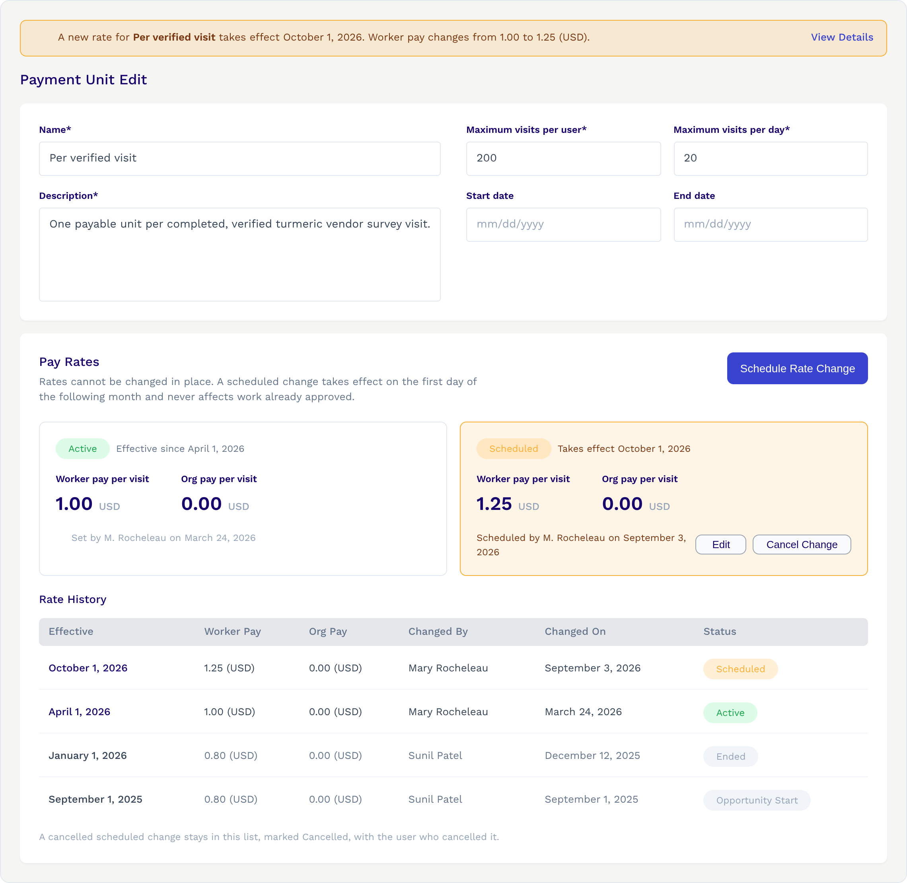
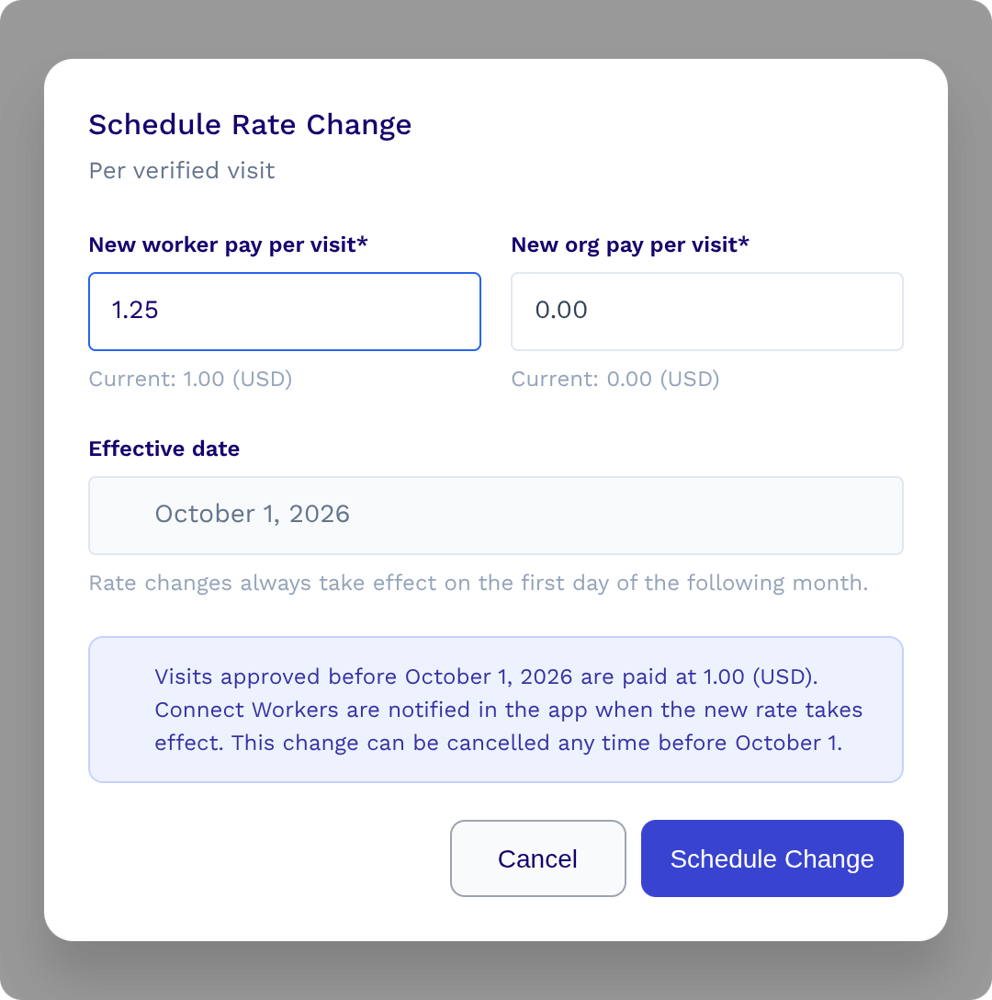
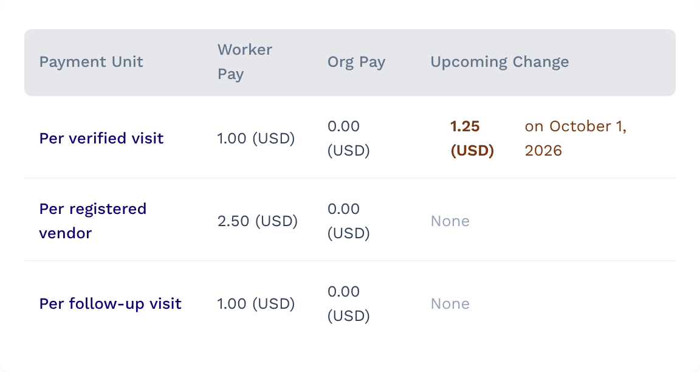

# Tech Spec: Scheduled Pay Rate Changes

- **Jira:** [CCCT-2884](http://dimagi.atlassian.net/browse/CCCT-2884) (epic [CCCT-2883](https://dimagi.atlassian.net/browse/CCCT-2883))
- **PRD:** "[PRD: Scheduled Pay Rate Changes](https://docs.google.com/document/d/16RgaTroDZc36ZnoAnqMhkt7uL41aj-VUq_pz50GVxeU/edit?tab=t.0#heading=h.edm5cm24b01s)"
- **Design:** [Claude design "Scheduled Pay Rate Changes](https://claude.ai/design/p/af178df3-1314-4e21-90b3-e1436099b7df?file=Scheduled+Pay+Rate+Changes.dc.html&via=share)"
- **Status:** Draft

## 1. Summary

Program Managers (PMs) can change a payment unit's pay rate (worker pay and/or org pay). This works for all active
opportunities, including ones already running. A change is **scheduled** and takes effect on the **1st of the next
month**. Until then it can be edited or cancelled. For a payment unit with no visits yet, the change takes effect
immediately.

A pay rate change only affects work **approved on or after** the date it takes effect. Work approved before that keeps
its old pay rate.

**Terms**

- **Visit:** one submitted form.
- **Delivery:** one completed set of a payment unit's required forms (deliver units). Pay and visit limits count
  deliveries. For a payment unit with one form, 1 delivery = 1 visit. This matches the UI ("Total Deliveries",
  "Worker pay per delivery"). Once approved, it is stored as a `Delivery` that links its visits (section
  [7](#7-recording-pay-per-delivery-the-key-change)).
- **Cost per delivery:** worker pay + org pay.

Worker-facing text and the "visit limit" name keep saying visits, since that is what the product calls them.

## 2. Goals

- PMs can schedule, edit and cancel a pay rate change on any payment unit.
- PMs can see the active pay rate, any upcoming change, and the full history (what changed, when, by whom).
- Workers are notified when their pay changes, and Network Managers (NMs) see a banner from 2 days before any change
  (section [10.1](#101-notifications)).
- Each invoice line shows a pay rate that really applied.
- A pay rate change never changes pay for work that is already approved.
- A pay rate increase never takes the opportunity over its budget.

## 3. Out of scope

- Fixing past invoices that went out at a wrong pay rate.
- Changing the opportunity's total budget automatically.
- Custom effective dates: the PM doesn't choose the date.
- Different pay rates for different workers in the same period.

## 4. The problem today

Today a PM can change the pay rate on the payment unit edit page, but the change can be **retroactive**: approved
work, including work done before the change, is repriced at the new pay rate.

Pay is not calculated once and kept. Each completed-work record stores its earned amount, but that amount is
**recalculated from scratch** as:

```
approved deliveries × current pay rate
```

So a change becomes retroactive in these situations:

- when a PM agrees or disagrees visits (all of that worker's records are recalculated, not just the agreed one)
- after visit and review imports
- every night, for every worker in every active auto-approve opportunity
- when an approved record receives another visit
- when an invoice is created: it reads the current pay rate. The automatic invoice runs on the **2nd** of each month
  and bills the previous month.

A worker whose records aren't recalculated keeps the old amount until they are, so workers in the same opportunity can
show earned pay at different pay rates for a while.

We want a new pay rate to apply only to deliveries approved from the 1st of the next month. Pay already earned, and
invoices for past months, should keep the pay rate that applied at the time.

## 5. Solution overview

### 5.1 Structure

- **Part 1: Foundation** (sections 6–8): reliable pay rate history, earned pay that never reprices past work, and
  invoices that bill it.
- **Part 2: Scheduling and applying pay rate changes** (sections 9–12): builds on Part 1 so PMs can schedule changes,
  with budgets, visit limits and notifications kept in step.

### 5.2 Key changes

1. **Pay rate history is the single source of truth.** A new table keeps one row per pay rate, with the date it
   takes effect. The pay rate on any day is the latest row that had taken effect by that day.
2. **Store each delivery and record its pay once.** A `Delivery` links the visits paid as one delivery, and a
   `PayRecord` stores its pay at the pay rate active on the day it was approved. Recorded pay is never edited or
   deleted: pay taken back (due to work rejection) is a reversal record.
3. **Invoices bill pay records**, so they always match earned pay, show the pay rate each delivery earned, and each
   billed delivery can be traced to its visits.
4. **Remove `amount` and `org_amount` from `PaymentUnit`** once everything reads from the pay rate history.

### 5.3 Product decisions

- **Budget check up front, for increases only.** When scheduling an increase, the budget must cover all remaining
  work at the new cost per delivery; otherwise the change is blocked until the PM adds budget. A decrease is
  never blocked on budget (section [11.2](#112-budget-check-when-scheduling)).
- **A pay rate change never changes visit limits,** for an increase or a decrease. PMs can still change them with
  Add Budget. New workers who join after a change is scheduled are priced at the higher cost (section
  [11.3](#113-visit-limits)).
- **Brand-new payment units.** If a payment unit has no visits, a pay rate change takes effect immediately
  (section [9.1](#91-payment-units-with-no-visits)).
- **Existing opportunities.** The feature applies to all active opportunities, including ones already running.

## Part 1: Foundation

Pay rate history, deliveries and pay records, and invoices (tickets 1–4, releases 1 and 2). Until a pay rate changes, pay and
invoices give the same results as today.

## 6. Data model

Model and lookup (6.1–6.2), the first pay rate (6.3–6.4), date rules (6.5), and retiring the old fields (6.6–6.7).

### 6.1 New model: `PaymentUnitRate`

```python
@pghistory.track(pghistory.UpdateEvent(), fields=["flw_amount", "org_amount"])
class PaymentUnitRate(BaseModel):
    payment_unit = models.ForeignKey(PaymentUnit, on_delete=models.PROTECT, related_name="pay_rates")
    flw_amount = models.PositiveIntegerField()  # worker pay
    org_amount = models.PositiveIntegerField(default=0)  # org pay
    planned_for = models.DateField()  # the 1st of a month; first pay rate: section 6.3
    cancelled_by = models.CharField(max_length=255, blank=True)  # user's email
    cancelled_on = models.DateTimeField(null=True, blank=True)
    workers_notified_on = models.DateTimeField(null=True, blank=True)  # set by the notification job (section 10)

    class Meta:
        constraints = [
            # At most one live (not cancelled) pay rate per payment unit per date
            models.UniqueConstraint(
                fields=["payment_unit", "planned_for"],
                condition=Q(cancelled_on__isnull=True),
                name="unique_live_pay_rate_per_date",
            ),
        ]
```

- **Who and when:** `BaseModel` gives `created_by` (who scheduled it), `modified_by` (who edited it last),
  `date_created` and `date_modified`.
- **Edits:** each change to the amounts of an existing row (editing a scheduled change, or a change in place,
  section [9.1](#91-payment-units-with-no-visits)) is saved as an event with the old and new amounts, who made it, and when.
- **`workers_notified_on`** is set once workers are told about the change (section
  [10](#10-when-a-change-takes-effect)). Rows that aren't a change (the Initial Rate and backfilled rows) get it when
  they are created, so the notification job skips them.

A pay rate's **status** is worked out, not stored:

| Status    | Rule                                                            |
| --------- | --------------------------------------------------------------- |
| Scheduled | not cancelled, and `planned_for` is after today                 |
| Active    | the latest not cancelled pay rate with `planned_for` up to today |
| Ended     | an older pay rate that took effect, when a newer one is active  |
| Cancelled | `cancelled_on` is set                                           |

**Active Pay Rate:** the pay rate workers are paid at today (the Active status above; section
[6.2](#62-looking-up-a-pay-rate)).

**Initial Rate:** a payment unit's first pay rate (its earliest non-cancelled row).

### 6.2 Looking up a pay rate

```python
class PaymentUnit(models.Model):
    def pay_rate_on(self, day):
        return self.pay_rates.filter(cancelled_on__isnull=True, planned_for__lte=day).order_by("-planned_for").first()

    @property
    def current_pay_rate(self):
        return self.pay_rate_on(date.today())
```

### 6.3 First pay rate of a payment unit

Every payment unit gets an Initial Rate row when it is created, from its pay. `planned_for` is the day it is created,
and never changes.

The pay rate and the unit's dates are kept separate:

- **Pay rate:** what a delivery pays.
- **Unit and opportunity dates:** when work can be paid. Visits before the start date are trial and never paid
  (section [6.5](#65-changing-payment-unit-and-opportunity-dates)).

### 6.4 Data migration for existing payment units

The **pay rate backfill** creates one row for **every** existing payment unit, in all opportunities (active, ended
and not started yet), from its current `amount` and `org_amount`. `planned_for` is:

- the opportunity's start date, if it has passed. Payment units have no created date, and no approval comes before
  the opportunity starts.
- otherwise, today, so the unit has an Active Pay Rate straight away (section [6.3](#63-first-pay-rate-of-a-payment-unit)).

### 6.5 Changing payment unit and opportunity dates

Visits before a unit's start date are marked trial and never paid. Once a visit may be paid, moving the start date
later would leave it before the start. Today a PM can edit start dates at any time, which could break this.

**Payment unit start date.** A PM can change it only if:

- the unit has **no visit that may be paid** (any visit that isn't trial), and
- the new date is **after today**, or **today** if the unit has no visits at all.

Otherwise the form shows an error: the unit already has visits, or the date is in the past.

**Opportunity start date.** A PM can change it only if:

- it **hasn't passed** yet. On the start day itself, it is locked once the opportunity has a visit that isn't trial.
- the new date is today only if the opportunity has no visits at all.

**Dates within the opportunity.**

- **Payment unit form:** a new or changed start or end date must fall between the opportunity's start and end dates.
  Dates that haven't changed aren't checked, so existing units outside the range can still be edited.
- **Opportunity form:** a changed start date can't be after any unit's start or end date. A changed end date can't
  be before any unit's start or end date.

**Why these rules**

- **Locked once a visit may be paid:** a non-trial visit could already be approved, so moving the start later would
  leave paid work before it. Trial visits are never paid, so they don't lock it.
- **Today, only with no visits:** visits processed earlier today are already marked trial. Moving the start date to
  today would put them inside the active period while they stay trial, which is misleading.
- **Never a past date:** the unit didn't really start then.

**Example.** Today is November 5. The unit starts on November 10.

| Change                                                  | Allowed?          | Why                                                                     |
| ------------------------------------------------------- | ----------------- | ----------------------------------------------------------------------- |
| Move to November 20                                     | Yes               | Not started yet, so any visits are trial.                               |
| Move to November 6                                      | Yes               | Not started yet, and the new date is after today.                       |
| Move to November 5 (today)                              | Only if no visits | Visits processed earlier today would be trial inside the active period. |
| Move to November 3                                      | No                | The new date is in the past.                                            |
| On November 12, with non-trial visits, move to Nov 20   | No                | Visits from November 10–12 may be paid, and would fall before it.       |
| On November 12, only trial visits, move to November 20  | Yes               | Its visits came before November 10, so none can be paid.                |

### 6.6 Removing `amount` and `org_amount` from `PaymentUnit`

1. **This feature:** every reader of `amount` / `org_amount` (pay, invoices, budgets and claim limits, payment unit
   form and table, add-budget forms, mobile API, exports) reads the pay rate history instead. The old fields are still
   written for a while:
   - **Until PMs can schedule changes:** editing pay on the form updates the active pay rate row and the old fields,
     so the Foundation release (section [14.1](#141-releases)) can be rolled back.
   - **After that:** they are only filled when a payment unit is created, because they are required columns.
2. **Follow-up:** drop the two fields with a migration.

### 6.7 Protecting pay rate history

Pay records (section [7.1](#71-models)) and invoices depend on pay rate rows, so they are never deleted in normal use: no delete in the app, and
`on_delete=PROTECT` on `payment_unit`.

**Exception:** `delete_opportunity` (stale and test opportunities) and the dev-only `generate_sample_data` delete
`PaymentUnitRate` rows just before `PaymentUnit`.

## 7. Recording pay per delivery (the key change)

Today, every recalculation prices all of a work's approved deliveries at the current pay rate:

```python
saved_payment_accrued = approved_count * payment_unit.amount
```

**New rule:** each approved delivery is stored once, and gets one pay record at the pay rate in force on the day it
was approved. Recorded pay is never edited or deleted. If pay is taken back, a reversal record is added.

This follows product's "Payment tracking and invoicing" goal, to trace each payment back to its visits:

- a `Delivery` tracks which visits count as one delivery
- a `PayRecord` links a delivery to the pay rate active when it was approved
- invoices bill pay records instead of today's calculation
- the exchange rate is the one on the approval date

### 7.1 Models

```python
class Delivery(BaseModel):  # the visits paid as one delivery
    completed_work = models.ForeignKey(CompletedWork, on_delete=models.PROTECT, related_name="deliveries")


class UserVisit(XFormBaseModel):
    delivery = models.ForeignKey(Delivery, null=True, blank=True, on_delete=models.PROTECT, related_name="visits")


class PayRecord(BaseModel):
    completed_work = models.ForeignKey(CompletedWork, on_delete=models.PROTECT, related_name="pay_records")
    # empty only for backfilled earnings from an old invoice row that today's visits can't make up
    delivery = models.ForeignKey(Delivery, null=True, on_delete=models.PROTECT, related_name="pay_records")
    reverses = models.OneToOneField(  # set only on a reversal; a record is reversed at most once
        "self", null=True, on_delete=models.PROTECT, related_name="reversal"
    )
    pay_rate = models.ForeignKey(PaymentUnitRate, null=True, on_delete=models.PROTECT)
    flw_amount = models.IntegerField()  # worker pay for one delivery, local currency; negative on a reversal
    org_amount = models.IntegerField()  # org pay, the same way
    exchange_rate = models.DecimalField(max_digits=20, decimal_places=6)  # USD = local ÷ this
    # sets the pay rate and invoice month; empty for a backfilled delivery whose date isn't known
    approved_on = models.DateTimeField(null=True)
    # why it was reversed; kept here because CompletedWork.reason is overwritten on its next status change
    reversal_reason = models.TextField(blank=True)
    invoice_row = models.ForeignKey(  # the only field that changes: set by billing, cleared by cancelling
        CompletedWorkInvoice, null=True, on_delete=models.SET_NULL, related_name="pay_records"
    )

    class Meta:
        constraints = [
            CheckConstraint(  # earnings are positive, reversals negative
                condition=Q(reverses__isnull=True, flw_amount__gte=0, org_amount__gte=0)
                | Q(reverses__isnull=False, flw_amount__lte=0, org_amount__lte=0),
                name="pay_record_sign",
            ),
        ]
```

**Kinds of pay record**

- **Earning:** pay for one delivery, at one pay rate.
- **Reversal:** a negative copy of an earning, with `reverses` set.
- **Live earning:** an earning that hasn't been reversed.

**Why the models look like this**

- **`Delivery` only groups visits.** Visits point to it, and the worker and payment unit come through
  `completed_work`. The approval date, pay rate and paid status live on its pay records, because a delivery can be
  reversed and approved again.
- **`pay_rate` can be empty.** Backfilled records only know their amounts. They are linked to the unit's pay rate
  when their amount per delivery matches it, and left empty when pay was edited after they were invoiced (section
  [7.3](#73-pay-record-backfill)).
- **No USD amounts on records.** They come from the exchange rate.

**Totals on `CompletedWork`**

- `saved_payment_accrued` and its org and USD versions become a cache of the sum of the work's pay records.
- `saved_approved_count` is the number of the work's deliveries with a live earning. It is kept up to date until
  ticket 12, so the `PAY_RECORDS` switch (section [7.3](#73-pay-record-backfill)) can be turned back off.
- The `payment_accrued` property, which multiplies by the current pay rate, reads the stored amount instead.

### 7.2 Updating pay

Every time a work is recalculated, `update_status` calls `sync_pay` for it, after setting its new status:

```python
def sync_pay(work):  # under the CompletedWork row lock
    if work.status != CompletedWorkStatus.approved:
        for earning in work.pay_records.live_earnings():
            reverse(earning)  # section 7.4
    else:
        # work approved again after a rejection: its reversed deliveries earn again
        for delivery in work.deliveries.without_live_earning():
            earn(delivery, approved_on=work.status_modified_date)
        for visits in match_new_deliveries(work):
            delivery = Delivery.objects.create(completed_work=work)
            UserVisit.objects.filter(pk__in=[v.pk for v in visits]).update(delivery=delivery)
            earn(delivery, approved_on=max(v.review_status_modified_date for v in visits))
    set_totals(work)  # saved by the updater's bulk_update at the end, as today


def earn(delivery, approved_on):
    pay_rate = delivery.completed_work.payment_unit.pay_rate_on(approved_on)
    PayRecord.objects.create(
        delivery=delivery, completed_work=delivery.completed_work, pay_rate=pay_rate,
        flw_amount=pay_rate.flw_amount, org_amount=pay_rate.org_amount,
        exchange_rate=get_exchange_rate(currency, approved_on), approved_on=approved_on,
    )
```

In short:

- **Work no longer approved:** each live earning is reversed (section [7.4](#74-rejecting-approved-work)).
- **Work approved:** deliveries whose earning was reversed earn again ("Approved again" below). Then new approved
  visits are grouped into deliveries, and each new delivery earns once.
- The work's cached totals are updated either way.

**Matching visits to deliveries** (`match_new_deliveries`)

1. Load the work's approved and agreed visits that have no delivery, by deliver unit, earliest agreed first
   (`review_status_modified_date`). Old visits with no agree date come first. `visit_date`, then `id`, break ties,
   since a bulk agree stamps many visits at once.
2. While every required deliver unit has such a visit, and, if the payment unit has optional deliver units, at least
   one optional visit is left, take the first from each required unit, plus the first optional visit. Together they
   form one delivery.
3. **Child payment units:** a parent gets no more deliveries than its children's approved count allows. Once the cap
   is reached, matching stops; the parent's remaining visits stay unlinked until the cap allows another delivery.

Visits that can't make a full delivery stay unlinked, and can join a later one.

**Example.** A payment unit has two required deliver units, Registration and Follow-up, and two optional ones,
Option 1 and Option 2. A work's agreed visits: R1 (Sep 3), F1 (Sep 5), O1 (Sep 6), R2 (Sep 10), O2 (Sep 12).

- **Delivery 1:** R1 + F1 + O1, approved Sep 6.
- **R2 and O2** have no Follow-up to pair with, so they stay unlinked.
- **F2 is agreed on Oct 2:** the next run makes Delivery 2 from R2 + F2 + O2, approved Oct 2.

> **Note:** 34 payment units have ever used child payment units, and none are in active opportunities (production
> data from the design doc).

**Approval date**

A delivery is approved when its last visit is approved and agreed. All opportunities are managed, so that is when the
PM agrees its last visit: the latest `review_status_modified_date` among its visits.

- **Not the time the updater ran.** A visit agreed at 23:50 on September 30 but processed at 00:30 on October 1 gets
  September's pay rate and invoice month.
- **Why agree order.** Matching in agree order gives each delivery the earliest approval date its visits allow, and
  links old visits in about the order they were billed (section [7.3](#73-pay-record-backfill)). Agree order never
  changes once set, since agreed visits are final.
- **Backfilled deliveries** are dated differently (section [7.3](#73-pay-record-backfill)).

**Approved again**

If a work is rejected (section [7.4](#74-rejecting-approved-work)) and later approved again, each delivery whose
earning was reversed earns again on the same `Delivery`, at the pay rate on the work's new approval date. Its visits
don't move.

**Effects**

- Agreeing visits, imports and the nightly job only add pay for new deliveries. Recorded pay is never repriced.
- Worker totals, reports and exports already read the stored amounts, so they don't change.
- `saved_approved_count` no longer decides new pay. The visit links do.

### 7.3 Pay record backfill

#### 7.3.1 Backfill approach

Old pay is rebuilt from existing invoice rows and the current pay rate. Old approval dates aren't needed to get the
amounts right: today's code prices deliveries at one pay rate each time it invoices them. Old pay isn't rebuilt from
visits alone, because invoice rows are the only record of what was actually billed and for how much, including pay
edited after invoicing.

The backfill runs four steps:

1. **Turn invoice rows into earnings.** Each existing invoice row becomes one earning per billed delivery, linked to
   the row:
   - **Amounts:** the row's amounts ÷ `billed_count`.
   - **Exchange rate:** the row's.
   - **`pay_rate`:** the unit's pay rate if the amounts match it, and empty otherwise (pay was edited after that
     invoice).
   - **On a rerun,** a new invoice row is linked to the work's existing unbilled earnings first, and earnings are only
     created for deliveries that don't have one. Otherwise an invoice created while the switch was off would bill
     those deliveries again.
2. **Link visits to deliveries.** For each work with approved, agreed visits, invoiced or not, group the visits into
   deliveries with the same matching as section [7.2](#72-updating-pay). Works with more than one delivery are
   grouped the same way.
   - The first N deliveries take the work's N earnings from step 1.
   - On approved work, the rest get new earnings at the current pay rate (what today's invoicing would bill).
   - If fewer deliveries match than were billed, the extra earnings stay without a delivery.

   Every approved, agreed visit must be linked: the updater treats any such visit with no delivery as unpaid, and it
   runs on every recalculation of approved work, including the nightly job.
3. **Reverse pay on old work rejected after it was invoiced.** Before this release, a work could be invoiced and then
   rejected (section [7.4](#74-rejecting-approved-work) blocks this from now on). Today such a work shows no pay,
   since only approved work earns. But its invoice row is still there, and step 1 turns that row into earnings,
   which would suddenly give the worker pay for rejected work. So each of those earnings gets a matching reversal,
   and the work's total goes back to 0, as today.

   The invoice itself isn't touched: it keeps the amount it billed, and no credit is added to a later invoice. That
   is also how it works today; credit lines are future work (section [15](#15-future-improvements)).

   For example, a work had 2 deliveries billed at 4 on the September invoice, and was rejected in October. Step 1
   gives it two earnings of +4, and step 3 adds two reversals of −4. The worker's total stays 0, and the September
   invoice stays at 8.
4. **Set the cached totals.**

**Approval dates of backfilled earnings**

- **A work's first delivery** gets the work's `status_modified_date` as its `approved_on`. That is when today's code
  counted the pay as earned, and the date today's invoicing bills by.
- **Later deliveries on the same work (duplicates)** get no `approved_on`. Additional deliveries don't update the
  work's date, so theirs isn't known. They are billed as additional deliveries are today (section
  [8](#8-invoices)).

So invoicing doesn't change. The agree-date rule in section [7.2](#72-updating-pay) only applies to new deliveries.

#### 7.3.2 Switch for deployment

The new code can't run before the backfill has run: on work with no pay records yet, it could pay a delivery twice
(example below). Running the backfill in a data migration would avoid that, but it is too slow for a deploy. So a
`PAY_RECORDS` waffle switch decides which code runs:

- **Off**, as deployed: pay and invoices work exactly as today. Totals are count × pay rate, invoices bill by
  `invoiced_approved_count`, and no deliveries or pay records are created.
- **On:** pay is recorded per delivery (section [7.2](#72-updating-pay)), and invoices bill pay records (section
  [8](#8-invoices)).

**Rollout**

1. Deploy with the switch off. Nothing changes for users.
2. Run the backfill. It builds the deliveries and pay records, then turns the switch on.
3. It runs once more, to catch what happened while it was running: work approved in the meantime gets its earnings,
   and any invoice created in the meantime gets earnings linked to its rows.

Today's code and the switch are removed in ticket 12.

**What goes wrong without it.** Delivery A was billed on the September invoice. The new code is deployed, and before
the backfill runs, the worker submits a new visit on the same work. The new code recalculates the work, finds A's
visit with no delivery, treats it as unpaid, and gives A a new, unbilled earning. Then the backfill adds A's earning
from the September invoice row. A now has two earnings, and the next invoice bills it again. The row lock doesn't
help: the two happen one after the other, not at the same time.

**Turning it back off** is for emergencies only. Today's code takes over, since both counts are kept up to date, but
it reprices pay at the current pay rate. Rerun the backfill before turning the switch on again.

> **Note:** the backfill is a re-runnable management command, not a migration. It runs under the same row lock as the
> updater, and skips what it has already handled, so it is safe to run again.

### 7.4 Rejecting approved work

Agreed visits can't be rejected today: the NM's reject, the visit status import and the review status import all
skip them. But a work can still stop being approved in two ways, and its pay goes with it:

- **A new visit** from a suspended worker, or one with a blocking pending task: form processing rejects the visit and
  the whole work.
- **Any visit on the work is rejected,** such as a duplicate (`_update_status`, when `auto_approve_payments` is on).

The completed work status import, which sets a work's status directly, isn't available in the UI and will be removed
(ticket 11).

**Rules**

- **Paid or invoiced work can't stop being approved.** Paid means its `payment_date` is set. Invoiced means one of its
  live earnings has an invoice row.
  - Rejecting one of its visits is refused: the NM sees an error, and the visit status import lists it as locked.
  - Form processing rejects the new visit but leaves the work approved.
- **Other work loses its pay through reversals.** Each live earning gets a reversal: a negative copy with the same pay
  rate and exchange rate, plus a reason. The work's deliveries and visit links stay, and its totals drop to 0. None
  of this pay was billed or paid, so invoices don't change.
- **Approved again:** see section [7.2](#72-updating-pay).

**Open question (product):** do these rules hold? Rejecting a work takes back pay for every delivery on it, so for
example a rejected duplicate cancels the original's pay; and paid or invoiced work stays blocked until invoices can
show credits. The rules above keep today's behaviour until product answers.

## 8. Invoices

Invoices bill **live earnings** (section [7.1](#71-models)) that aren't on an invoice yet, instead of multiplying by
the current pay rate. So they always match recorded pay and never look up a pay rate. Invoices already created keep
their amounts; the backfill only links their rows to earnings.

**What gets billed**

The same rules as today, so the current invoicing approach doesn't change:

- live earnings with no invoice row, approved within the invoice's dates
- plus earlier ones on work already invoiced (additional deliveries)
- each under the month of its `approved_on`

Backfilled earnings with no `approved_on` (section [7.3](#73-pay-record-backfill)):

- **A duplicate delivery** (not the work's first) is billed as additional deliveries are today: with its work's
  first billing, or on the next invoice if the work is already invoiced, under the invoice's month. This keeps
  today's invoicing for old pay. New duplicate deliveries have an approval date, so they are billed under the month
  they were approved.
- **A work's first delivery** is never billed, as today: a work with no `status_modified_date` never falls within an
  invoice's dates.

**Reversals aren't billed.** Section [7.4](#74-rejecting-approved-work)'s block means only unbilled earnings are
reversed, and an earning with a reversal is never billed. Old work's backfilled reversals (section
[7.3](#73-pay-record-backfill)) aren't credited, as today. Credit lines are future work (section
[15](#15-future-improvements)).

**Invoice rows**

- **One invoice row (`CompletedWorkInvoice`) per invoice, work, month and pay rate:** as today, but split by month and
  pay rate.
- Each earning points to its row (`PayRecord.invoice_row`). The row's `billed_count` and amounts are the sum of its
  earnings.
- `unique_together = ("invoice", "completed_work")` is dropped (ticket 4). Line items don't change.
- **Cancelling an invoice** deletes its rows, which clears `invoice_row` on their earnings, so they are unbilled again.
- **`invoiced_approved_count` is still kept up to date** in both modes, until ticket 12 drops it: billing sets it to
  the work's billed earnings, and cancelling rolls it back. This keeps the switch able to go back off.

**Behind the `PAY_RECORDS` switch** (section [7.3](#73-pay-record-backfill)): billing an invoice, the billable preview
and its export, and cancelling an invoice. Showing and exporting existing invoices reads their rows, so it works the
same either way.

**What the invoice shows**

- **Lines** are grouped by month, payment unit and pay rate: "N verified visits x `<currency>` `<rate>`". A month with
  two pay rates has two lines. Additional deliveries are part of these lines, under the month they were approved; the
  existing "Additional Deliveries" count on the invoice form stays.
- **Export:** one row per invoice row, as today, plus a pay rate column (and an org pay rate column when org pay is
  shown), worked out as amount ÷ `billed_count`.

**Example.** Worker pay goes from 4 to 5 on October 1. One worker's earnings:

| Earning        | Approved on | Worker pay |
| -------------- | ----------- | ---------- |
| Delivery A     | Sep 12      | 4          |
| Delivery B     | Sep 30      | 4          |
| Duplicate of A | Oct 1       | 5          |
| Delivery C     | Oct 8       | 5          |

- **October 2 invoice (September):** A and B, as one line: "2 verified visits x USD 4". The duplicate was approved
  after the end date, so it waits for the next invoice.
- **November 2 invoice (October):** the duplicate of A and C, as one line under October: "2 verified visits x USD
  5". The duplicate is billed at the pay rate it was approved at, as part of the normal line.

## Part 2: Scheduling and applying pay rate changes

What PMs, NMs and workers see, the budget check, and notifications (tickets 5–9, release 3). Depends on the
changes in Part 1.

## 9. Scheduling a change

**Who:** PM users with admin access to the opportunity, the same users who can edit payment units today. No new
permissions.

**When it takes effect:** the 1st of next month; the PM does not choose the date. One exception changes the pay rate in
place instead: the unit has no visits, so the change takes effect immediately (section [9.1](#91-payment-units-with-no-visits)).

**Scheduling, editing and cancelling**

| Action   | Allowed                             | Refused                                                                     |
| -------- | ----------------------------------- | --------------------------------------------------------------------------- |
| Schedule | no change is scheduled yet          | a change is already scheduled (section [12.1](#121-payment-unit-edit-page)) |
| Edit     | a scheduled change, before its date | once its date has come, or it is cancelled                                  |
| Cancel   | a scheduled change, before its date | once its date has come, and always for the Initial Rate                     |

- Editing updates the same row; each edit is kept as an event (section [6.1](#61-new-model-paymentunitrate)).
- Cancelling sets `cancelled_by` and `cancelled_on`; the row stays in the history as "Cancelled".

**When a change is blocked** (checked on schedule and on edit)

- The new pay rate must differ from the active one in worker pay or org pay.
- **The opportunity ends before the effective date.**
- **An increase the budget can't cover** for the remaining work at the new cost (section
  [11.2](#112-budget-check-when-scheduling)). The message shows how much budget is missing and links to Add Budget
  (section [12.2](#122-schedule-rate-change-modal)). On edit, the check uses the edited amounts in place of the
  change's current ones.

**Locking:** scheduling, editing and cancelling lock the opportunity row. Workers joining and Add Budget take the same
lock, so the budget check always sees their limits.

### 9.1 Payment units with no visits

If a payment unit has **no visits** (Trial and Over Limit visits don't count), a change takes effect **immediately**.
Nobody has earned anything at the old pay rate, so it **edits the active pay rate in place**, usually the Initial
Rate. `planned_for` doesn't change. The old amounts are kept as an event (section
[6.1](#61-new-model-paymentunitrate)).

This includes units that haven't started yet, since all their visits are trial. Workers aren't notified before the
unit starts.

- **Modal:** the effective date shows today. Before saving, the PM confirms that the change takes effect immediately
  and can't be cancelled, and that workers are notified now (if worker pay changes).
- **Budget:** the same check as scheduling (section [11.2](#112-budget-check-when-scheduling)). Visit limits don't
  change.
- **On save:** if worker pay changed, workers are notified. No NM banner.

**Avoiding race conditions:** lock first, then check again that the unit still hasn't started or still has no visits.

```python
@transaction.atomic
def change_pay_rate_in_place(payment_unit, flw_amount, org_amount, user):
    # Lock first, then check, so nothing can slip in between:
    # - workers joining and Add Budget lock the opportunity; the budget check must see their limits
    # - form processing locks the claim limit rows before saving a visit; without this a visit could
    #   arrive and be auto-approved at the old pay rate, after the PM was told the change is immediate
    opportunity = Opportunity.objects.select_for_update().get(pk=payment_unit.opportunity_id)
    list(OpportunityClaimLimit.objects.select_for_update().filter(payment_unit=payment_unit))
    started = not not_started(payment_unit)
    if started and has_visits(payment_unit):
        raise ValidationError("This payment unit now has visits. Schedule the change for the 1st instead.")
    check_budget(opportunity, payment_unit, flw_amount, org_amount)  # section 11.2; increases only
    pay_rate = payment_unit.pay_rates.select_for_update().filter(cancelled_on__isnull=True).latest("planned_for")
    worker_pay_changed = pay_rate.flw_amount != flw_amount
    pay_rate.flw_amount = flw_amount
    pay_rate.org_amount = org_amount
    pay_rate.modified_by = user.email
    pay_rate.save(update_fields=["flw_amount", "org_amount", "modified_by", "date_modified"])
    if started and worker_pay_changed:  # no notification before the unit starts
        # planned_for stays the original date, so the message shows today
        transaction.on_commit(partial(send_pay_rate_change_notification.delay, pay_rate.pk, date.today()))
    return pay_rate
```

## 10. When a change takes effect

Nothing has to be applied on the 1st. The pay rate is looked up by date (section [6.2](#62-looking-up-a-pay-rate)),
and the budget was already checked when the change was scheduled (section [11.2](#112-budget-check-when-scheduling)).
Visit limits don't change.

The only work left on the 1st is telling workers. A Celery beat task, **the notification job**, runs daily. For each
change that has taken effect and whose workers haven't been notified yet, it notifies workers if worker pay changed
(section [10.1](#101-notifications)) and sets `workers_notified_on`, so it never sends twice. It skips changes on
opportunities that have ended or are inactive, like other jobs that only act on running opportunities.

If a run fails or is missed, the next day's run sends the message. It is late, but no pay is wrong: the pay rate
applies by date.

### 10.1 Notifications

| What changed                     | Workers (app notification) | NMs (Connect Web banner) |
| -------------------------------- | -------------------------- | ------------------------ |
| Worker pay (with or without org) | Yes                        | Yes                      |
| Org pay only                     | No                         | Yes                      |

**Worker notification:** a push notification through the existing messaging service, sent to all workers with
access to the opportunity. It says the new pay applies to work approved from the effective date, since work is paid
at the pay rate on its approval date. Example: "From `<Effective date>`, work approved earns `<New worker pay>`
`<Currency>` per `<Payment unit name>`."

**NM banner:** see section [12.4](#124-banners).

## 11. Budget and visit limits

### 11.1 How it works today

- Each payment unit has a **max visits per worker** (`max_total`).
- Each worker gets their own **visit limit** when they join: the payment unit's max. A worker can only join if the
  remaining budget covers their full share, otherwise they are refused.
- PMs can raise or lower an individual worker's limit later, so workers on the same payment unit can have different
  limits.
- **Claimed budget** = every worker's visit limit × (worker pay + org pay).
- **Remaining budget** = total budget − claimed budget.

### 11.2 Budget check when scheduling

An increase can only be scheduled if the budget can pay for all the work still to come at the **new** cost per
delivery:

```
required budget = used budget
                + Σ over workers of max(0, visit limit − deliveries approved) × cost per delivery
```

- **Used budget:** worker pay + org pay already earned, at the pay rates that applied (pay records, section
  [7](#7-recording-pay-per-delivery-the-key-change)).
- **Cost per delivery:** the new cost for the unit being changed; other units use their budget cost per delivery
  (section [11.4](#114-claimed-budget)).
- **If the required budget is more than the total budget,** the change is blocked until the PM adds budget. The
  modal shows the missing amount and links to Add Budget (section [12.2](#122-schedule-rate-change-modal)).

**Why the new cost for all remaining work.** Until the 1st, deliveries are approved at the current (lower) pay rate;
after it, at the new one. Pricing all remaining work at the new cost covers either case, without knowing when each
delivery will be approved. Nothing needs checking again on the 1st.

**Only an increase is checked**, meaning the total cost per delivery (worker pay + org pay) goes up. A decrease
lowers future spending, so it is never blocked, even if the opportunity is already over budget for other reasons
(for example, an NM approving visits over a worker's limit).

**Example.** Worker pay goes from 4 to 5 (no org pay). Total budget is 1,500.

| Worker | Visit limit | Approved | Visits left | Used (at 4)   | Remaining work (at 5) |
| ------ | ----------- | -------- | ----------- | ------------- | --------------------- |
| Asha   | 100         | 20       | 80          | 20 × 4 = 80   | 80 × 5 = 400          |
| Ben    | 150         | 10       | 140         | 10 × 4 = 40   | 140 × 5 = 700         |
| Chen   | 100         | 100      | 0           | 100 × 4 = 400 | 0                     |

Required budget = 520 + 1,100 = 1,620, so the change is blocked: 120 is missing. Once the PM adds 120, it can be
scheduled.

### 11.3 Visit limits

- **A pay rate change never changes visit limits.** A change, up or down, leaves every worker's visit limit and the
  payment unit's max visits per worker as they are. PMs can still change them with Add Budget, as today.
- **New workers** who join after a change is scheduled get the payment unit's max visits per worker, as today. They
  can only join if the remaining budget covers it at the higher cost, otherwise they are refused, so the budget is
  never overspent.
- **Add Budget**, including raising an existing worker's limit, works as today, but prices added visits at the higher
  cost while a change is scheduled.
- **Budget may be left over** when work is done at the lower pay rate: deliveries approved before an increase, or
  after a decrease. It shows up as remaining budget, which the PM can give to workers as extra visits with Add Budget.

### 11.4 Claimed budget

Today claimed budget = visit limit × current cost. Once a new pay rate is in effect, that prices deliveries already
approved at the new pay rate, though they were paid at the old one. Claimed budget looks too high or too low, and new
workers can be wrongly blocked or let in. So claimed budget **must** be:

```
worker pay + org pay already earned (at the pay rates that applied)
  +  max(0, visit limit − deliveries approved) × budget cost per delivery
```

- **Budget cost per delivery:** the higher of the current cost and any scheduled cost. Every budget check uses it, so
  they all agree.
- **Why `max(0, …)`:** an NM can still approve over-limit visits (for example, through the visit status import), so
  deliveries approved can go above the visit limit. Without it, the second part would go negative and cancel out pay
  they really earned, making the budget look bigger than it is.

## 12. UI

Screenshots from the Claude design are included below. This section only lists what the screenshots don't show.

### 12.1 Payment unit edit page



- Worker pay and org pay are no longer on the form. They are only shown, read-only, in the Pay Rates card.
- Cancel Change asks for confirmation first.
- **Schedule Rate Change** is **disabled** when a change is already scheduled, with the tooltip: "A change is already
  scheduled for `<Effective date>`. Edit or cancel it instead."
- Rate History: an edited pay rate lists its edits (old → new amounts, who, when).

**Differs from the screenshot**

- The first pay rate is labelled "Initial Rate", not "Opportunity Start": it starts the day the unit is created, not on
  the opportunity's start date (section [6.3](#63-first-pay-rate-of-a-payment-unit)).
- "Rates cannot be changed in place" is only shown once the unit has visits. Until then, a change is made in place
  (section [9.1](#91-payment-units-with-no-visits)).
- The banner at the top is the NM banner (section [12.4](#124-banners)).

### 12.2 Schedule Rate Change modal



- The same modal, pre-filled, is used for **Edit**.
- Setting worker pay or org pay to 0 asks the PM to confirm before saving.
- **Effective date** is shown, not editable: the 1st of next month, or today (section [9.1](#91-payment-units-with-no-visits)).
- **Not enough budget:** an error stops the save. It shows the missing amount and an **Add budget** link that opens
  the Add Budget form for this opportunity, so the PM can fix it without leaving the workflow (section
  [11.2](#112-budget-check-when-scheduling)).

### 12.3 Payment units list



- The Upcoming Change column says what changes, for example "Worker pay 4 → 5 (USD) from October 1, 2026".
  If both worker pay and org pay change, show both lines.
- Only PMs see the org pay line, like the existing "Org pay per delivery" column, which NMs don't see.
- **Differs from the screenshot:** the column shows the old and the new pay, and says which one changes, not just the
  new amount.

### 12.4 Banners

**Upcoming change banner (NMs)**

- Shown on **every Connect Web page**, not just the edit page, to members of the opportunity's organisation, when a
  change takes effect in **2 days or fewer**. Because of that it names the opportunity:

  "`<Opportunity name>`: a new rate for `<Payment unit name>` takes effect `<Effective date>`. Worker pay changes
  from `<Old worker pay>` to `<New worker pay>` (`<Currency>`)."

  For an org pay change, the second sentence says "Org pay changes from … to …". If both change, it shows both.
- If several changes are coming, one line per opportunity and payment unit.
- **Differs from the edit page screenshot:** the banner names the opportunity and is shown on every page, not only on
  the edit page.

## 13. All scenarios

**Scheduling and editing**

| Case                                          | Behaviour                                                                                          |
| --------------------------------------------- | -------------------------------------------------------------------------------------------------- |
| Change scheduled on the last day of the month | Takes effect the next day. The banner is shown till the end of the last day.                       |
| Several PMs edit the scheduled change         | Last edit wins. Each edit is shown in the history.                                                 |
| Cancel, then schedule again in the same month | Allowed. The cancelled row stays in history and a new scheduled row is created.                    |
| Opportunity ends before the effective date    | Scheduling is blocked (section [9](#9-scheduling-a-change)).                                       |
| Budget can't cover an increase                | Scheduling is blocked until budget is added (section [11.2](#112-budget-check-when-scheduling)). |
| Two units' changes in the same opportunity    | The second is checked with the first's higher cost already counted, so both are always funded.     |

**On the 1st**

| Case                                    | Behaviour                                                                                              |
| --------------------------------------- | ------------------------------------------------------------------------------------------------------ |
| End date moved earlier after scheduling | The pay rate still applies by date; workers aren't notified (section [10](#10-when-a-change-takes-effect)). |
| Notification job fails or is missed     | Pay is unaffected: the pay rate applies by date. The next day's run sends the notification late.          |

**Budget and visit limits**

| Case                                | Behaviour                                                                                                    |
| ----------------------------------- | ------------------------------------------------------------------------------------------------------------ |
| New workers join before the 1st     | They get max visits per worker, and can only join if the budget covers it at the higher cost (section [11.3](#113-visit-limits)). |
| Budget added before the 1st         | Added visits are priced at the higher cost (section [11.3](#113-visit-limits)).                             |
| Pay rate decrease                   | No budget check, even if the opportunity is already over budget. Limits stay the same. Budget reserved at the higher cost becomes remaining budget once the change applies. |
| Workers join before the unit starts | Limits are priced at the Initial Rate (section [6.3](#63-first-pay-rate-of-a-payment-unit)).                 |

**Earned pay and invoices**

| Case                                       | Behaviour                                                                               |
| ------------------------------------------ | --------------------------------------------------------------------------------------- |
| Duplicate approved after a pay rate change | Billed under the month it was approved, at its own pay rate (section [8](#8-invoices)). |

**Special payment units**

| Case                                  | Behaviour                                                                                                       |
| ------------------------------------- | --------------------------------------------------------------------------------------------------------------- |
| Payment unit with no visits           | Active pay rate is edited in place, takes effect immediately (section [9.1](#91-payment-units-with-no-visits)). |
| Payment unit with child payment units | Each unit has its own pay rate. Changing a parent does not change its children.                                 |
| Pay rate set to 0                     | Allowed (same as today). The modal asks the PM to confirm.                                                      |
| Pay rate raised from 0                | The same budget check, at the new cost. Limits stay the same.                                                   |

## 14. Implementation tickets (proposed, to be created after approval)

1. Pay rate history model and migration
2. Restrict editing payment unit and opportunity dates
3. Read pay rates from the history
4. Deliveries and pay records, invoices bill them, and rejected work's pay is reversed (CCCT-3016)
5. Pay Rates card and Rate History (read-only)
6. Schedule, edit and cancel, and record edits with pghistory
7. Notification job
8. Upcoming pay rate changes: list column and banner
9. Immediate change for payment units with no visits or not started yet (section [9.1](#91-payment-units-with-no-visits))
10. Block rejecting paid or invoiced work (CCCT-3065, section [7.4](#74-rejecting-approved-work))
11. Remove the completed work export and status import (CCCT-3064, section [7.4](#74-rejecting-approved-work))
12. Drop `amount` and `org_amount` from `PaymentUnit` and `invoiced_approved_count` from `CompletedWork`, and remove
    today's pay and invoice code with the `PAY_RECORDS` switch

### 14.1 Releases

Tickets are reviewed and merged one at a time, then deployed in these releases.

| Release       | Tickets    | Notes                                                                                                                                                                                                                                                                                                                               |
| ------------- | ---------- | ----------------------------------------------------------------------------------------------------------------------------------------------------------------------------------------------------------------------------------------------------------------------------------------------------------------------------------- |
| 1. Foundation | 1, 2, 3    | Nothing new for PMs except the date rules. Pay and invoices give the same results as today. Safe to roll back.                                                                                                                                                                                                                 |
| 2. Earned pay | 4, 10, 11  | Deliveries and pay records, and invoices bill them. Deploy with the `PAY_RECORDS` switch off, then run the pay record backfill (section [7.3](#73-pay-record-backfill)), which turns it on. Editing pay on the form no longer reprices work already approved. Add the `UserVisit.delivery` index with `AddIndexConcurrently` in its own migration, so building it doesn't block form submissions. To roll back, turn the switch off (section [7.3](#73-pay-record-backfill)); the code itself is not safe to roll back. |
| 3. Feature    | 5–9        | Everything PMs see arrives together: Pay Rates card, scheduling, immediate changes for units with no visits, the notification job, the list column and banner.                                                                                                                                                                                    |
| 4. Follow-up  | 12         | Drop the old fields once releases 1 to 3 have been live and stable.                                                                                                                                                                                                                                                                 |

> **Note:** releases 1 and 2 can ship together if needed. The combined release is then not safe to roll back either.

> **Note:** right after deploying release 1, check for any inconsistency (rare): a payment unit created during the
> deploy may have no row in the pay rate table. If so, a developer can run the pay rate backfill (section [6.4](#64-data-migration-for-existing-payment-units)) once again.

## 15. Future improvements

- **Drop copied columns from invoice rows.** `billed_count` and the local amounts are sums of the row's pay records,
  and `is_delta` can be derived. Read them from the records instead.
- **Drop the cached totals from `CompletedWork`.** `saved_payment_accrued`, `saved_org_payment_accrued` and their USD
  versions are sums of the work's pay records. Read them from the records instead, after checking that worker
  totals, reports and exports stay fast.
- **Add the missing budget from the change modal.** Instead of linking to Add Budget, offer to add the missing amount
  in the same step, when the PM agrees to the increase (section [11.2](#112-budget-check-when-scheduling)).
- **Keep approved work approved.** A rejected extra visit, such as a duplicate, could leave its work approved
  instead of rejecting it, so only deliveries whose own visits are rejected lose their pay (section
  [7.4](#74-rejecting-approved-work)). Product is checking whether work-level rejection is needed.
- **Reject paid work with a credit.** Paid or invoiced work can't be rejected (section
  [7.4](#74-rejecting-approved-work)), for example if it turns out to be fraud. Billing its reversal as a credit line
  on the next invoice would allow it.
- **Show each delivery on invoices.** List the approval date and pay rate of each delivery an invoice bills.
- **Group visits by delivery** in the UI, for example in the worker's visit list.
