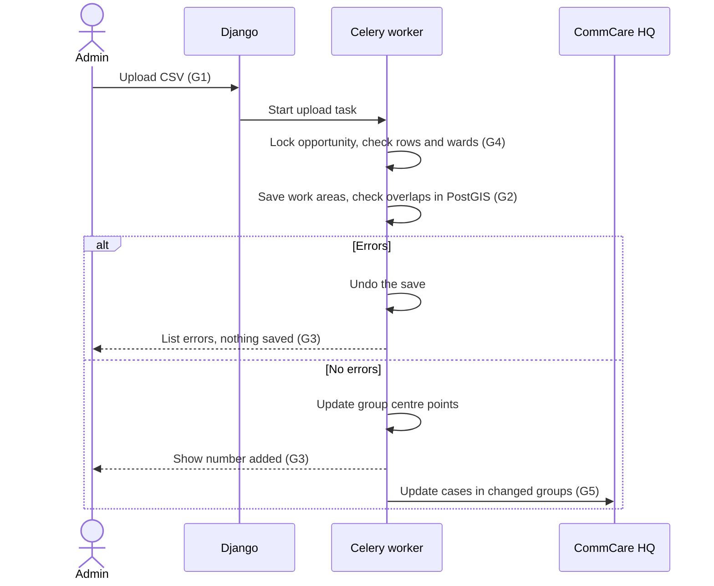

# Add work areas to a running opportunity

## Overview

**Problem.** Once an opportunity has work areas, there's no way to add more. To fix a missed work area you have to
clear all work areas and upload again, and you can't clear them once any are assigned or visited. So after delivery
starts, a missed work area can't be added.

**Current flow.**

1. An admin clicks "Upload Work Areas" on the Progress Map and uploads a CSV, one row per work area.
2. Every row is checked before anything is saved. Any error means nothing is saved, and the errors are listed by row.
3. After a successful upload, the button is gone for good.
4. Work areas are then grouped and assigned to workers. Each assigned work area becomes a case on CommCare HQ, which
   the mobile app reads. The case includes the centre point of the work area's group.

Nothing checks whether work areas overlap.

**Goals.**

- **G1.** Admins can add work areas to an opportunity that already has some, even during delivery, without
  affecting existing work areas, assignments or visits.
- **G2.** Work areas in an opportunity don't overlap (excluded ones aside). Two work areas overlap when they share
  more than 5% of the smaller one's area. An upload that breaks this rule saves nothing.
- **G3.** A rejected upload says which rows are wrong and how to fix them. A successful one says how many work areas
  were added. The screens match the existing upload screens.
- **G4.** New work areas join the groups named in the file. A group never spans two wards. Work areas without a group
  name are left ungrouped.
- **G5.** When an upload adds work areas to a group, the mobile app gets the group's new centre point.
- **G6.** The rules for clearing work areas, clearing groups and clustering don't change.

**Solution in brief.** Let the existing upload run when work areas already exist, and label the button "Add Work
Areas". Add two checks to every upload: group wards must match, and no overlaps. The overlap check runs in the
database right after the new rows are saved, inside the same transaction, and undoes the save if anything overlaps.
Lock the opportunity while an upload is checked and saved, so two uploads can't run at once. After an upload, a
background job updates the HQ cases of assigned work areas in groups that gained members.

## At a glance

| Area | Change |
|---|---|
| Django apps | None |
| Data models | None |
| URLs and endpoints | No new routes. The work area upload and the API's bulk-create endpoint accept uploads when work areas exist, and both run the new checks. |
| Background work | A new Celery task, `sync_work_area_group_cases`, updates HQ cases after an upload changes a group. |
| External services | CommCare HQ receives case updates after some uploads. |
| Settings and feature flags | None. Stays behind the existing `microplanning` feature flag. |
| Dependencies | None |
| Templates and frontend | The upload button says "Add Work Areas" once work areas exist. The modal title matches. |

## Assumptions

- **A1.** Wards are compared as exact text after trimming spaces. If users type the same ward differently, the
  comparison needs to ignore case.
- **A2.** The overlap query stays fast for first uploads of tens of thousands of rows, because the spatial index on
  boundaries limits it to neighbouring pairs. Tested on a local database with synthetic square work areas about
  800 m across (about 0.6 km² each):
  - 22,550 new rows checked against each other took 3 seconds.
  - 289 new rows checked against 22,550 saved ones took 0.03 seconds.

  Real boundaries have more points than squares, so we can expect each check to take a bit longer, though 22,550 work areas is hardly a realistic scenario.
- **A3.** The mobile app uses the group centre point on the HQ case. If it doesn't, the background task can be
  dropped.

## Architecture changes

### URLs and endpoints

| Route | View | Change | Goals |
|---|---|---|---|
| `/a/<org_slug>/microplanning/<opp_id>/upload_work_areas/` | `WorkAreaImport`, the work area CSV upload | No longer refuses when work areas exist. | G1 |
| `/a/<org_slug>/microplanning/<opp_id>/` | `microplanning_home`, the Progress Map | Shows "Add Work Areas" once work areas exist. | G1, G3 |
| `/export/opportunity/<opp_id>/work_areas/bulk_create/` | `WorkAreaBulkCreateView`, the API endpoint that creates work areas | Already allows adding. Gets the new checks. | G2, G4 |

### Behaviour

Both the upload page and the API endpoint use `WorkAreaCSVImporter` (`microplanning/tasks.py`), the class that
checks and saves work area rows. All changes below live there, so both routes get them.

#### Adding work areas (G1, G3, G6)

**Entry:** an admin clicks "Add Work Areas" on the Progress Map.

- The button says "Upload Work Areas" when there are no work areas and "Add Work Areas" when there are. Both open the
  same modal, with the same column list and result screens. The button is hidden while an upload runs, as today.
- The upload page and the upload task stop refusing opportunities that have work areas.
- The importer locks the opportunity row, then checks and saves in one transaction. Today it locks nothing and checks
  before the transaction starts. The lock stops two uploads, e.g. two API calls, from each passing the overlap check and then saving
  work areas that overlap each other.
- New work areas start unassigned. Admins assign them in the existing assignment mode.
- Clear and clustering buttons keep their current rules (G6).

#### Overlap check (G2, G3)

**Entry:** every work area upload, once every row has passed its own checks and the ward check.

The importer saves the new rows, then runs one PostGIS query inside the same transaction. The query looks at every
pair of the opportunity's work areas where at least one is new, so it covers both rows in the file and saved work
areas. For each pair it:

1. keeps only pairs whose boundaries touch (`ST_Intersects`, which uses the spatial index on boundaries);
2. builds the region the two share (`ST_Intersection`). Work areas that only share an edge or a corner share a line
   or a point, which has no area;
3. divides that region's area (`ST_Area`) by the smaller work area's area;
4. reports the pair if the result is more than 5%. The limit is a new constant, `WORK_AREA_MAX_OVERLAP_RATIO`, in
   `microplanning/const.py`.

If any pair is reported, the importer rolls back the save and returns the errors. When called from the API, which
already runs inside the request's transaction, the rollback undoes only the importer's part. The importer keeps the
CSV row number of each new work area so errors can name rows.

Using the smaller work area's area means a small work area drawn inside a large one is caught: the shared region is
the whole small one, so the result is 100%. PostGIS's yes/no `ST_Overlaps` test isn't used because it returns false
when one shape is inside the other, and it can't apply a tolerance.

Excluded work areas are skipped, so a replacement can be drawn over the same ground. Inaccessible work areas are
checked, so ground that was ruled out isn't added again.

Each overlap is one line in the existing error table:

- "Row 12 (WA-101) overlaps existing Work Area WA-007 by 23%. Correct the boundary or remove the row, then upload
  the file again."
- "Rows 12 (WA-101) and 15 (WA-104) overlap by 30%. Correct one boundary or remove one row, then upload the file
  again."

At most 50 overlaps are listed, plus a line saying how many more there are.

#### Group ward check (G4)

**Entry:** every work area upload that includes group names.

The file is rejected, listing the rows, if:

- rows using the same group name have different wards, or
- a row names an existing group in a different ward.

Today the first case quietly uses the first row's ward, and the second is accepted.

Otherwise groups work as today: existing groups are reused by name, new names create groups, and a file must name a
group on every row or none. Work areas without a group are placed by hand with the existing Edit Work Area form.

#### Group centre points (G4, G5)

Uploads already recalculate the centre point of every group named in the file. No change needed; a test is added for
an upload that adds work areas to an existing group.

#### Updating HQ cases (G5)

**Entry:** a successful upload that changed the centre point of a group that existed before the upload.

- Once the upload is saved, the importer queues `sync_work_area_group_cases` with those groups.
- The task sends the HQ cases of assigned work areas in those groups, 100 at a time, using the same HQ update as
  assignment.
- Work areas from the upload aren't assigned yet, so they have no case to send.

### Background work and external services

| Task | Trigger | If HQ is down or not set up |
|---|---|---|
| `import_work_areas_task`, the existing upload task | An upload from the Progress Map | Doesn't call HQ. |
| `sync_work_area_group_cases` (new) | An upload that changed an existing group's centre point | No HQ setup: log and stop. HQ error: retry with backoff, up to 5 times. The upload has already succeeded. |

### Templates and frontend

- `microplanning/home.html`: one upload button, labelled by whether work areas exist.
- `microplanning/import_area_modal.html`: title "Upload Work Areas" or "Add Work Areas". Its column list adds:
  "Boundaries must not overlap each other or existing work areas by more than 5%."

## Decisions

| Decision | Alternative rejected | Reason |
|---|---|---|
| Overlap limit of 5% of the smaller work area. | Any overlap; a fixed area in m². | Boundaries from GIS tools often overlap slightly. A fixed area means different things for small and large work areas. |
| Check overlaps on every upload, including the first and the API. | Only when adding. | One rule, and every upload uses the same code. |
| Measure overlaps in PostGIS after saving the new rows, and roll back if any overlap. | Measure in Python with shapely before saving. | One indexed query covers rows in the file and saved work areas. No separate in-memory code path. Undoing a save inside an open transaction is cheap. |
| Skip excluded work areas. | Check all. | A replacement for an excluded work area can use the same ground. |
| Leave work areas without a group name ungrouped. | Require group names; cluster only new work areas. | The Edit form already sets a group. Clustering alongside existing groups would need a redesign. |
| Lock the opportunity during upload. | Rely on the upload page's existing cache flag. | The API has no such flag. |
| Update HQ cases in a background task. | Update during the upload; don't update. | The upload shouldn't wait or fail on HQ, and phones need the new centre point. |
| No upload history table. | Store each upload. | Seeing all work areas on the map is enough, and works already. |

## Risks

- **Coverage drops after an upload.** New work areas raise the coverage targets, so coverage percentages fall. This
  is correct but may surprise users.
- **Finished groups reopen.** A group counts as finished for a worker in audit reports once all their work areas
  there are done. Assigning them a new one in that group reopens it, which is expected.
- **Other tabs show stale groups.** Assignment mode caches group members. Another open tab won't see new members
  until it reloads.
- **Long lock on big first uploads.** Checking now happens inside the lock, so a large first upload holds it longer.
  Uploads run in the background and first uploads happen before delivery, so the impact is small.
- **HQ updates can fail for good.** If a worker's HQ user can't be found, retries fail too. The task gives up after
  5 tries and logs it.

## Optimization opportunities (optional)

- The Edit Work Area form, exclusion and inaccessibility approval also move group centre points without updating
  other HQ cases. They could queue the same task. Left out to keep the scope small.
- The Edit Work Area form accepts a group from another ward. It could use the same ward check.
- HQ case updates use the default 5-second timeout, which may be short for 100 cases. This also affects assignment,
  so it belongs in its own change.
- Work area centre points come from the CSV and aren't checked against the boundary. A check could be added later.

## Suggested tickets

1. **Overlap check** (G2, G3). Lock the opportunity and move the row checks into the save transaction. Add the
   PostGIS overlap query, the rollback, the error lines, the 50-line cap, the constant and the modal note. Tests:
   - Shared edges pass.
   - 4% overlap passes; 6% fails.
   - A small work area inside a large one fails.
   - Excluded work areas are skipped; inaccessible ones are checked.
   - Overlaps within the file are caught.
   - The 50-line cap.
   - The API returns overlap errors, and nothing from the request is saved.
   - A rejected upload leaves no new work areas or groups behind.
2. **Group ward check** (G4). Reject the two ward mismatches. Tests for both, and for reusing a matching group. Can be
   built alongside ticket 1.
3. **Allow adding work areas** (G1, G3, G6). Needs ticket 1 first, so adding never ships without the overlap check.
   - Remove the "already exist" refusals.
   - Show "Add Work Areas".

   Tests:
   - Adding to an opportunity with assigned and visited work areas leaves them unchanged.
   - A group's centre point updates when it gains work areas.
   - Button visibility.
   - Clear and clustering buttons are unchanged.
4. **Update HQ cases after upload** (G5). Needs ticket 3. Add `sync_work_area_group_cases` and queue it after the
   upload saves. Tests:
   - Only assigned work areas in changed, existing groups are sent.
   - Nothing is queued when no existing group changed.
   - The task stops quietly without HQ setup.
   - The task retries on HQ errors.
