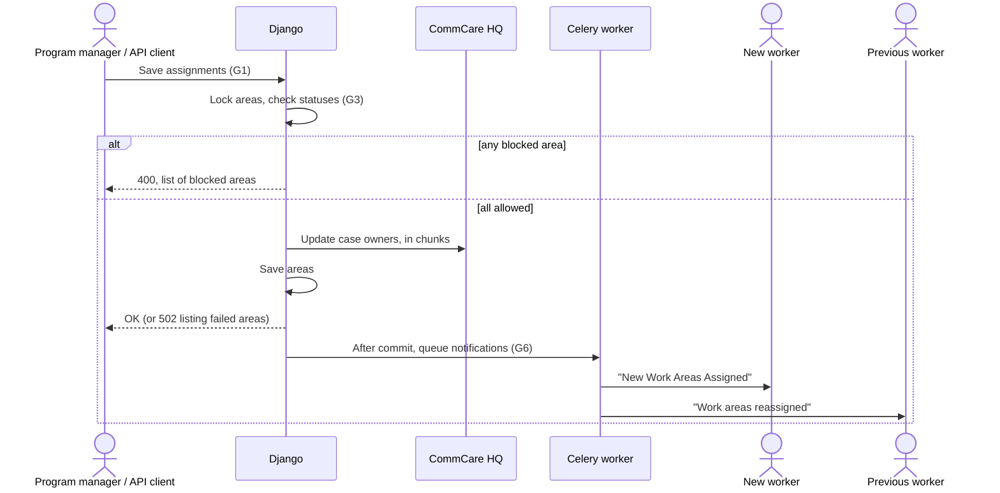

# Work area reassignment

Jira: CCCT-2748

## Overview

**Problem.** Program managers sometimes need to move a work area to a different worker while
an opportunity is running:

- **Handoff**: the first worker can't finish the visits, so someone else carries on.
- **Mop-up**: someone revisits an area that is already covered, for example because the first
  worker's visit data isn't trusted.

Managers can already do this by assigning an area that has a worker to someone else, but it
goes wrong in several ways:

- Progress then counts only the new worker's visits, so after a handoff the area may never
  reach its target.
- Nothing stops a manager moving an excluded or inaccessible area.
- The previous worker isn't told.
- There's no way to see who held an area or how many visits each worker made there.

**Current flow.**

1. A program manager selects work areas on the microplanning map, picks a worker and saves.
   The data API can do the same.
2. Connect moves each area's CommCare HQ case to the worker's phone and sends them a push
   notification.
3. The worker submits visit forms for the area.
4. The area moves from "not visited" to "visited", then to "expected visit count reached" once
   enough of the current worker's visits are approved.

**Goals.**

- **G1.** Reassign work areas from the map and the API, with the same rules on both.
- **G2.** An area's progress counts approved visits from every worker who has worked there.
- **G3.** Areas can be reassigned unless they are excluded or confirmed inaccessible.
- **G4.** Visits from a worker who isn't assigned to the area are accepted but flagged for
  reviewers.
- **G5.** Managers can see who held each area, when, and how many visits each worker made.
- **G6.** Both the new and the previous worker are notified.

**Solution in brief.** Reassigning stays part of the normal assign action, with one shared set
of checks used by both the map and the API. The HQ case moves to the new worker, and both
workers get a push notification. Handoff and mop-up are treated the same: everyone in an area
works towards one target, and the project decides what counts by approving or rejecting
visits. Late visits from the previous worker are accepted with a new review flag. An area
waiting on an inaccessibility review can still be reassigned, and the request stays open. The
audit trail comes from data Connect already keeps, the work area's change history and each
visit's link to its area, and is shown on the map, in the visit export and in the visits API.

## At a glance

| Area | Change |
|---|---|
| Django apps | None |
| Data models | None. The new visit flag is a new value in the existing list of visit flags. |
| URLs and endpoints | No new routes. Assigning on the map and through the API gains status checks. The work area detail and inaccessibility review endpoints return more information, and denying a request recalculates the area's status. The visits API returns the work area. See [URLs and endpoints](#urls-and-endpoints). |
| Background work | The previous worker is notified with the existing push notification task. |
| External services | None new. Reassigning uses the HQ case update that assigning already makes. |
| Settings and feature flags | None. Everything stays behind the existing microplanning feature flag. |
| Dependencies | None |
| Templates and frontend | Map assignment mode, the work area panel, the inaccessibility review panel and the visit export all change. See [Templates and frontend](#templates-and-frontend). |
| App READMEs | `form_receiver/README.md` documents the new flag and the new way of counting progress. |

## Assumptions

- **A1.** The deliver app lets a worker submit visits for an area whose HQ case shows "expected
  visit count reached" or "request for inaccessible". Reassigned areas keep their status, so
  a mop-up worker will see these. If this is wrong, the decision not to change status on
  reassignment needs revisiting, for example by resetting "reached" areas to "visited".

## Architecture changes

### URLs and endpoints

No routes are added. These existing ones change:

| Route | View | Change | Goals |
|---|---|---|---|
| `/a/<org_slug>/microplanning/<opp_id>/assignment/save/` | `save_assignment`, which saves assignments made on the map | Runs the shared reassignment checks. | G1, G3, G6 |
| `.../assignment/group_work_areas/` and `.../assignment/flw_work_areas/<assignee_id>/` | The map's lookups for the areas in a group, or held by a worker | Also return each area's current worker. | G1 |
| `.../work_area_detail/<work_area_id>/` | `work_area_detail_json`, the data for the map's work area panel | Adds assignment history and visits per worker. | G5 |
| `.../review_inaccessibility/<work_area_id>/` and `.../action/` | The inaccessibility review panel and its approve/deny action | Shows the current worker if it isn't the one who made the request. Denying recalculates status. | G3 |
| `/export/opportunity/<opp_id>/work_areas/bulk_update/` | `WorkAreaBulkUpdateView`, the API for editing many work areas at once | Runs the shared reassignment checks when `opportunity_access` (the assigned worker) changes. | G1, G3, G6 |
| `/export/opportunity/<opp_id>/user_visits/` | The visits API | Adds `work_area_id` and `work_area_slug`. | G5 |

Permissions don't change. On the map, only admins of the program manager or supervising
organization can assign. The API also allows admins of the network manager organization that
runs the opportunity.

### Behaviour

#### Reassigning work areas (G1, G3, G6)

**Entry:** a program manager saves assignments on the map, or an API client changes an area's
worker.

Both entry points hand the requested areas and workers to a new shared function,
`prepare_work_area_assignments` in `microplanning/helpers.py`, before saving anything. It:

1. Locks the areas, so a visit arriving at the same moment can't change their status. The map
   already does this; the API doesn't.
2. Drops areas that already have the requested worker. Nothing is recorded or sent for them.
3. Rejects the whole request if any area being reassigned is excluded or inaccessible, and
   lists those areas in the response. Nothing is saved.
4. Leaves the status of reassigned areas alone. Unassigned areas still become "not visited".

Saving uses the existing function that saves assignments and updates HQ cases in chunks of
100, where a failed chunk rolls back on its own. The change history records the new worker as
it does today, so a reassignment is simply an entry whose previous worker was someone else.

Once the changes are committed:

- New workers get the existing "New Work Areas Assigned" notification.
- Each previous worker gets one notification: "Work areas reassigned — Some of your work areas
  have been reassigned to another worker. Please sync your app to send any unsent forms."
- Areas in a failed chunk keep their old worker and send nothing.

Each entry point keeps its own request parsing and response format. Unassigning doesn't
change: only "not visited" areas can be unassigned, so a visited area can be reassigned but
not unassigned.

#### Reassigning an area waiting on an inaccessibility review (G3)

**Entry:** a manager reassigns an area whose worker has asked for it to be marked inaccessible,
before reviewing the request, for example to see whether someone else can reach it.

The request stays pending, and the area keeps the status "request for inaccessible". Until
the manager reviews it, the new worker's visits are recorded but don't change the area's
status. The new worker also can't raise their own request, because an area can only have one
pending request.

The review works as today, except for one change to denial:

- **Approve**: the area becomes "inaccessible" and stays with the new worker.
- **Deny**: the area's status is recalculated from its visits instead of being reset to "not
  visited". Visits made while the request was pending therefore count. The "request denied"
  notification still goes to the worker who made the request.

The review panel shows "Currently assigned to <name>" when the area has moved to a different
worker.

#### Counting progress across workers (G2)

**Entry:** an area's status is recalculated (`WorkArea.update_status`) when a visit for it
arrives, when visits are approved, or when its expected visit count is edited. This doesn't
change.

The recalculation currently looks only at the current worker's visits. It will look at
everyone's:

- The area becomes "visited" once anyone has visited it.
- It becomes "expected visit count reached" once approved visits from all workers together
  reach the target.

The coverage progress report already counts this way, so the two will agree.

Status still never goes backwards. Rejecting visits doesn't trigger a recalculation, and the
calculation never picks a lower status anyway. An area that reached its target and is then
reassigned for mop-up keeps showing "reached" (see A1).

#### Visits from a worker who isn't assigned (G4)

**Entry:** a deliver form arrives for a work area.

Forms the previous worker filled in before the reassignment still reach Connect. HQ has
confirmed that it doesn't check case ownership when it accepts or forwards a form, and Connect
is told who submitted the form, not who owns the case. The previous worker keeps their access
to the opportunity, so Connect records the visit as normal. A suspended worker's visits are
still rejected.

If the person submitting isn't the area's current worker, the visit gets a new flag,
`work_area_not_assigned` ("Worker is not assigned to this work area"), added to the visit
flags in `utils/flags.py`. Like any flagged visit, it isn't auto-approved, so a reviewer
decides whether it counts. The flag can't be switched off per opportunity, and it doesn't
reject the visit. Inaccessibility requests are still only accepted from the current worker.

#### Viewing the audit trail (G5)

**Entry:** a manager clicks a work area on the map, exports visits, or calls the visits API.

- **Work area panel**: adds two sections.
  - **Assignment history**: one row for each period the area was held, with the worker, start
    and end dates, and who made the change. It is built from the area's change history
    (pghistory), which already records every change of worker.
  - **Visits by worker**: total and approved visits for each worker who visited the area.
- **Visit export**: adds a "Work Area" column with the area's slug.
- **Visits API**: adds `work_area_id` and `work_area_slug`, blank for visits without an area.
  Existing clients aren't affected.

### Background work and external services

- **Previous-worker notification**: sent with the existing push notification task, after
  commit. If ConnectID messaging is down, it fails like any other push notification; the
  reassignment is already saved.
- **HQ case updates**: unchanged from assigning. Reassigning also sends the area's current
  status to HQ. That status can be out of date on HQ today, because status changes caused by
  visits aren't sent when they happen.

### Templates and frontend

- **Map assignment mode** (`templates/microplanning/map_handler.html`):
  - Areas that can't be reassigned can't be selected, in the same way exclude and unassign
    already block ineligible areas.
  - Each queued assignment shows how many areas it takes from another worker.
  - If the server rejects a request, the blocked areas are listed.
- **Work area panel**: the "Assignment history" and "Visits by worker" sections, shown once
  the area has had a worker.
- **Inaccessibility review panel**: the "Currently assigned to <name>" line.
- **Visit export**: the work area column appears in the export only, not on the visits page.

## Decisions

| Decision | Alternative rejected | Reason |
|---|---|---|
| One shared function for the reassignment checks and notifications. | Separate checks on the map and in the API. | Copied rules drift apart, and G1 needs them to match. |
| Reject the whole request if any area is blocked. | Save the allowed areas and skip the rest. | A partial save leaves the manager unsure what changed. The map already rejects whole requests with invalid IDs. |
| Count approved visits from all workers. | Count only visits from workers who held the area. | Reviewers already control what counts through approval, and tracking past holders adds work for nothing. |
| Flag visits from workers who aren't assigned, without rejecting them. | Reject them, as the "pending assigned task" flag does. | They are usually real work done offline by the previous worker. |
| Keep the same HQ case. | A new case for each worker. | Handoff and mop-up share one target, and a new case would split the area's history on HQ. |
| Keep a pending inaccessibility request open when the area is reassigned. | Close or deny it automatically. | The request records what the previous worker found. Only the manager's review should settle it. |
| Recalculate status when a request is denied. | Always reset to "not visited". | The new worker may have made visits while the request was pending. |
| Build the assignment history from the existing change history. | A new table of assignments. | The history already records each change of worker, with who and when. |
| Tell reassignments apart by comparing consecutive history entries. | Label them "reassigned" and save them separately. | The history already shows the change, and separate saves could fail independently. |

## Risks

- **The deliver app may block visits to "reached" areas.** See A1. Confirm with the app team
  before building.
- **An HQ failure can leave some areas with the old worker.** This is existing behaviour. The
  response lists them, and they send no notifications.
- **History may credit the wrong person for a status change.** A change caused by another
  worker's visit is recorded under the current worker's name. Visit counts aren't affected.

## Optimization opportunities (optional)

- **Status recalculation runs one query per area**, for example once per area when visits are
  bulk-approved. A grouped query would be faster. This is left out because reassignment
  doesn't make it worse.
- **The map and the API still validate workers and area IDs separately.** Moving that into the
  shared function is a natural follow-up but isn't needed here.

## Suggested ticket breakdown

Each ticket can be merged on its own once its dependencies are in.

| # | Ticket | Goals | Depends on |
|---|---|---|---|
| 0 | Confirm assumption A1 with the app team | G2, G3 | — |
| 1 | Count visits from all workers in an area's status | G2 | — |
| 2 | Flag visits from workers who aren't assigned to the area | G4 | — |
| 3 | Shared reassignment checks and notifications (backend) | G1, G3, G6 | — |
| 4 | Reassignment in the map's assignment mode | G1, G3 | 3 |
| 5 | Inaccessibility review for reassigned areas | G3 | 1, 3 |
| 6 | Assignment history and visits by worker on the work area panel | G5 | — |
| 7 | Work area on the visit export and visits API | G5 | — |

**0. Confirm A1 with the app team.** Check that the deliver app allows visits to areas showing
"expected visit count reached" or "request for inaccessible". If it doesn't, settle how status
changes on reassignment before starting ticket 3.

**1. Count visits from all workers.**
- The status recalculation counts every worker's visits, not just the current worker's.
- Before release, count the production areas whose status would move forward and note it in
  the PR.
- Update `form_receiver/README.md`.
- Test: a handoff where the two workers' approved visits together reach the target.

**2. Flag visits from workers who aren't assigned.**
- Add the `work_area_not_assigned` flag and apply it in the form receiver. It doesn't reject
  the visit.
- Update `form_receiver/README.md`.
- Tests: the assigned worker's visit isn't flagged; anyone else's is flagged, isn't
  auto-approved and isn't rejected.

**3. Shared reassignment checks and notifications.**
- Add the shared function: lock, drop no-change areas, reject excluded or inaccessible areas.
- Notify previous workers after commit.
- Use it from both the map and the API, keeping each one's permissions and response format.
- Tests: each status; a request with one blocked area saves nothing; reassigning to the same
  worker does nothing; only saved chunks send notifications; the map and the API behave the
  same.

**4. Map assignment mode.**
- The group and worker lookups return each area's current worker.
- Blocked areas can't be selected.
- Queued assignments show how many areas are reassignments.
- Rejected requests list the blocked areas.

**5. Inaccessibility review for reassigned areas.**
- Denying recalculates the area's status from its visits.
- The panel shows "Currently assigned to <name>" when the worker has changed.
- Test: denying after the new worker's visits were approved leaves the area "visited" or
  "reached".

**6. Assignment history and visits by worker.**
- The detail endpoint returns assignment periods from the change history and visit counts per
  worker.
- The panel shows both sections once the area has had a worker.
- Tests: history entries that don't change the worker are merged; unassigned periods are
  shown.

**7. Work area on the visit export and visits API.**
- Add a "Work Area" column to the export only.
- Add `work_area_id` and `work_area_slug` to the visits API.
