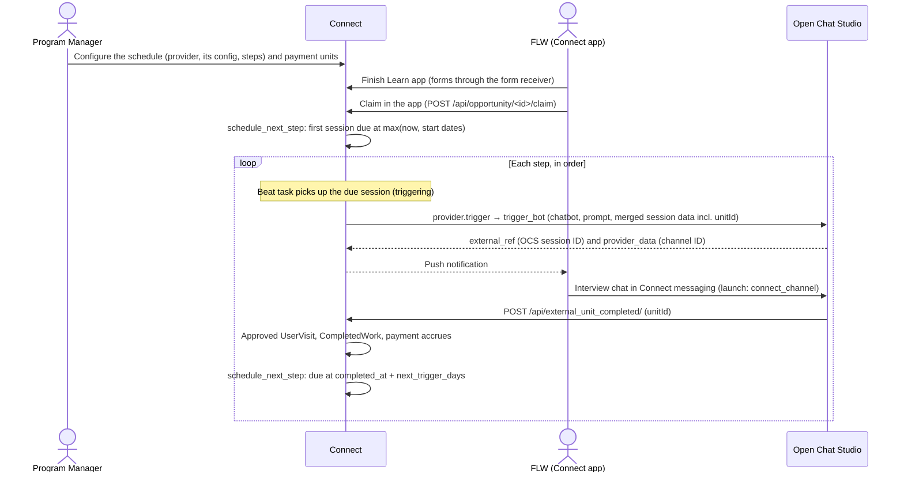

# Optional Deliver Apps and External Units

**Jira Ticket:** [CCCT-2861](https://dimagi.atlassian.net/browse/CCCT-2861)

---

## Tech Spec

**Epic:** _Add Epic_
**Ticket Number & Description:** [CCCT-2861](https://dimagi.atlassian.net/browse/CCCT-2861) — Optional Deliver Apps and External Units (OCS interviews first)

| Field                      | Details                                                                               |
| -------------------------- | ------------------------------------------------------------------------------------- |
| **Related Materials**      | [CCCT-2861](https://dimagi.atlassian.net/browse/CCCT-2861)                            |
| **Mockups / Wireframes**   | [Web mockups](https://claude.ai/artifact/VQnbjnfkok9XrDw2orZubu) (Android not mocked) |
| **Author**                 | Pawan Verma                                                                           |
| **Feature Release Path**   | Path 2: New features with stability                                                   |
| **Release Switch**         | `external_schedule` waffle flag, per opportunity (Ticket 1)                           |
| **Implementation Tickets** | 8 tickets, listed in order under Implementation Tickets                               |

### Relevant Codebases

- [commcare-connect](https://github.com/dimagi/commcare-connect) — optional deliver app, external unit and scheduler models, the provider layer and OCS provider, Program Manager UI, external unit completion endpoint, mobile API fields.
- [commcare-android](https://github.com/dimagi/commcare-android) — skip the Deliver app launch after Learn when there is none; show the activity and external payment units; the activity opens by its launch type.
- [open-chat-studio](https://github.com/dimagi/open-chat-studio) — configuration only, no code changes: an OCS pipeline step posts each interview completion to Connect's external unit completion endpoint.

---

### Introduction

This change lets an opportunity run without a CommCare Deliver app and adds external units: paid work that an external service runs and reports back to Connect. OCS chatbot interviews are the first, and at launch the only, provider. External units are a new kind of `DeliverUnit`, triggered one at a time by a per-opportunity scheduler and completed through one shared completion endpoint that records the visit with the same helpers as the form receiver. This lets them reuse the whole payment, claim-limit and invoicing pipeline instead of building a parallel one. Everything specific to a service sits behind a provider interface, so a later integration adds a provider, not new models, endpoints or mobile fields.

---

### Solution

**Proposed Solution:**

External units are modelled as a new kind of `DeliverUnit`, so they reuse payment units, `UserVisit`, `CompletedWork`, claim limits and invoicing. A per-opportunity scheduler triggers them one at a time. The scheduler, session state machine, claim handling and visit and payment path are generic; each schedule names one **provider** (a registry key such as `ocs`) that owns the service-specific parts: the schedule's and steps' config forms and their validation, the credentials, the trigger call and what the mobile app opens. The first step triggers once the FLW has claimed the opportunity in the app, through the existing claim endpoint, whether or not the opportunity has a Deliver app. No external unit is ever paid without a claim. The service posts each completion to one shared endpoint, `/api/external_unit_completed/`, keyed by `unitId`, using an OAuth application that Connect links to the provider through an `ExternalServer` record (the repurposed `HQServer`).

**Flow (OCS provider):**



1. A Program Manager sets up the schedule: its provider (OCS in v1), the schedule's provider config (for OCS: the chatbot every interview uses and the session data sent with every interview, such as the FLW cohort), then for each step its config (for OCS: the opening prompt and the step's session data), order and Next Trigger days, and payment units that use the external units. The schedule stays editable while steps run; edits apply to sessions not yet triggered.
2. The FLW finishes the Learn app and claims the opportunity in the app, through the existing claim endpoint, as today. The claim creates the first session, due at the later of now and the opportunity and payment unit start dates.
3. The beat task picks up each due session and triggers it through the schedule's provider (`provider.trigger`, which for OCS calls `ocs_api.trigger_bot`), and the FLW is notified.
4. The FLW does the work in the external service. For OCS, they have the interview chat with the bot in Connect messaging.
5. The service posts the completion to `/api/external_unit_completed/`. Connect records an approved `UserVisit`, payment accrues through `CompletedWork`, and the next step is scheduled for `completed_at + next_trigger_days`.
6. Steps 3–5 repeat until the last step is complete.

The work splits into 8 tickets:

| #                                                                    | Ticket                                                | Repo             | Depends on |
| -------------------------------------------------------------------- | ----------------------------------------------------- | ---------------- | ---------- |
| [1](#ticket-1--make-the-deliver-app-optional)                        | Make the Deliver app optional                         | commcare-connect | —          |
| [2](#ticket-2--android-skip-the-deliver-app-after-learn)             | Android: skip the Deliver app after Learn             | commcare-android | 1          |
| [3](#ticket-3--external-unit-model-provider-layer-and-schedule-page) | External unit model, provider layer and schedule page | commcare-connect | 1          |
| [4](#ticket-4--schedule-and-trigger-external-sessions)               | Schedule and trigger external sessions                | commcare-connect | 3          |
| [5](#ticket-5--start-on-claim-and-the-completion-endpoint)           | Start on claim and the completion endpoint            | commcare-connect | 1, 4       |
| [6](#ticket-6--mobile-api-activity)                                  | Mobile API: activity                                  | commcare-connect | 3, 5       |
| [7](#ticket-7--android-show-the-activity)                            | Android: show the activity                            | commcare-android | 6          |
| [8](#ticket-8--edit-a-running-schedule)                              | Edit a running schedule                               | commcare-connect | 4, 5       |

- **External components:** OCS (trigger API, which already exists, and a completion post to Connect's new endpoint that is configured in an OCS pipeline with no code changes). Mobile app changes in commcare-android.
- **Provider interface:** the one new abstraction. Each provider is a small class in a registry, keyed by `ExternalSchedule.provider`. The scheduler, the trigger task's retry and attempts cap, the completion endpoint and the mobile API are generic and call it. Only the OCS provider ships in v1 (Ticket 3).
- **Claims:** FLWs always claim manually in the app through the existing `ClaimOpportunityView` (`POST /api/opportunity/<id>/claim`), with its budget and end-date rules unchanged. When the opportunity has no Deliver app the view skips `create_hq_user_and_link` (Ticket 1). A successful claim starts the FLW's schedule (Ticket 5). Connect never claims on the FLW's behalf.
- **Security:**
  - `/api/external_unit_completed/` only accepts tokens whose OAuth application belongs to an `ExternalServer` with a provider `service` (not `commcare_hq`), with read/write scope, and that `service` must equal the provider of the session's schedule. Otherwise one integration's token could complete another provider's sessions. Any other token gets `403`. `/api/receiver/` only accepts `service=commcare_hq` servers, so an integration's token can't post HQ forms either.
  - Each payload must reference an existing `ExternalSession` by `unitId`. The session fixes the FLW, opportunity and external unit, so a service cannot create visits for arbitrary users or units.
  - External units' `DeliverUnit` rows have no `app`. The opportunity itself can still have a Deliver app: form units and external units can sit on the same opportunity, in separate payment units. Every `DeliverUnit` query that filters by `app=opportunity.deliver_app` is patched, because `filter(app=None)` matches `app IS NULL` and would return every opportunity's external units.
  - Credentials are resolved by the provider. The OCS provider uses the OCS OAuth token of the Program Manager who owns the schedule's connection (`ExternalSchedule.configured_by`), as OCS tasks do today.
- **Scaling:** the beat task selects due sessions with `select_for_update(skip_locked=True)` and an index on (`status`, `scheduled_for`), moves each to `triggering` with a fresh `trigger_token` in the same transaction and dispatches `trigger_external_session` on commit. The worker only proceeds while the session is still `triggering` with its token, and records the result with a conditional update, so a session is never triggered twice and a completion that arrives mid-trigger is never overwritten. At most one open session exists per FLW per opportunity (a partial unique constraint, with `schedule_next_step` locking the `OpportunityAccess` row), so volume is bounded by active FLWs.
- **Limitations:**
  - A step the FLW never finishes blocks the rest of their schedule until a Program Manager re-triggers or skips it.
  - OCS triggering depends on one Program Manager's OCS connection. Another Program Manager can take it over explicitly.
  - Edits to a running schedule never change a session that has already been triggered; it finishes with the provider config it was triggered with.
  - Form deliver units and external units can't share a payment unit, because their `entity_id`s differ.
  - An FLW whose next step has no funded claim limit, or whose payment window has closed, waits at that step; later steps are not triggered in its place.
  - If the payment window closes while a step is in progress, the completion is recorded as an over-limit visit (`claim_limit_ended`) and the schedule moves on, as form visits do today.
  - Opportunities with no Deliver app have no tasks (neither relearn nor OCS).
- **API changes:** new `POST /api/external_unit_completed/` for integrations. `/api/receiver/` keeps its payload and responses, but `FormReceiver.post` now looks up the token's server as an `ExternalServer` with `service=commcare_hq`, so a token from an integration's application is rejected there (Ticket 3). The mobile opportunity serializer emits `deliver_app: null`, `delivery_type`, `unit_type` on payment units and visits, and a new `activity` field (with a `launch` descriptor). Progress stays on the existing `delivery_progress` endpoint, unchanged.
- **Error logging:** the provider raises `ProviderNotConfigured` for missing configuration (for OCS: no OCS account for `configured_by`, unset `OCS_BASE_URL`), which is logged and marks the session `failed` without retrying, and `ProviderTransientError` for transient errors, which retry with backoff (`autoretry_for` + `retry_backoff`) until the session's `attempts` reaches `MAX_TRIGGER_ATTEMPTS`, then mark the session `failed` with `last_error`. A timed-out trigger is ambiguous (the service may have started the work), so it is never retried past the cap; the Program Manager re-triggers it. Completion posts with an unknown `unitId` return `404`, and posts for an FLW with no claim raise `ProcessingError`; both are logged.

**Monitoring and Alerting Plan:**

- Log every trigger attempt and failure with the session ID, provider and opportunity.
- On the opportunity page, show a banner to Program Managers when sessions are `failed` because of provider credentials (for OCS, the Program Manager's OCS connection).
- On the worker page, flag sessions that have been `triggered` for more than 7 days.
- Add Sentry alerts on unhandled errors (`5xx`) from `/api/external_unit_completed/` and on `trigger_external_session` final failures. `4xx` responses (unknown session, missing claim, wrong application or provider) are not sent to Sentry; they are logged in the application logs, and OCS logs failed posts on its side.

**Deployment and Release:**

- Migrations are additive apart from renaming `HQServer` to `ExternalServer` (a `RenameModel`, so no data moves); they run with `migrate_multi`. Data migrations register the beat task and create the `external_schedule` flag and the `interviews` delivery type. Code that imports `HQServer` ships in the same deploy as the rename.
- Mobile: opportunities with no deliver app are hidden from clients below the new mobile API version (_Add version_), so older apps never see `deliver_app: null`.
- OCS must be configured with the Connect OAuth client and the `/api/external_unit_completed/` URL, and an `ExternalServer` record (`service=ocs`, `url` = the OCS base URL) created for that OAuth application, before the feature is used.
- All tickets are released together, so there is no interim state to support (for example no locked schedule before editing exists).
- Rollback: revert the deploy. Already-recorded external unit visits stay as ordinary approved visits.

**Alternative Solutions:**

- **OCS-specific models and endpoint** (`OCSInterview`, `InterviewSession`, `/api/interview_completed/`, `interviews[]` on mobile; an earlier version of this spec). Rejected because each further integration would need its own models, endpoint, mobile fields and Android screen. The provider interface keeps the scheduler, state machine and payment path shared and puts only the service-specific parts in a provider.
- **A provider per step**, so one schedule could mix services (an OCS interview, then a survey from another tool). Rejected for v1: credentials (`configured_by`, the connection card) and the schedule-level config already belong to one provider, and no program needs a mixed schedule. If one does, `provider` can move back to `ExternalStep` with a data migration copying the schedule's value.
- **One completion endpoint per provider.** Rejected: one shared endpoint with a provider check keeps the payload contract the same for every provider.
- **Posting completions to `/api/receiver/` in the HQ form shape**, with `FormReceiver` branching on the OAuth application. Rejected because the service would have to fabricate an HQ form (`domain`, `app_id`, `xmlns`, a deliver block) that means nothing for its work, the HQ receiver would carry integration branching, and an external ID used as `xform_id` changes on re-trigger. A dedicated endpoint gives integrations a small, explicit payload and reuses the same helpers extracted from `process_deliver_unit`.
- **A separate unit model with its own accrual path.** Rejected because it would need parallel versions of `calculate_completed`, visit listings, exports, invoicing and the mobile payment views, and the two paths would drift.
- **Claiming automatically when the FLW finishes Learn** (on opportunities with no Deliver app, from a Celery task). Rejected: the app already has a claim step and endpoint, a manual claim keeps one claim path with the same budget rules for every opportunity, and an automatic claim would reserve budget for FLWs who may never start.
- **An `activities[]` list on mobile**, one entry per session. Rejected because only one session can be open at a time, so only one entry is ever actionable; sessions are created one step at a time, so the list wouldn't include steps not reached yet; and finished work already appears as visits and payments. A single `activity` gives the app what it needs, and progress comes from the existing `delivery_progress` endpoint. If parallel external work is ever allowed, a list can come in a new mobile API version.
- **Sending `unitId` to OCS in `participant_data`** (as OCS tasks send `connectTaskId`). Rejected because OCS participant data belongs to the participant, not the session: two open sessions on the same chatbot for one FLW would overwrite each other's ID.

---

### Implementation Tickets

#### Ticket 1 – Make the Deliver app optional

**Repo:** commcare-connect · **Depends on:** —

**Changes:**

- Add `Opportunity.has_deliver_app` (`deliver_app_id is not None`).
- Schedule toggle: a waffle flag `EXTERNAL_SCHEDULE = "external_schedule"` (`flags/flag_names.py`), created by data migration with a note describing it, decides whether an opportunity can have a schedule. `schedule_enabled(opportunity)` is true when the flag is active for the opportunity, its program or its organization (`Flag.is_active_for`).
  - It is turned on for interview opportunities: when an opportunity is created with the `interviews` delivery type (a `DeliveryType` with slug `interviews`, added by the same data migration if it doesn't exist), `OpportunityInitForm.save` and the program API's create both add it to the flag's `opportunities` through one helper. The delivery type can't be changed after creation, so this runs only on create.
  - Any other opportunity, or its program or organization, can be added to the flag by hand on Internal Features → Toggles & Switches or in the admin, so test opportunities can be set up without the delivery type.
  - It gates the UI only: the "This opportunity uses a Deliver app" checkbox (below), the Schedule step, the Configure Schedule menu item, the Schedule resources tab and dashboard chip, the external units group on the payment unit form (Ticket 3) and the Interviews worker tabs (Ticket 4). Turning it off on an opportunity with a running schedule hides these but doesn't stop the schedule; pause the schedule first.
  - A missing flag row or `interviews` delivery type means the toggle is off; nothing errors.
- Guard with it: `get_application` (`commcarehq/views.py`), `OpportunityChangeForm.clean_active`, `sync_learn_modules_and_deliver_units` and its callers, `verification_flags_config`, `UserVisit.hq_link` (returns `None` for external unit visits), the HQ link in `user_task_details`, and `ClaimOpportunityView`, which skips `create_hq_user_and_link` when the opportunity has no Deliver app.
- Patch every query that filters `DeliverUnit` or `TaskType` by `app=opportunity.deliver_app`, because once external units exist `filter(app=None)` returns every opportunity's external units:
  - `opportunity/views.py`: `OpportunityDashboard`, `verification_flags_config`, `TaskTypesConfig`, `deliver_unit_table`
  - `opportunity/forms.py`: `DeliverUnitFlagsForm`, `FormJsonValidationRulesForm`, `CreateTaskForm`
  - `program/api/serializers.py`: `get_deliver_app`
  - `opportunity/api/serializers/automation.py`: the payment unit deliver-unit validation, which must accept the opportunity's external units and reject other opportunities' units
- The other callers of the Deliver app's domain (work-area case sync, attachment downloads, usercase updates for relearn tasks) only run when a Deliver app exists, so they are unchanged.
- Hide, not grey out, everything that needs the Deliver app when there is none: the Deliver app link and resource chip, the Deliver units tab of `opportunity_resource_modal.html`, "sync deliver units", Verification Rules in the opportunity menu, microplanning, and the Deliver worker tab.
- Tasks are disabled when there is no Deliver app: hide Configure Task Types in the opportunity menu, the Tasks worker tab and the Tasks tab on the single-worker page, and reject task type creation and task assignment. `TaskType.app` stays required.
- `OpportunityInitForm` and `OpportunityInitUpdateForm`: when the schedule toggle is on, the Apps card gets a "This opportunity uses a Deliver app" checkbox, on by default, rendered as a `simple-toggle`. It is the first field of the Deliver column, with a "Deliver app" field label and the height of an input, so it lines up with Learn app domain and each Deliver field lines up with its Learn counterpart. The create form has no opportunity yet, so it checks the program's delivery type and the flag for the program and organization; the update form uses `schedule_enabled(opportunity)`. With the toggle off there is no checkbox and a Deliver app is required, as today. Unticking it hides the deliver domain and app fields, clears them and skips their validation, and shows a note that the Schedule step becomes required and Deliver-only features aren't available. The checkbox is disabled once Connect Workers have joined, like the app fields today. Skip `_build_commcare_app("deliver")` when there is no Deliver app; compare learn and deliver apps only when both are set.
- Program API serializer (`program/api/serializers.py`): `deliver_app` becomes `required=False, allow_null=True`; `get_deliver_app` returns `null` when absent.
- `OpportunitySerializer` (mobile) and the data export serializer emit `deliver_app: null` when absent.
- Opportunities with no Deliver app are left out of the opportunity list for clients below the new mobile API version (`AcceptHeaderVersioning`; _Add version_).

**Acceptance criteria:**

- Every page and task above works for an opportunity with `deliver_app=None`, with no 500s.
- `get_application` still lists apps for a domain that contains an opportunity without a Deliver app.
- Tests parametrized over "with" and "without Deliver app" using a new `opportunity_without_deliver_app` fixture.
- Two opportunities without a Deliver app never see each other's external units in any page, form or API listed above, and the automation API rejects another opportunity's unit.
- A Program Manager can create, edit and activate an opportunity with no Deliver app, through the web and the program API.
- An opportunity with no Deliver app shows no Tasks UI, and task types can't be created on it.
- "This opportunity uses a Deliver app" is on for a new opportunity. Turning it off saves the opportunity with no Deliver app; the checkbox can't be changed once workers have joined.
- An opportunity created with the `interviews` delivery type, through the web or the program API, is added to the `external_schedule` flag; one with any other delivery type is not.
- Adding an opportunity, its program or its organization to the flag by hand shows the schedule UI; removing it hides that UI with no 500s.
- With the flag off, the create and edit forms have no Deliver app checkbox and require a Deliver app.
- With the flag row or the `interviews` delivery type missing, opportunity creation works and the toggle reads as off.
- Deliver-only menu items, tabs and links are not rendered (rather than shown disabled) when there is no Deliver app.
- Older clients never receive an opportunity with `deliver_app: null`; new clients receive it, and can claim it (no HQ user is created).

#### Ticket 2 – Android: skip the Deliver app after Learn

**Repo:** commcare-android · **Depends on:** 1

**Changes:**

- After the Learn app completes, the FLW claims the opportunity as today. When `deliver_app` is null, skip the Deliver app download and launch, both after Learn and after the claim.
- Send the new API version header.

**Acceptance criteria:**

- An FLW on an opportunity with no Deliver app finishes Learn, claims, and is not prompted to install or open a Deliver app.
- Opportunities with a Deliver app behave as today.

#### Ticket 3 – External unit model, provider layer and schedule page

**Repo:** commcare-connect · **Depends on:** 1

**Changes:**

Data model:

- `DeliverUnit`:
  - Add `unit_type` (choices `form` / `external`, default `form`). The service that runs an external unit comes from its schedule's `provider`.
  - Add `opportunity` (FK, nullable, `CASCADE`).
  - Make `app` nullable.
  - Add a check constraint: `form` requires `app`; `external` requires `opportunity` and no `app`.
- Add `Opportunity.available_deliver_units()`: the Deliver app's form units plus the opportunity's external units.
- New `ExternalSchedule`:
  - `opportunity` (OneToOne)
  - `provider` (CharField, a registry key such as `ocs`, validated against the registry): the one service every step of this schedule runs on. Chosen when the schedule is created (preselected and not shown while only one provider is configured), and fixed once any session exists.
  - `configured_by` (FK User, `SET_NULL`): the Program Manager whose connection the provider uses for credentials (for OCS, their OCS token).
  - `active`
  - `config` (JSONField, default `dict`): schedule-level config for the schedule's provider (for OCS, `{"chatbot_id": ..., "session_data": {...}}`), validated by that provider's `schedule_config_form`. For OCS it holds the chatbot every step on this opportunity uses and the session data sent with every interview, such as the FLW cohort (`cohortId`).
- New `ExternalStep` (one row per step in the schedule; the scheduler's columns):
  - `schedule` (FK `ExternalSchedule`, `CASCADE`)
  - `deliver_unit` (OneToOne external `DeliverUnit`, `PROTECT`): the step's unit; its `name` is the step's display name.
  - `config` (JSONField, default `dict`): provider-owned step config, validated by the schedule's provider's `config_form`. For OCS: `prompt_text` and `session_data`; the chatbot is set once on the schedule.
  - `order` (PositiveInteger): unique per schedule.
  - `next_trigger_days` (PositiveInteger): the Next Trigger column; days after this step is completed before the next one triggers; unused on the last row.
  - `active` (default `True`): false once the step is retired from a running schedule (Ticket 8). Retired steps are never picked for new sessions.
- New `ExternalSession`:
  - `external_id` (UUID): sent to the service as `unitId` and posted back on completion.
  - `opportunity_access` (FK)
  - `step` (FK `ExternalStep`); the unit is `step.deliver_unit`
  - `status` (`scheduled`, `triggering`, `triggered`, `completed`, `failed`, `skipped`, `cancelled`). `skipped` is a Program Manager decision and is final; `cancelled` (FLW suspended, opportunity ended, payment window closed) can be reopened.
  - `scheduled_for`
  - `triggered_at`
  - `completed_at`
  - `external_ref` (CharField, blank): the service's ID for the work (for OCS, the OCS session ID).
  - `provider_data` (JSONField, default `dict`): what the provider returns from a trigger and needs later (for OCS, `connect_channel_id`).
  - `trigger_token` (UUID, nullable): issued by the beat task each time it moves the session to `triggering`. Only the worker holding the current token may call the provider or record the result.
  - `trigger_claimed_at` (nullable): when the current `trigger_token` was issued; used to find sessions stuck in `triggering`.
  - `attempts` (PositiveSmallIntegerField, default `0`): provider trigger calls made for this session, including Celery retries. The session ends `failed` when it reaches `MAX_TRIGGER_ATTEMPTS`. A Program Manager re-trigger resets it to `0`.
  - `last_error` (TextField, blank): the error from the most recent failed trigger call (the exception text or the service's error response). Cleared on a successful trigger and on re-trigger.
  - `user_visit` (OneToOne, nullable)
  - Unique on (`opportunity_access`, `step`); index on (`status`, `scheduled_for`).
  - Partial unique constraint `one_open_external_session` on (`opportunity_access`) where `status` is `scheduled`, `triggering`, `triggered` or `failed`, so an FLW can never have two open sessions on an opportunity.
- Opportunity deletion (`opportunity/deletion.py`): add `ExternalSession` (`step__schedule__opportunity`), `ExternalStep` (`schedule__opportunity`) and `ExternalSchedule` (`opportunity`) to `OPPORTUNITY_DELETIONS`, in that order and before the `DeliverUnit` entry, because `ExternalStep.deliver_unit` is `PROTECT` and would otherwise block deleting the units. `DeliverUnit.opportunity` cascades, so external units not in any payment unit go with the opportunity. External units belong to one opportunity, so the detach-instead-of-delete branch for shared Deliver app units never applies to them.
- Repurpose `HQServer` as `ExternalServer` (a `RenameModel` migration, so existing rows and the `hq_server` foreign keys on `Opportunity`, `CommCareApp`, `HQApiKey` and `ConnectIDUserLink` are kept):
  - Add `service` (choices `commcare_hq` and the provider keys, e.g. `ocs`; default `commcare_hq`, so existing rows backfill as HQ servers).
  - `name`, `url` and `oauth_application` stay. For a provider, `oauth_application` is the OAuth application the service uses to post completions.
  - Every place that lists or looks up HQ servers filters on `service=commcare_hq`: `FormReceiver.post`, the program API's `hq_server_url` field, the HQ server choices on `OpportunityInitForm`, `OpportunityInitUpdateForm` and `HQApiKeyCreateForm`, the admin and the `generate_microplanning_data` command.

Provider layer and the OCS provider:

- A provider registry and protocol. Each provider is a small class registered under its `key`:

```python
class ExternalProvider(Protocol):
    key: str                                       # "ocs"
    display_noun: str                              # "Interview"; labels in the UI and the mobile app
    def is_configured(self) -> bool                # e.g. OCS_BASE_URL set
    def config_form(self) -> type[Form]            # step fields: prompt, session data
    def schedule_config_form(self) -> type[Form]   # schedule-level fields: chatbot, session data
    def check_connection(self, user) -> bool       # "Use my connection" takeover
    def trigger(self, session) -> TriggerResult    # -> external_ref, provider_data
    def launch_descriptor(self, session) -> dict   # what the mobile app opens
    def external_links(self, session) -> list[ExternalLink]  # labelled links into the service, for Program Managers
```

- `trigger` raises `ProviderTransientError` for errors worth retrying and `ProviderNotConfigured` for missing configuration or credentials. The retry and attempts cap in Ticket 4 wrap it; providers never retry themselves.
- Validation lives only in the provider's forms. `ExternalStep.config` and `ExternalSchedule.config` are JSON with no column constraints, so `config_form` and `schedule_config_form` do that job through their field validation and `clean()`. The schedule page is the only write path for this config, so every save goes through the forms.
- `external_links` returns `ExternalLink(label, url)` items for Program Managers to open the work in the service. They are rendered as outline buttons that open in a new tab (`target="_blank" rel="noopener"`), with a tooltip saying the viewer needs access to the service. Connect only links; it never fetches or shows the service's data.
- `launch_descriptor` returns data, not a screen: `{"type": "connect_channel", "channel_id": ...}` for OCS; a later provider could return `{"type": "url", "url": ...}`. Android renders one screen per launch type, not per provider.
- The OCS provider (`key="ocs"`, `display_noun="Interview"`) wraps today's OCS integration:
  - `is_configured`: `OCS_BASE_URL` is set.
  - Schedule config: `chatbot_id` (a tom-select, `data-tomselect="1"`, loaded from `ocs_api.list_chatbots`), used by every step, and `session_data` (a JSON object). Step config: `prompt_text` (sent to start the conversation, not shown to the FLW) and `session_data`. Steps on one chatbot are told apart by their prompt and session data (for example `interview = baseline`).
  - Form validation: `chatbot_id` is required on the schedule config; session data must be a JSON object; the key Connect sets (`unitId`) is reserved and rejected. The reserved key belongs to the OCS provider because it is an OCS session-data detail.
  - Credentials: the OCS OAuth token of `schedule.configured_by`. `check_connection(user)` calls `ocs_api.list_chatbots` with the user's token.
  - `trigger`: `ocs_api.trigger_bot(configured_by, identifier=<username>, experiment=schedule.config["chatbot_id"], prompt_text=step.config["prompt_text"], session_data={**schedule.config["session_data"], **step.config["session_data"], "unitId": <external_id>})`. Merge order: the schedule's session data first, then the step's (a step key overrides the same schedule key), then `unitId`. Returns `external_ref` = the OCS session ID and `provider_data` = `{"connect_channel_id": ..., "chatbot_id": ...}`. The chatbot is recorded on the session so that the session's link and the worker page keep showing the chatbot it ran on after the schedule's chatbot changes.
  - `ocs_api.trigger_bot` gains a `prompt_text` parameter; the current hard-coded training prompt becomes the default, so OCS tasks are unchanged. A blank step prompt is sent as `None` and gets that default.
  - `launch_descriptor`: `{"type": "connect_channel", "channel_id": provider_data["connect_channel_id"]}`.
  - `external_links`: one link, "OCS session data": the OCS session's page (from `external_ref`, the OCS session ID, on the chatbot recorded in `provider_data`), where the session data and the conversation can be seen, as an absolute URL on `OCS_BASE_URL`. If the URL needs IDs Connect doesn't have (for example the OCS team slug), the provider stores them in `provider_data` from the trigger response. There is no link before the session is triggered, when an ID is missing or when `OCS_BASE_URL` is unset.

Schedule page and payment unit linking:

- New class-based view `ExternalScheduleView` (`opportunity:external_schedule`): Program Manager CRUD for external units and schedule steps. Adding a step creates its external `DeliverUnit` (`unit_type=external`, `opportunity` set) together with the `ExternalStep` row.
- Opportunity creation: the stepper (`opportunity/steps.html`) becomes Create Opportunity → **Schedule** → Payment Unit → Budget, so steps exist before payment units are built from them. The Schedule step has a "Skip" button only when the opportunity has a Deliver app; without one, at least one step is required to continue. Once the opportunity exists, the page opens from a "Configure Schedule" item in the opportunity menu (`is_opportunity_pm`) with breadcrumbs instead of the stepper. The resources modal gets a Schedule tab and the dashboard a Schedule chip.
- Page layout (see the mockups):
  - Two cards above the steps: **connection** (owner, a status pill for connected / not working / not connected, and "Use my connection") and **schedule** (an Active toggle, disabled until the schedule's provider config is complete and every step has a payment unit, and the provider's settings, titled **Chatbot settings** for OCS: the chatbot and the shared session data as chips, edited together in one "Chatbot settings" modal).
  - The **steps table**: a drag handle, order, the step's name with the provider's `display_noun` badge ("Interview"), the provider's summary of its config (for OCS, the step's session data as chips), "Next step after" (Next Trigger days; "last step" on the last row), the payment unit (a "None yet" warning when it has none), session counts (done · open) and an Actions column with the edit button. The Actions header and its buttons are centred in the column (`attrs` with `text-center` on `th` and `td`, since `.base-table thead th` is left-aligned).
  - Adding and editing a step happens in a modal (the `tasks/new_task_modal.html` pattern, re-rendered by htmx on errors). The modal holds the step's name, the schedule provider's `config_form` and Next Trigger days; there is no provider field, because the provider is set on the schedule.
- Reordering follows open-chat-studio's annotation fields form (`human_annotations/queue_form.html`): native HTML5 drag on the handle, in an Alpine component in its own JS file, with no new dependency. Drag is the only way to reorder; there are no up/down buttons, so every row has the same handle and actions. Moves happen client-side; a "Save order / Discard" bar appears once the order changes, and "Save order" posts the ordered step IDs in one request.
- Session data (the schedule's and each step's) is edited as key/value rows with add and remove, stored as a JSON object of strings. The reserved `unitId` key is rejected on its row.
- Each step's config is edited and validated through the schedule provider's `config_form`; the schedule's provider config through `schedule_config_form`.
- The page, the Schedule stepper step, the menu item, the resources tab and the dashboard chip are shown only when `schedule_enabled(opportunity)` (Ticket 1). With the toggle off the stepper is Create Opportunity → Payment Unit → Budget, as today.
- Only providers whose `is_configured()` is true are offered when the schedule is created. If none is, hide the page and nav item.
- Connection takeover: saving the schedule does not change `configured_by`. A "Use my connection" action sets `configured_by` to the current Program Manager after `provider.check_connection(user)` succeeds. The page shows the current owner and whether their connection works. It is the only way `configured_by` is set, including on first setup. For OCS, if the Program Manager hasn't connected OCS, show `ocs/_connect_prompt.html`. "Use my connection" asks for confirmation first.
- The schedule can only be activated when its provider config is valid (for OCS, a chatbot is chosen) and every step's unit belongs to a payment unit.
- `add_payment_unit` / `edit_payment_unit` / `PaymentUnitForm`: choices come from `available_deliver_units()`. The existing checkbox lists for required and optional units are split into a group per unit type, "Form deliver units" and the external units labelled with their provider's noun ("Interviews (OCS)"); the form-units group is hidden when there is no Deliver app.
- A payment unit's required and optional units must all be one `unit_type`; mixed payment units are rejected.
- Individual payment = one payment unit per external unit; set payment = one payment unit with several required external units.

**Acceptance criteria:**

- Migrations run with `migrate_multi`; existing `DeliverUnit` rows backfill to `unit_type=form` and existing `HQServer` rows become `ExternalServer` rows with `service=commcare_hq`.
- The `DeliverUnit` check constraint rejects invalid combinations.
- `delete_opportunity` deletes an opportunity that has a schedule, steps, sessions and external units in payment units, without a `ProtectedError`.
- Constraints enforce one schedule per opportunity, unique step order per schedule, one session per FLW per step and at most one open session per FLW per opportunity.
- The registry rejects an unknown provider key on `ExternalSchedule`, and the provider can't be changed once the schedule has sessions.
- OCS schedule config without a chatbot, session data that isn't an object, or session data using `unitId` fails validation with a clear error.
- Every step's trigger uses the schedule's chatbot.
- The OCS trigger call carries the step's prompt and the schedule's session data merged with the step's (step keys win), plus `unitId`.
- OCS tasks still get the default training prompt.
- The provider and the registry are unit tested without the database or OCS (`pytest-httpx` for the OCS calls).
- A Program Manager can add, reorder and remove steps and set Next Trigger days at any time; once sessions exist, the rules in Ticket 8 apply.
- The creation stepper includes the Schedule step when the schedule toggle is on, and only then; it can be skipped only when the opportunity has a Deliver app.
- Dragging a row reorders the steps, and the order is saved only on "Save order".
- Saving the schedule never changes `configured_by`; the takeover action does, and fails with a clear error when the provider's connection check fails.
- Invalid provider config fails validation with the provider's error.
- The schedule can't be activated while its provider config is incomplete (for OCS, no chatbot) or a step has no payment unit.
- The page degrades as described when OCS isn't connected or configured.
- A Program Manager can create payment units from external units, individually or as a set.
- Mixed-type payment units fail validation with a clear error.

#### Ticket 4 – Schedule and trigger external sessions

**Repo:** commcare-connect · **Depends on:** 3

**Changes:**

- `schedule_next_step(access)` is the only place sessions are created or reopened, and it is idempotent:
  - It first locks the `OpportunityAccess` row (`select_for_update`), so concurrent callers (claim, completion, skip, replan) check and create one at a time. If the `one_open_external_session` constraint still fires, it treats the FLW as already scheduled and does nothing.
  - It does nothing if the FLW already has an open session (`scheduled`, `triggering`, `triggered`, `failed`).
  - Otherwise it takes the lowest-order active step with no `completed` or `skipped` session for this FLW. If that step is payable for the FLW (below), it creates its session, or reopens a `cancelled` one. If not, it schedules nothing, so the FLW waits at that step, and the worker page shows why (for example "No funded claim limit for <payment unit>").
  - Payable means the FLW's claim has an `OpportunityClaimLimit` for the step's payment unit, that limit is not used up, and `scheduled_for` is on or before `claim.end_date`, the claim limit's `end_date` and the payment unit's `end_date`. A new claim funds every payment unit: `ClaimOpportunityView` rejects it with `OPPORTUNITY_FULL` unless the remaining budget covers `budget_per_user()`, as today, and that rule now covers external units too. A limit can only be missing for a payment unit added after the FLW claimed that the claim-limit backfill couldn't fund; steps never trigger for work that can't be paid.
  - `scheduled_for` is the latest of: now (or `completed_at + next_trigger_days` of the previous step), `opportunity.start_date` and the step's payment unit `start_date`. Steps never run before they can be paid; otherwise the visit would be a `trial` visit and never paid.
  - The selection rule, including the payable check, is a pure function over plain data (sessions, steps, claim limits, dates), so it can be unit tested without the database.
  - It is called on claim, completion, skip and un-suspension, and through `replan_external_sessions` (Ticket 8) on a worker's claim end-date extension, payment unit changes and schedule reactivation.
- Beat task `trigger_due_external_sessions` (every 5 minutes, registered by data migration) selects due `scheduled` sessions on active schedules, for active steps, with `select_for_update(skip_locked=True)`, moves them to `triggering`, sets a fresh `trigger_token` and `trigger_claimed_at`, and dispatches `trigger_external_session(session_id, trigger_token)` with `transaction.on_commit`. Sessions stuck in `triggering` (by `trigger_claimed_at`) for more than 30 minutes are picked up again the same way, with a new token, which retires the old worker. This is separate from Celery retries, which happen inside one worker's chain: recovery covers a worker that died or a task that was lost before it ran. The 30 minutes must stay well above the provider call timeout plus the longest Celery retry backoff (`retry_backoff_max`), so only dead workers are recovered.
- `trigger_external_session(session_id, trigger_token)` locks the session and returns unless it is still `triggering` and its `trigger_token` matches. It then repeats the payable check for today: if the claim, claim limit or payment unit has ended, or the limit is used up, since the session was scheduled, it marks the session `cancelled` (conditional on its token), logs the reason and makes no provider call. Before every provider call, Celery retries included, it repeats that check and increments `attempts` in its own committed update, so the count survives a failed call and a worker retired by recovery stops at its next attempt; if `attempts` has already reached `MAX_TRIGGER_ATTEMPTS`, it marks the session `failed` instead of calling. It then calls `provider.trigger(session)` for the schedule's provider and records the result with a conditional update, `filter(pk=..., status=triggering, trigger_token=trigger_token).update(status=triggered, external_ref=..., provider_data=..., triggered_at=now)`. If no row matches, a completion or a newer worker has already won, so it does nothing; a `completed` session stays `completed`. Marking the session `failed` uses the same conditional update.
- `ProviderTransientError` retries with `autoretry_for` + `retry_backoff`. Every retry is another provider call and increments `attempts`, so `attempts` is the single cap: at `MAX_TRIGGER_ATTEMPTS` (a module constant, initially 3) the session is marked `failed` with `last_error`. Each failed call overwrites `last_error`. `ProviderNotConfigured` marks the session `failed` without retrying.
- Sessions are cancelled when the FLW is suspended or the opportunity ends, and reopened through `schedule_next_step` when the FLW is un-suspended or their claim's end date is extended. Extending `Opportunity.end_date` alone doesn't change existing claims (`OpportunityClaim.end_date` is copied at claim time), so it reopens nothing; Program Managers extend workers' claims as today with `AddBudgetExistingUsersForm` (which updates `OpportunityClaim.end_date` and the claim limits' `end_date`), and that form's `save()` dispatches `replan_external_sessions(schedule_id)` on commit (Ticket 8), which calls `schedule_next_step` for every claimed worker with no open session.
- Worker views, both labelled with the provider's noun ("Interviews"):

  - The worker list (`BaseWorkerListView.tabs`) gets a tab, shown when the schedule toggle is on and the opportunity has a schedule: one row per claimed worker with progress ("1 of 3"), current step, status, since when, and an Attention column. Filters: All, Needs attention (failed, or in progress for more than 7 days), In progress, Waiting, Finished.
  - The Attention column names the issue as a badge, not an icon, with the detail in a tooltip (`x-tooltip`), and the badge links to where the issue is fixed:

    | Issue                 | When                                                     | Tooltip detail                      | Links to                                                                                                  |
    | --------------------- | -------------------------------------------------------- | ----------------------------------- | --------------------------------------------------------------------------------------------------------- |
    | No reply in 7+ days   | `triggered` for more than 7 days                         | the step and when it started        | the worker's Interviews tab with that session selected (Re-trigger, Skip)                                 |
    | Couldn't start        | `failed` with `ProviderTransientError` or another error  | the step, attempts and `last_error` | the worker's Interviews tab with that session selected (Re-trigger)                                       |
    | OCS connection        | `failed` with `ProviderNotConfigured` (credentials)      | whose connection failed             | the connection card on the schedule page                                                                  |
    | No funded claim limit | Waiting: no funded `OpportunityClaimLimit` for the step  | the step and payment unit           | that payment unit's edit page                                                                             |
    | Payment window closed | Waiting: past the claim, claim limit or payment unit end | which end date passed               | the payment unit's edit page, or the Add Budget page for existing workers when it is the claim's end date |

    The issue label for a provider credential failure uses the provider's name ("OCS connection"). A worker with no issue shows a dash. The waiting reason comes from the pure selection function behind `schedule_next_step`, run for the page's rows with their claims, claim limits and payment units prefetched, so it adds no per-row queries.

  - The single-worker Interviews tab accepts `?session=<external_id>` next to `?user=` and opens with that session selected, so the badge lands on the session and its actions.
  - The single-worker page gets a tab next to Visits (`components/worker_page/visit_task_tabs.html`): a card per step with its status, dates and, when it failed, the last error and attempts. Once a step has been triggered, its details also show the provider's `external_links` (for OCS, OCS session data). Re-trigger (in progress or failed) and Skip (any open session) both ask for confirmation. Re-trigger warns that the worker may see two chats. Skip opens a warning modal (`components/confirm_modal.html` gains an optional `warning`, rendered in the `message-warning` style above the message, with a red confirm button) listing what is lost, computed for that session: the step won't be paid and the skip can't be undone; when the step is a required unit of a payment unit with other required units, the worker can no longer earn that payment unit; when the session is `triggered`, the open chat stays but a completion from it is not recorded. It also names the step that will be scheduled next and points to Re-trigger as the alternative.
  - The single-worker tab has filters, following `opportunity/user_tasks.html`: a filter icon button on the tab bar, with a count badge when filters are applied, opens a Filters modal rendering a `UserExternalSessionsFilterSet` (django-filter, through `FilterMixin`) with Status, Step (retired steps included and marked) and "Needs attention only" (failed, or in progress for more than 7 days). Filters are GET parameters next to `?user=`, so a filtered view can be linked, and the table is loaded by htmx with them. An empty result shows "No interviews match these filters" with a Clear action.
  - Statuses as Program Managers see them: Scheduled (with the due date), Starting (`triggering`), In progress (`triggered`), Completed, Failed, Skipped, Cancelled, and Waiting when nothing could be scheduled.

- Sessions `triggered` for more than 7 days are flagged. Re-trigger moves the session back to `scheduled`, due now, resets `attempts` to `0`, clears `last_error` and `trigger_token`. Skip marks it `skipped` (unpaid) and calls `schedule_next_step`.
- The opportunity page shows a banner when sessions fail because of provider credentials, linking to the connection card on the schedule page.

**Acceptance criteria:**

- No step triggers before the opportunity or payment unit start date.
- No step triggers for an FLW without a claim.
- No session is created for a step whose payment unit has no funded claim limit for the FLW, or whose payment window ends before `scheduled_for`; the worker page shows why.
- A `scheduled` session whose payment window ends before it triggers is cancelled without a provider call.
- Two concurrent `schedule_next_step` calls for one FLW leave exactly one open session.
- Running `trigger_external_session` twice for the same session makes one provider call.
- When a session stuck in `triggering` is recovered while the original worker is still running, only one provider call is made after recovery: the old worker's token no longer matches.
- A completion that arrives while `provider.trigger` is in flight leaves the session `completed`; the worker's late result does not reopen it.
- A trigger that keeps failing makes exactly `MAX_TRIGGER_ATTEMPTS` provider calls (Celery retries included), then ends `failed` with `last_error` set.
- Re-triggering a `failed` session resets `attempts` to `0` and allows a fresh set of attempts.
- A failed trigger is visible on the worker page and can be re-triggered.
- Each Attention badge shows its issue type and tooltip, and links to its fix: a session issue opens the worker's Interviews tab with that session selected, a credential failure opens the connection card, and a waiting reason opens the payment unit's edit page or the Add Budget page for existing workers.
- Skip only takes effect after the warning modal is confirmed, and the modal lists the set payment unit it breaks when the step is a required unit of one.
- On the single-worker Interviews tab, each filter (status, step, needs attention) narrows the rows, filters combine, and the badge shows how many are applied.
- A suspended and then un-suspended FLW resumes at the step they were on.
- Extending a worker's claim end date with `AddBudgetExistingUsersForm` reopens their cancelled session through the replan; extending only the opportunity's end date does not.
- The trigger task is tested with a fake provider registered in the test, so it does not depend on OCS.
- Until Ticket 5 ships, sessions are started by calling `schedule_next_step` directly (tests, shell); claims start them from Ticket 5.

#### Ticket 5 – Start on claim and the completion endpoint

**Repo:** commcare-connect · **Depends on:** 1, 4

**Changes:**

Starting the schedule on claim:

- The FLW claims through the existing `ClaimOpportunityView` (`POST /api/opportunity/<id>/claim`) on every opportunity, with or without a Deliver app. Its budget and end-date checks, responses and error codes are unchanged; it skips `create_hq_user_and_link` when there is no Deliver app (Ticket 1), since FLWs already get an HQ user on the Learn domain from `start_learn_app`.
- After a successful claim on an opportunity with an active schedule, the view calls `schedule_next_step(access)` in the same transaction, so the claim and the FLW's first session commit together. `schedule_next_step` only touches the database, so it adds no outside call to the claim request.
- Claiming keeps today's rule: there is no claim unless the remaining budget funds every payment unit, external units included, for that worker. A claim that fails (budget full, opportunity ended) creates no claim and no session, and returns the existing error code to the app, so the worker sees it at once.
- Learn completion does not claim or schedule anything. FLWs who claimed before the schedule existed or was activated are picked up by `replan_external_sessions` (Ticket 8).

The completion endpoint:

- Each integration has a dedicated OAuth application in Connect, used only for posting completions, linked from an `ExternalServer` with its provider as `service`. For v1, one for OCS.
- New class-based view `ExternalUnitCompletedView` at `POST /api/external_unit_completed/` (`api:external_unit_completed`), next to `TaskCompletedView`. It uses `OAuth2Authentication` and `TokenHasReadWriteScope`, plus a permission class that requires `request.auth.application` to belong to an `ExternalServer` whose `service` is a provider key. `FormReceiver` only changes as described in Ticket 3: its server lookup filters on `service=commcare_hq`.
- `ExternalUnitCompletionSerializer` validates the payload. The view hands the validated data and the server's `service` to a service function, `complete_external_session(unit_id, provider, external_ref, started_at, completed_at, data)`, which holds all the logic and is tested directly.
- `complete_external_session` locks the `ExternalSession` found by `unitId` (`404` if none) and checks that its schedule's `provider` equals the server's `service` (`403` if not). It then branches on the session's status:
  - `completed`: return and do nothing.
  - `cancelled` or `skipped`: log it and record nothing.
  - `triggering`, `triggered` or `failed`: record the visit, mark the session completed (`completed_at`, and `external_ref` from the payload) and call `schedule_next_step`, all in one atomic block. `failed` is accepted because the service may have started the work even though Connect's trigger call timed out.
- Completions from an earlier external session after a re-trigger are handled by the same status rules, so the step is paid once and the next one is scheduled once.
- `process_deliver_unit` is split into small helpers (claim lookup and claim-limit lock, visit counts, trial and over-limit handling with `CompletedWork`, finalizing `CompletedWork`). `process_deliver_unit` and `complete_external_session` each compose them with their own status rules, rather than sharing one helper with flags. `update_payment_accrued_for_user` is called by both.
- The `UserVisit` for an external unit:
  - `user`, `opportunity`, `opportunity_access` and `deliver_unit` come from the session, not the payload.
  - `entity_id` = the FLW's `User.user_id`; `entity_name` = the FLW's name.
  - `xform_id` = the session's `external_id`. It is stable across re-triggers, so `unique_xform_entity_deliver_unit` also blocks a second visit for the same session.
  - `visit_date` = `completed_at`.
  - `form_json` = `{"metadata": {"timeStart": started_at, "timeEnd": completed_at, "location": null}, "provider": ..., "external_ref": ..., "data": data}`. The `metadata` block keeps `UserVisit.duration` and other `form_json` readers working.
  - Status is always `approved` + `review_status=agree` unless over limit or the FLW is suspended.
  - No `clean_form_submission`, blocking-task check, attachment downloads, location or flags.
- Visit details on the worker's Visits tab (`user_visit_details` and `user_visit_details.html`): for an external unit visit, found through its `ExternalSession` (`user_visit.externalsession`), the panel shows Information (payment unit, entity name, duration), a section named after the provider with the step's config summary, the `external_ref` and the provider's `external_links`, and `data.summary` when present. The map, form JSON, media and HQ link are not rendered, because external unit visits have none.
- A missing claim raises `ProcessingError` (`400`), as for forms.

`POST /api/external_unit_completed/` (new endpoint):

- Auth: OAuth2 bearer token from an integration's OAuth application (an `ExternalServer` with a provider `service`), scope read/write.
- Request body:

```json
{
  "unitId": "<ExternalSession.external_id>",
  "external_ref": "<the service's ID, e.g. the OCS session ID>",
  "started_at": "2026-10-09T09:50:00Z",
  "completed_at": "2026-10-09T10:14:30Z",
  "data": { "summary": "_[Add fields OCS will send]_" }
}
```

- `unitId` (UUID) and `external_ref` are required. `completed_at` defaults to the time of receipt, as on `/api/task_completed/`. `started_at` is optional. `data` is an optional JSON object stored on the visit. The payload is the same for every provider.
- Response: `200` on success, on a duplicate, and on a completion for a `cancelled` or `skipped` session. `400` on validation errors or a missing claim. `403` when the token's application has no provider `ExternalServer`, or its `service` doesn't match the session's provider. `404` when no session matches `unitId`.

**Acceptance criteria:**

- `ClaimOpportunityView` responses and error codes are unchanged.
- Finishing Learn creates no claim and no session, with or without a Deliver app.
- Claiming in the app, on an opportunity with or without a Deliver app, creates the first session and triggers it within one beat interval (or at the start date).
- A claim on an opportunity with no Deliver app makes no HQ call.
- A failed claim creates no session.
- A completion creates exactly one approved `UserVisit` and updates `CompletedWork` and accrued payment.
- Posting the same completion twice creates one visit and schedules one next step.
- A late completion from an earlier external session, after a re-trigger, creates no second paid visit and no second next step.
- A completion for a `cancelled` or `skipped` session records nothing.
- A completion for a `failed` session is recorded.
- A set payment unit pays only after its last required external unit.
- A token from an application with no provider `ExternalServer` is rejected with `403`, including an HQ server's (`service=commcare_hq`).
- A token whose `ExternalServer.service` differs from the provider of the session's schedule is rejected with `403`.
- An integration's token posting to `/api/receiver/` is rejected, and HQ servers keep working after the rename.
- `UserVisit.duration` works for external unit visits.
- The visit details panel for an external unit visit shows the OCS session data link and renders without a map or form; with `OCS_BASE_URL` unset it renders without the link.
- HQ form processing is unchanged, and `/api/receiver/` accepts the same payloads from HQ servers' tokens as before the rename.

#### Ticket 6 – Mobile API: activity

**Repo:** commcare-connect · **Depends on:** 3, 5

**Changes:**

Everything below goes on the opportunity API itself: new fields on `OpportunitySerializer` (`opportunity/api/serializers/mobile.py`), returned by `GET /api/opportunity/`, which the app already loads. There is no new endpoint, so the app gets the activity in the same response as the opportunity.

- `delivery_type` (the `DeliveryType` slug, e.g. `interviews`; `null` when unset), the same delivery type that turns on the schedule toggle on the web (Ticket 1), so the app shows features by delivery type rather than by a new opportunity-type field. Also `payment_units[].unit_type` (`form` | `external`).
- `activity` (a nested object on each opportunity): the requesting FLW's open session on that opportunity (`scheduled`, `triggering`, `triggered` or `failed`; the `one_open_external_session` constraint means there is at most one), or `null` when there is none (no schedule, waiting for a funded claim limit, or every step done). Fields: `external_id`, `provider`, `label` (the step's name), `noun` (the provider's `display_noun`, e.g. "Interview"), `status`, `scheduled_for` and `launch`.
- `launch` is where the provider's `launch_descriptor(session)` goes, e.g. `{"type": "connect_channel", "channel_id": ...}` for OCS. It is `null` until the session is `triggered` (a `scheduled`, `triggering` or `failed` session has nothing to open yet). CommCare launches stay on `learn_app` and `deliver_app` and have no launch descriptor.
- No progress field. The worker's progress comes from the existing `delivery_progress` endpoint (`DeliveryProgressView`), which already returns their deliveries (built from `CompletedWork`), payments, accrued amount and claim limits; completed external units create `CompletedWork` like form visits, so it needs no change.

```json
{
  "deliver_app": null,
  "delivery_type": "interviews",
  "activity": {
    "external_id": "9b2f…",
    "provider": "ocs",
    "label": "Follow-up",
    "noun": "Interview",
    "status": "triggered",
    "scheduled_for": "2026-10-06T09:00:00Z",
    "launch": { "type": "connect_channel", "channel_id": "…" }
  }
}
```

- Load the open session with a `Prefetch` on the requesting FLW's accesses (`ExternalSession.objects.filter(status__in=OPEN).select_related("step__deliver_unit")`, into a `to_attr`), so the query count doesn't depend on the number of opportunities.
- `UserVisitViewSet`: visits gain `unit_type`.

**Acceptance criteria:**

- An FLW's opportunity response has their open session as `activity`, with `launch` set once it is triggered.
- `activity` is `null` when the FLW has no open session, including on an opportunity with no schedule.
- `delivery_progress` responses are unchanged, and include completed external units in `deliveries` and `payment_accrued`.
- The response carries the opportunity's `delivery_type` slug, and `null` when it has none.
- A `django_assert_num_queries` test shows the query count is the same for one and several opportunities.
- Existing fields are unchanged.

#### Ticket 7 – Android: show the activity

**Repo:** commcare-android · **Depends on:** 6

**Changes:**

- What "Start" opens comes from data the app already receives, with no opportunity-type field: with a `deliver_app`, the Deliver app as today, with the activity shown alongside when `activity` is set; with `deliver_app: null`, the activity, opened by its `launch`. `delivery_type` decides which features and labels are shown (for example the interview screens for `interviews`), not how anything is launched.
- Show the activity with its `noun`, `label` and status. There is no new progress UI; the existing delivery progress screens, fed by `delivery_progress`, cover it. Opening it is driven by `launch.type`: one renderer per launch type, not per provider. v1 implements `connect_channel` (opens the chat via `channel_id`). With `launch: null` (scheduled, starting or failed) it shows the status and due date without an open action, and an unknown type is shown the same way. With `activity: null` no activity is shown.
- Label external payment units and visits.

**Acceptance criteria:**

- An FLW sees their activity's status and can open it once it is triggered.
- On an opportunity with no Deliver app, "Start" opens the activity; on one with a Deliver app it opens the Deliver app as today.
- An activity with an unknown launch type, or with no `launch` yet, is shown but not openable, and the app doesn't crash.
- Earnings from external units show alongside other payment units.

#### Ticket 8 – Edit a running schedule

**Repo:** commcare-connect · **Depends on:** 4, 5

There is no locked phase: the schedule stays editable from setup onwards. This ticket adds what editing needs once workers have sessions, so a Program Manager can change the schedule after steps have started. The rule throughout: a session that has been triggered (`triggering`, `triggered`) keeps going as it was triggered; everything not yet triggered follows the new schedule.

**Changes:**

- `ExternalScheduleView` allows every edit once sessions exist. Saving locks the `ExternalSchedule` row (`select_for_update`), so two Program Managers saving at once are applied one after the other, and dispatches `replan_external_sessions(schedule_id)` with `transaction.on_commit` when the edit can change which step comes next or when (order, Next Trigger days, adding or retiring a step, reactivating).
- What each edit affects:
  - **Provider config (the schedule's and each step's):** read at trigger time, so it applies to every session triggered after the save, including re-triggers. No replan. For OCS this includes the chatbot: changing it moves every later interview to the new chatbot, while triggered sessions finish on the one recorded in their `provider_data`. The schedule's provider can't be changed once any session exists.
  - **Next Trigger days:** recomputes `scheduled_for` of `scheduled` sessions. The delay is always the Next Trigger days of the step the FLW most recently completed, not its neighbour in the new order.
  - **Order:** the next step is the lowest-order active step the FLW hasn't completed or skipped, so after a reorder an FLW may get an earlier-placed step next. Completed steps are never repeated.
  - **Adding a step:** saved only with a payment unit for its unit, as on activation. FLWs who had already finished every step get it scheduled from their last completion.
  - **Removing a step:** a step with no sessions is deleted with its `DeliverUnit`. One with sessions is retired (`active=False`) instead, because its unit can have paid visits. Its `scheduled` and `failed` sessions are cancelled and the FLW moves on to their next step; its `triggering` and `triggered` sessions can still complete and are paid.
  - **Retiring a required unit of a set:** rejected while the step is a required unit of a payment unit with other required units, because FLWs could then never complete the set. The page says to change the payment unit first.
  - **Changing an external unit's payment unit** (`edit_payment_unit`, or moving it to another payment unit): rejected while any session for that step is `triggering`, `triggered` or `failed`, because completion pays through `deliver_unit.payment_unit` and the in-flight session must be paid against the unit it was started under (`failed` sessions can still receive a late completion). Sessions not yet triggered follow the new mapping, and the change runs a replan.
  - **Pausing (`active` off):** the beat task stops triggering the schedule's sessions; triggered sessions can still complete and are paid. Reactivating runs the replan.
- Turning the Active toggle off asks for confirmation with the number of workers it affects, split into those with a `scheduled` session (it won't trigger while paused) and those with a `triggering` or `triggered` session (they can still finish and are paid). While the schedule is paused, a warning in the schedule card shows the same counts. Turning it back on doesn't confirm, and neither does turning it off when no worker has an open session. The counts come from one aggregate query over the schedule's open sessions.
- `add_payment_unit`, `edit_payment_unit` and `AddBudgetExistingUsersForm` (claim end-date extensions) dispatch `replan_external_sessions` on commit, after `create_claim_limits` backfills existing claims, when the payment unit contains external units, so FLWs waiting on a funded claim limit are scheduled once one exists.
- `replan_external_sessions(schedule_id)` (Celery, idempotent, on commit):
  - For each `scheduled` session, locked with `select_for_update(skip_locked=True)` (a session the beat task is claiming is skipped and triggers with the version it read): re-run the selection rule from `schedule_next_step`. If it picks the same step, update `scheduled_for`; otherwise cancel this session and create or reopen the picked one.
  - For each claimed, unsuspended FLW on a running opportunity with no open session, call `schedule_next_step(access)`. This also starts schedules for FLWs who claimed before the schedule existed.
  - It reuses the pure selection function from Ticket 4, so the outcome of an edit can be unit tested without the database.
- Edits that change what comes next ask for confirmation in a dialog with the number of workers and `scheduled` sessions they re-plan, e.g. "The new order applies to 7 workers whose next interview hasn't started". Provider config edits don't confirm.
- Retired steps are listed in a collapsed "Retired steps" section below the steps table, with how many sessions are done and how many are still finishing.
- In the step modal, "Remove step" becomes "Retire step" once the step has sessions, with a confirmation that says what is cancelled and what is still paid. When retiring is rejected (a required unit of a set), a dialog explains why and links to the payment unit.
- Track `ExternalStep` and `ExternalSchedule` with pghistory, so mid-run changes can be traced to the Program Manager who made them.

**Acceptance criteria:**

- After an edit to provider config, the next trigger uses the new values and already-triggered sessions are untouched.
- Changing Next Trigger days moves the due date of `scheduled` sessions and of nothing else.
- Reordering changes the next step for FLWs whose next session is `scheduled`, and never for FLWs whose session is `triggering` or `triggered`.
- Adding a step schedules it for FLWs who had already finished every step.
- Removing a step with sessions retires it: its open, untriggered sessions are cancelled, its triggered sessions can still complete and are paid, and no new session is created for it.
- Retiring a step that is a required unit of a multi-unit payment unit is rejected with a clear error.
- Changing the schedule's provider once any session exists is rejected.
- Pausing stops new triggers; reactivating replans and resumes.
- Turning Active off shows the number of affected workers before it takes effect, and the paused schedule card keeps showing it; with no open sessions it turns off without a confirmation.
- Running `replan_external_sessions` twice gives the same result as running it once.
- Changing an external unit's payment unit is rejected while a session for that step is `triggering`, `triggered` or `failed`.
- An FLW waiting for a funded claim limit is scheduled after a payment unit change creates one.
- A replan running while the beat task claims sessions never triggers a session twice.

---

### Further Considerations

- **Provider scope:** the interface is designed against one provider. With no second concrete use case today (a survey tool or an IVR call, for example), the `launch` descriptor and the credential model are only checked against OCS. Expect to extend the protocol (`check_status` polling, work started by the service, org-level credentials) when the second provider arrives, rather than designing for those now.
- **Schedule toggle lifetime:** `flags/README.md` expects flags to be short-lived, but `external_schedule` is a lasting per-opportunity gate. Confirm whether it stays, or is replaced by a plain delivery-type check plus a staff-only override once the feature is established.
- **Unpayable steps:** a claim funds every payment unit, so this only arises for a payment unit added after the FLW claimed that the budget couldn't fund, or when a payment window has closed. v1 holds the FLW at that step. The alternative is to skip ahead to the next payable step, which keeps the FLW earning but breaks the order. Confirm with programs.
- **Mixed payment units:** disallowed in v1, because form visits use a beneficiary `entity_id` and external units use the FLW. Confirm no program needs "form + external" sets.
- **One chatbot per opportunity:** every step uses the schedule's chatbot, and steps differ by opening prompt and session data. If a program needs a different bot for one step, the OCS provider can accept an optional `chatbot_id` override in step config later, without a model change.
- **Credentials:** decided to keep per-Program-Manager tokens for OCS. If that Program Manager leaves or disconnects, every OCS trigger fails until another Program Manager takes over the connection. An org-level connection remains an option, as a provider credential change.
- **Stalled steps:** with one-at-a-time triggering, an abandoned step blocks the rest. v1 flags it after 7 days and lets a Program Manager re-trigger or skip it; skipped steps are never paid.
- **Editing a running schedule:** edits apply only to sessions not yet triggered (Ticket 8). Confirm with programs that a mid-run reorder sending some FLWs to an inserted step before their next planned one is acceptable, and whether a retired step's `triggered` sessions should still be paid (v1 pays them).
- **OCS trigger idempotency:** the token stops two Connect workers calling OCS for one session, but a call that times out after OCS created the session is retried, which can leave two OCS sessions. Ask OCS whether the trigger API can accept an idempotency key; the `trigger_token` fits, because it is shared by Celery retries and replaced on recovery and re-trigger.
- **Session data from OCS:** confirm that the OCS pipeline that posts completions can read `unitId` from session data and make an authenticated HTTP call to Connect.
- **Payload contract with OCS:** agree the exact `data` fields OCS sends with a completion.
- **OCS session link:** confirm the URL format for an OCS session's page, whether it needs the OCS team slug (and whether `trigger_bot` can return it, or the full URL), and that Program Managers have OCS access to that team. Without access, the link opens OCS's login or permission page.
- **Mobile compatibility:** agree the minimum mobile API version for opportunities with no Deliver app.
- **QA:** test opportunities with a Deliver app only, external units only, and both. Cover Learn finishing through module completion and through the assessment, claiming when the budget is full or the opportunity has ended, an FLW who claimed before the schedule was set up, duplicate posts, late posts after a re-trigger, a post from the wrong integration, suspended FLWs, FLWs who claim before the start date, and over-limit.
